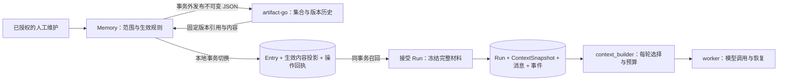

# Agentic Kit 通用 Agent Memory 技术设计

状态：部分实施，2026-11-17 按当前工作树更新。本地 OwnerPrivate 人工 CRUD（删除语义为 Retire）、显式 Restore、生效投影和操作回执已有实现；`RecallTx` 已接入 Run 接受事务并冻结完整材料。本次新增可选 artifact 归档与固定绑定，依赖 artifact-go `v0.5.0`、server-go `v0.13.0`。配置归档时，API 后台已能继续未完成的 Create/Update/Restore。版本历史 API、自动提炼、语义检索及版本删除/回收未实现，真实 artifact 部署尚未联合验证。

本文同时保留目标契约：多主体共享授权、版本历史查询及故障验收要求不因领域类型或适配接口已存在而视为完成。当前 HTTP 人工维护只开放 OwnerPrivate，身份读取沿用现有入口，完整认证 middleware 尚未接入。本文替代 2026-10-13 草案中的自建版本表与首期自动提炼方案，沿用 [框架设计 §6.6](refactoring-design.md#66-上下文管线与-memory-基础版) 和 [ADR-0005](adr/0005-context-and-memory-foundation.md) 的范围。版本服务分工见 [ADR-0008](adr/0008-memory-artifact-versions.md)。

## 1. 设计结论

复用 artifact-go 保存记忆的不可变内容和版本历史；Memory 拥有记忆身份、权限、适用条件、当前生效选择与召回。Memory 在本地保存当前生效内容的检索投影，Run 接受时将选中内容完整冻结进已有 ContextSnapshot。worker 仅消费冻结材料，执行和恢复无需访问 artifact-go。

一条记忆对应一个 artifact 集合，一次内容修改对应一个 artifact 版本。artifact 发布成功表示内容已经存档；Memory 本地事务成功切换生效引用后，新 Run 才能召回它。两者是独立的业务事实。



该分工复用版本编号、不可变内容、发布幂等和保护能力，保留 Memory 的领域规则。在线召回不增加远端逐条取版本的调用，也不把网络请求放进接受 Run 的数据库事务。

当前提供人工创建、纠正、停用及恢复、显式召回和冻结，以及配置归档时的后台 Pending 恢复；Fact、Preference、Procedure 通过人工维护入口写入。生效版本历史查看仍待实现。自动提炼、模型写记忆、候选晋升、技能按需加载和摘要式上下文压缩属于后续设计。未配置 Artifact Endpoint 时使用本地模式，维护和召回可用，但没有远端版本引用，也不会自动补归档。

## 2. 已核对的基础与接入前提

### 2.1 当前 API 基础

[会话提交](../pkg/durable/session_service.go)、[应用执行提交](../pkg/durable/execution_service.go)已经包含幂等、历史材料、Run/消息/事件一致提交；[共享执行存储](../pkg/durable)提供租约、步骤和恢复基础。Memory 维护与发布编排位于 `internal/app/memory`，纯值位于 `pkg/memory`，远端适配位于 `internal/client/artifact.go`。`pkg/durable/prepare.go` 调用注入的 `RecallTx` 并冻结材料；durable 不承担 Memory CRUD，也不引用 artifact SDK。

### 2.2 artifact-go 当前能力

当前适配依赖 artifact-go `v0.5.0` 的 SDK 契约，已接入集合创建与版本发布。下表说明消费方式；本地适配和测试不代表真实 artifact 部署已完成联合验收。

| 能力 | 当前契约 | Memory 使用方式 |
| --- | --- | --- |
| 集合 | 固定 tenant、可选 project、type、编号规则；同 scope/type 的规范化名称唯一 | 每个 Entry 一个 `agent-memory` 集合，整数版本 |
| JSON 版本 | `payload` 不可变；`annotations` 可修改 | 正文、来源、条件、有效期和输出限制全部进入 payload |
| 发布幂等 | `CreateVersion` 的 requestKey 按集合及可信 UserID 隔离；同键同参重放 | 从持久 Memory 操作 ID 派生稳定键，固定调用身份 |
| 集合创建 | `CreateArtifact` 支持 requestKey，同一存储归属下同键同参确认原集合 | 使用 entryID 稳定派生创建键；不同键同名冲突不接管，见 §2.4 |
| alias 与 latest | 普通 alias 按 revision 改绑；latest 为最高 ready Sequence | 首版不用它们表达 Memory 生效状态 |
| 草稿 | 完整内容保存、修订检查、发布指定修订 | 首版直接发布 JSON；有独立编辑工作流后再接草稿 |
| 保护与保留 | Protected 阻止正常删除及淘汰；集合 retention 默认禁用 | 发布时 `protected=true`，首版保持 retention 关闭 |
| 固定引用 | VersionID、VersionURI、Sequence；Resolve 返回固定目标 | 保存固定引用；引用只用于定位和追溯，不当访问凭证 |
| 删除 | 删除清空 payload；发布回执可重放为 410 墓碑 | 停用不调用版本删除；历史源缺失与 Run 快照分别处理 |

接口形状见 artifact [版本 DTO](../../artifact-go/sdk/go/artifactv1/artifact_api_version.go)、[集合 DTO](../../artifact-go/sdk/go/artifactv1/artifact_api_artifact.go)及 [SDK](../../artifact-go/sdk/go/artifactv1)。Resolve 不创建版本保留义务；Protected 是布尔保护，不是按消费者计数的 pin。storage 的文件 Bind/Release 不能用于 JSON 版本保留。

### 2.3 数据隔离与接入约束

artifact `v0.5.0` 提供 `(tenant_id, project_id, user_id)` 三元数据隔离与集合幂等创建契约，project 为空表示该租户内该用户的非项目数据。适配层通过 `WithRequestIdentity` 传递 tenant、精确 project 和 ResourceUserID，并随 Entry/Operation 固定绑定；各入口在真实部署中的隔离行为仍需联合验收。

Memory核验业务访问权后，由适配层提供可信的存储归属上下文。存储user_id与真实维护者可以不同：它随ArtifactBinding固定，真实维护者保存在Memory操作回执和payload中。接入只要求能够传递已核验的三元组；账号、凭据治理及部署身份形式不在本设计范围。

MemoryScope包含owner、actor等业务约束，不能直接等同artifact三元组。创建前按以下规则生成绑定并随操作意图持久化：

| MemoryScope | artifact存储归属 | 约束 |
| --- | --- | --- |
| OwnerPrivate | 服务端为该owner确定的tenant/user，project为空 | 无业务tenant时使用明确的存储归属映射；映射缺失则拒绝创建，不能以空user或任意公共tenant兜底 |
| ActorPrivate | 已核验tenant、project为空、user=actor | 不同actor不能共用一个存储user |
| ActorProject | 已核验tenant/project、user=actor | 同actor不同项目仍隔离 |
| ProjectShared | 已核验tenant/project、user=创建时核验的归属用户（首版取创建者actor） | 后续成员通过Memory当前项目权限访问，远端仍使用原固定归属 |

ProjectShared的存储user不授予其独占的Memory业务权限；创建者离开项目也不改变绑定，其他有权限成员继续通过Memory维护。接入方须能在核验当前维护者权限后承载绑定的归属上下文；不能承载时明确报接入错误，不切换为当前编辑人的user、不新建另一个集合。普通客户端不能直接指定任意ArtifactBinding。owner、agent和输出受众的额外限制仍由Memory检查，artifact不推断这些业务规则。

**SDK与框架依赖。** 当前 go.mod 使用 artifact-go `v0.5.0` 和 server-go `v0.13.0`，不使用本地 replace。仅 `internal/client` 引用 artifact SDK，领域值、durable、builder、worker 和本项目公开 SDK 不暴露其类型。验证使用 `GOWORK=off`；本地构建与协议测试不能代替真实部署联调。

### 2.4 artifact-go 接入契约与部署验收

三元数据隔离和集合幂等创建已由所依赖的 `v0.5.0` 提供，Memory 适配已消费这些契约。下表保留服务端职责与部署验收条件，不表示真实 artifact 部署已经验证：

| 项目 | artifact-go负责的交付 | Memory消费约束 |
| --- | --- | --- |
| 三元数据隔离 | tenant、精确project、user共同限定集合、子资源、Resolve、游标与名称唯一性 | 固定ArtifactBinding，业务共享与访问政策由Memory授权 |
| 集合幂等创建 | 可选requestKey，集合行保存成功创建事实；首次201、重放200，SDK返回类型不变 | Memory必填由entryID稳定派生的64字符内键；同三元组同键同参返回同一集合，合法异参409，不同键同名不接管 |
| 正式发布与兼容验证 | 部署服务与 SDK 契约一致 | 已固定发布依赖；真实部署仍需联合验证 |

集合创建键唯一范围为 `(tenant_id, 精确project scope, user_id, requestKey)`；用集合不可变创建字段比较规范参数，无需另建回执表。名称唯一范围也包含user_id，因此不同用户可使用相同名称与请求键。归档后原键返回原集合当前状态，不重新激活。只有非空键具有成功重放与未知结果确认保证；无键保持非幂等调用，不按NULL键查结果。

Memory的集合创建键按 entryID 稳定派生，版本发布键按操作ID派生，两者不随重试变化。同一Entry的首次Create、后续Update/Restore共享集合键；Entry已有绑定时直接复用，不再创建集合。已归档集合可以原发布键确认此前成功存档；若此前未发布，遵守归档集合禁止新发布规则，不能换集合继续。无需分页查同名集合或补精确name查询恢复路径。

Memory的生效、停用/恢复、主题唯一性、历史筛选与Run快照继续由本项目负责；artifact不增加Memory状态机、active alias、引用计数或自动对账任务。

## 3. 职责与权威来源

| 数据或规则 | 所有者 |
| --- | --- |
| 不可变内容、版本编号、版本历史及存档结果 | artifact-go |
| Entry 身份、精确 MemoryScope、主题唯一性、权限、生效/停用 | Memory |
| 生效版本的完整检索投影及索引 | Memory，本地事务维护，只对应当前生效引用 |
| 某次维护的意图、请求键、远端发布结果、本地应用结果 | Memory 操作回执 |
| 某个 Run 当时实际选定的内容与政策 | 执行 ContextSnapshot |
| 模型输入组合、完整消息组选择和 token 预算 | context_builder |
| 模型/工具执行进度与接管 | worker 与 durable |

Memory 不再建立保存所有正文的 `memory_version` 表，也不实现另一套版本编号、草稿或 alias。当前投影是一次已完成生效事务的本地结果，具有完整正文和来源；它不支持独立编辑，也不是带TTL或随远端可用性失效的缓存。重建投影必须读取其固定版本并校验内容，不能取 latest。投影缺失或与引用不一致时明确报错，不在 Run 事务中远端补读。

一个 artifact 版本可以已存档却从未生效，例如并发纠正输掉本地 revision 检查。以下版本历史查询为待实现契约：只展示成功生效过的版本，以本地Applied且操作类型为Create/Update/Restore的回执作为索引，按appliedRevision降序游标分页，返回固定版本引用、操作者和生效时间；Retire回执不生成版本历史项。配置远端存档时，每次恢复也发布一个新版本，因此一个成功内容操作对应一个历史版本，无需远端全版本扫描或去重。

历史列表只读本地元数据，版本详情按回执中的固定引用向artifact读取正文。详情入口必须同时核验Entry权限、该versionID存在成功生效回执且属于绑定集合；只知道同集合中的未采用versionID也不能通过此入口读取。Pending/Rejected及其未采用存档不混入Memory用户版本历史。该筛选只约束Memory API；artifact按三元归属展示完整存档历史，不理解Memory是否采用某版本。源正文缺失时保留历史项并明确报告不可用；artifact暂时离线不阻塞历史列表。当前选用的版本引用与条目停用状态分别返回，不将停用条目标成正在生效。

首版不维护 artifact `active` alias，Memory 的 activeVersionRef 是唯一生效选择。否则一次更新必须协调两个可变指针，并且 alias 成功不能证明权限、投影和审计一起提交。

## 4. 记忆身份与内容

### 4.1 领域范围

| MemoryScope | 精确身份键 | 用途 |
| --- | --- | --- |
| OwnerPrivate | owner | 无独立业务 Scope 的普通调用 |
| ActorPrivate | owner + tenant + actor | 应用中的个人偏好和方法 |
| ActorProject | owner + tenant + project + actor | 项目中的个人经验 |
| ProjectShared | owner + tenant + project | 有权限成员维护的项目共享经验 |

Owner、tenant、project、actor 均来自服务端核验的身份。相同服务 owner 下不同 actor 不共享私人记忆；agentID 是可选适用限制，不能替代身份键。范围列规范化并加 CHECK，空 actor 不能表达所有用户。`subjectKey` 非空时建立 `UNIQUE(完整MemoryScope, agentID, kind, subjectKey)` 部分唯一索引；空subjectKey不参与该唯一性限制。可选身份列和agentID统一规范为空串并校验，避免NULL绕过约束。同范围同类型允许多个不同主题，同一主题不能创建两个Entry。Entry停用后仍保留主题身份，通过§6.3的显式恢复继续维护原Entry，不必更名或新建。

首版不提供跨范围复制或分享，也不得原地扩宽旧条目的范围。后续若增加分享，需要同时核验源材料/证据允许的传播范围、目标写入权和显式分享授权；同时拥有两个项目的访问权不能自行扩大源内容的适用范围。`OutputVisibility=Private/Project` 与本次结果的 `OutputAudience` 同时核验：能读个人偏好，不等于可将它写入项目成员共同可见的回复。ProjectShared 固定 Project；其他默认 Private，授权主体明确允许后才能用于项目输出。

### 4.2 MemoryDocument

一份版本 payload 包含完整类型化内容：

```json
{
  "schemaVersion": 1,
  "entryID": "mem_example",
  "scope": {"kind": "ActorProject", "owner": "app", "tenant": "t_example", "project": "p_example", "actor": "u_example"},
  "agentID": "agent_example",
  "kind": "Procedure",
  "subjectKey": "project.test.entrypoint",
  "summary": "修改接口后执行项目集成测试",
  "body": {"goal": "确认接口与持久化行为", "steps": ["运行项目规定的集成检查"], "checks": ["确认检查成功且没有跳过数据库测试"]},
  "conditions": {"taskTags": ["api-change"], "toolNames": []},
  "outputVisibility": "Private",
  "source": {"class": "HumanConfirmed", "actor": "u_example", "evidence": []},
  "validUntil": null
}
```

示例 ID 仅解释数据形状。Memory 在发布前规范化、验证并固定文档；EntryID、scope、agentID、kind、subjectKey 与本地身份记录必须一致。Fact/Preference 保存明确事实或偏好，Procedure 保存目标、条件、步骤、检查及限制；三者均接受完整新内容，纠正生成新版本。

正文、条件、证据、可见性和有效期影响执行，全部放入不可变 payload。annotations 仅用于可修改展示信息，首版可留空；召回和冻结不得从 annotations 读取执行语义。服务端设置来源和操作者，首版只有明确维护接口能产生 HumanConfirmed，普通聊天中模型识别的“同意”不授予该身份。

EvidenceRef 引用已授权 Run/message/step/event 及必要摘要，保存时核实存在性与范围；后续源事实被删除时显示不可用，不能继续声称可验证。完整轨迹继续归执行存储。记忆正文属于参考材料，不因来源是人类而取得系统指令或新工具权限。

首版只用 JSON payload，正文上限同时满足 Memory 自身限制和部署的 artifact MaxPayloadBytes；超限明确拒绝。当前 artifact 默认 payload 上限为 256 KiB，这不是模型 token 预算。首版不自动转 S3 文件，也不把完整聊天或 checkpoint 作为 Memory 版本。

## 5. 本地持久化

首版增加两类记录；Run 快照复用框架现有目标模型。

当前表为 `memory_entry`、`memory_operation`，仅支持空库或空 schema 初始化，无历史迁移或回填。主题部分唯一索引 `memory_entry_subject_identity` 覆盖完整 scope、agent、kind 和非空 subjectKey；回执复合唯一索引 `memory_operation_owner_request` 覆盖 `(owner_id, request_key)`。更丰富的 Principal/CallerID 命名空间及历史索引属于目标契约，不能视为当前 schema 已具备。

| 记录 | 字段与约束 |
| --- | --- |
| MemoryEntry | ID、精确范围、agentID/kind/subjectKey、ArtifactBinding、activeVersionRef、revision、retiredAt、生效完整 payload 与词项/标签投影；引用和内容同时更新 |
| MemoryOperation | ID、授权请求命名空间、requestKey、intentDigest、操作类型Create/Update/Restore/Retire、entryID、expectedRevision、操作者、规范文档及固定远端发布参数、artifact 身份/存储范围、结果引用、Pending/Applied/Rejected、appliedRevision、appliedAt、错误原因与审计时间；UNIQUE(请求命名空间, requestKey) |
| ContextSnapshot 中的 Memory 材料 | Off 或 Recall 的选择、Empty 或选中条目、EntryID/entry revision、固定版本引用、完整内容/来源、召回与构建政策、预算及 digest |

MemoryOperation的请求命名空间使用服务端规范化的非空值，并以数据库唯一约束保证同键只有一条回执。并发首次请求采用条件插入；输家必须加载赢家回执、比较intentDigest后继续或返回Conflict，不能用自己预生成的operationID/EntryID调用artifact。所有远端副作用只能发生在持久回执创建成功或已读取既有回执之后。同一操作的Applied/Rejected为终态；远端调用返回后锁回执重新检查，若另一请求已完成则返回原结果，不能覆盖终态。

成功内容操作的 `(entryID, appliedRevision)` 唯一，历史索引按entryID及appliedRevision建立；相关成功回执随Entry历史保留，不能按临时幂等缓存清理。Retire回执仍保留操作结果，但不进入内容版本列表。

ArtifactBinding 包含服务端确定的 store 标识、tenant_id、可空project_id、非空user_id和artifactID；三元归属创建时固定，后续读取/发布/重试均使用原绑定；版本引用再加 versionID、整数编号、固定 URI。地址与凭据不从用户提交的 URI 读取。公开 MemoryVersionRef 使用本项目纯值，不返回访问凭据或借用第三方类型。跨数据库引用无法加本地外键，由写入流程核验并用故障测试覆盖。

Entry revision 表示领域状态变更，artifact Sequence 表示内容存档顺序，两者不能互换。投影携带版本引用和文档摘要，摘要沿用上下文的确定性编码规则；编码格式带版本，不直接依赖 JSON map 序列化顺序。

MemoryOperation 既是跨服务恢复记录，也是幂等成功回执和生效审计，不另建一套 feedback/event/job 表。Pending 保留继续原操作所需的规范文档；终态只保留摘要、引用、结果和审计，释放临时正文。回执不包含全部历史内容，历史正文仍由 artifact 保存。凭据不进入操作表。

## 6. 人工创建与纠正

### 6.1 本地准备 → 远端发布 → 本地生效

1. **准备短事务。** 核验当前用户写权限，按规范化请求命名空间和 requestKey 查回执。同键异意图返回 Conflict；Applied 返回原结果，Rejected 返回原拒绝。同键 Pending 继续原操作。新操作核对 expectedRevision、条目状态和文档，按§5的唯一约束保存稳定 operationID、EntryID、完整意图及远端参数；并发输家加载赢家回执，不能另起操作。Update要求条目启用；显式Restore要求条目停用。事务提交后才允许远端调用。
2. **在事务外创建或确认集合。** 新Entry使用 `memory-<entryID>` 稳定名称、`agent-memory` type、integer scheme以及由entryID稳定派生的固定创建键，调用§2.4的幂等CreateArtifact。原键原参数重试返回同一artifactID，核验结果并持久保存绑定后再发布；不同键的同名冲突不接管。首次归档在本地准备事务中把解析出的绑定写回Entry，后续不同actor的纠正/恢复复用该固定绑定，不再创建第二个集合。Memory不扫描集合列表恢复创建。
3. **在事务外发布版本。** 使用稳定 operationID 作为不超过 64 字符的 requestKey；固定ArtifactBinding中的user_id、tenant/project、规范 payload、`protected=true`、空 files/aliases/annotations。重试原参数，不能使用新键掩盖超时。artifact 返回 ready 的固定身份与 payload 后，核对集合、Entry、scope、schema 和摘要，并将结果交给生效事务。
4. **生效短事务。** 重新核验写权限，锁操作回执和 Entry，先检查回执终态并重放既有结果；仍为Pending时检查原expectedRevision、范围，以及Update必须启用、Restore必须停用的状态条件。第一次创建在这里插入 Entry 并受主题唯一约束保护；纠正则原子切换 activeVersionRef、完整投影和索引、递增 revision；Restore同时清空retiredAt。操作设为Applied并保存原appliedRevision、appliedAt、操作者及固定版本引用。只有这一步完成才对调用方报告记忆已生效。

不跨 HTTP 保持数据库锁，也不尝试跨库事务。当前 Archive 先以数据库时钟领取 2 分钟持久 claim，再执行事务外 HTTP；集合创建与发布共用 1 分钟总预算。已返回的集合身份、版本引用或墓碑各用独立的 5 秒预算写回，脱离请求取消和远端截止时间；后续远端调用与本地生效仍遵守请求取消。绑定与版本引用写回必须匹配 claim token、Pending 状态且 claim 未过期，旧执行者不能覆盖新的领取者。Archive 完成或出错均按 token 释放 claim；进程崩溃时由过期机制释放执行权，调用方随后用原请求键继续。集合创建键由 entryID 稳定派生，版本发布键由原操作 ID 派生；同一Entry的重试与不同actor操作因此固定同一集合和调用身份，远端重复调用仍保持幂等。固定绑定的 StoreID 与当前适配器不匹配时返回 503 MemoryUnavailable，恢复原存储映射后以原请求键重试。本地生效另由短事务和 revision 条件保证只应用一次。

配置归档时，API 启动后立即执行一轮后台 Pending 恢复，之后每 30 秒执行一轮；单轮最多处理 20 条，单轮预算 2 分钟，单条操作 90 秒。恢复复用原 claim、Archive 与本地 activate，只继续 Create/Update/Restore；Retire 是本地短事务，没有远端 Pending。失败项按 claim 与 CAS 语义留在 Pending 或转 Rejected，后台不对 Rejected 自动重试；远端不可用时保持 Pending，损坏回执和无绑定回执会刷新排队时间，避免长期占住批次头部。多实例依靠同样的 claim 与本地 CAS 去重；当前不提供运维 Pending 列表接口。停机时未完成项保持 Pending，由下次启动或其他实例继续。

### 6.2 并发与不确定结果

两个基于 revision=4 的纠正可能都在 artifact 存档，但只有一个能把 Memory 更新到 revision=5。另一操作终结为 Rejected/RevisionConflict，其存档版本保持未采用，不能成为Memory生效版本或被下一次召回选中；artifact latest仍可能指向它，Memory不据此选用。新建主题冲突采用相同规则。实现必须持久保存Rejected与已存档版本引用；可用条件插入（ON CONFLICT DO NOTHING）或条件更新检查影响行数，在同一可提交事务内记录拒绝，不能依赖触发唯一异常后已被中止的事务继续写回执。自动删除这类受保护版本不属于首版。

artifact 已发布而本地提交前进程退出时，后台恢复或原键重试在持久 claim 过期后继续；已保存版本引用时复用该引用，否则以原远端键确认同一版本，再尝试原 CAS。条目修订变化或状态不再满足本次Update/Restore意图则记录冲突。发布超时/结果不明时保留 Pending，不能当成确定失败或创建新版本。完整权限撤销检查仍依赖后续访问模型接入。

本地生效提交结果不明时，按原键读取主库回执；仍不能确定则返回 503 `MemoryOperationOutcomeUnknown`，下次继续原键。同键 Applied 回放不回拨生效指针，不覆盖后来纠正，也不重新访问 artifact；返回原 appliedRevision/版本引用，当前 Entry 如另行返回必须明确标为当前状态。每次回放仍核验当前访问权限。

Rejected仅用于原意图无法继续的参数错误、领域冲突或业务授权终止。存储上下文映射、配置或暂时依赖故障保留Pending，修复后继续原键，即使能确认此次尚未发布也不永久拒绝该意图。远端 410 表示原发布已发生但正文被删除，不能换键重建并自动生效，应记录 `MemoryVersionUnavailable` 并保留原版本身份。

### 6.3 停用与恢复

Retire 是本地短事务：使用 requestKey、expectedRevision，更新 retiredAt/revision 并记成功回执。保留生效引用和投影用于审计，召回严格排除停用条目。并发中的旧纠正无法越过新的 revision；同键停用重放不再次递增。

恢复复用完整更新接口 `PUT /v1/memories/{id}`，请求显式携带 `restore=true`、当前expectedRevision、完整内容和新requestKey；服务端将它归一为Restore操作。缺省/false为普通Update，不能意外恢复停用记忆；对启用条目请求restore=true返回状态Conflict。同键成功回放优先于当前状态检查，避免第一次恢复后重试因状态已启用而失败。

Restore沿用§6.1发布与本地生效流程，即使内容相同也形成新的artifact版本和成功回执；重新检查内容、来源、输出范围及有效期，已过期内容需更新有效期后才能恢复。在最终CAS成功前Entry持续停用，成功时新引用、完整投影、retiredAt清空、revision递增及回执同事务提交。本次恢复失败不修改Entry；没有其他成功写入时仍保持停用，有并发成功写入时保留赢家状态，旧恢复请求不能覆盖它。恢复只影响后续显式Recall，不改写任何已接受Run，不新增Restore端点或后台工作流。

Retire只对启用条目执行；已停用时同键重放原结果，新的停用请求返回状态Conflict。所有停用/恢复操作共用§5的回执唯一约束。

Retire 不归档 artifact 集合、不删除版本、不改写已有 Run 快照。彻底擦除将涉及 artifact、Entry 投影、操作暂存、运行快照和证据，须另行设计。首版不把停用描述为物理删除。

## 7. 召回与冻结

### 7.1 明确使用意图

普通聊天和应用执行都默认 `MemorySelection=Off`，只有本次请求明确 `Recall` 才查询记忆。缺省与显式 Off 归一为同一意图；Off 携带召回参数报 Invalid。Recall 的显式范围条件/政策选项进入请求 Intent，解析后的记忆正文与策略版本进入 ContextSnapshot。相同请求键从 Off 改为 Recall 或修改显式条件返回 Conflict。

Agent 版本不因本设计增加自动开启学习的开关。服务端政策约束允许范围和上限，CRUD 成功不自动开启任何后续 Run。

### 7.2 使用本地生效投影的 RecallTx

沿用框架的同事务 prepare：durable 先处理原请求回放，再锁会话、读取规范事实；当前由 `pkg/durable/prepare.go` 调用注入的 Memory `RecallTx`，从同一个数据库事务读取 Entry 与完整生效投影。它不调用 artifact；迁移到目标 `app/execution/context.go` 属于后续目录重组。

查询先过滤精确 MemoryScope、Agent 限制、停用/过期、条件及 OutputVisibility/OutputAudience，再按受控词项和标签匹配，稳定排序后限制条目数及材料字节。已实现口径：召回请求可携带 `RecallFilter{Terms, Tags, MaxEntries, MaxBytes}`；查询文本与显式 Terms 一起按词项规则（ASCII 连续字母数字为一个词项、小写归一，汉字逐字成词项，见 `memory.MatchTerms`）要求全部命中条目的 subjectKey/summary/body；Tags 要求全部出现在 `Conditions.TaskTags`（大小写不敏感）。排序按 revision 降序、ID 升序稳定；默认上限 `DefaultRecallMaxEntries=8`、`DefaultRecallMaxBytes=32KiB`，显式负值关闭对应上限；字节超限跳过该条并继续选择后续更小条目。中文片段与代码标识符使用明确词项规则并有固定验收样例；不宣称语义检索能力，不先引入向量库。

一次查询读取引用与内容的一致行；其语句快照是本次选择时点。并发纠正/停用在该时点之后提交，已选结果仍可进入此次 Run；在其之后开始的召回读取新状态。首版不要求对整个记忆集合加锁，也不承诺多条 Entry 属于同一知识发布批次。

将选中条目的完整正文、条件、来源、固定版本引用及顺序映射为 ContextBlock；与策略和预算一起编码到 ContextSnapshot，并与 Session/Run/用户消息/事件原子提交。无匹配保存 Recall/Empty，Off 保存明确关闭；本地读取或投影校验失败使接受事务回滚，不能静默降为 Empty。投影正常时 artifact 暂时离线不影响 Recall，这来自已完成的本地生效契约。

已实现 scope 构造口径：普通聊天无业务 tenant/project 上下文，固定 OwnerPrivate。应用执行从接受时已核验的 workspace scope 派生（`pkg/durable/prepare.go` 的 `memoryScopeFromFacts`）：tenant+actor 且 project 为空为 ActorPrivate；tenant+project+actor 为 ActorProject；组件缺失时回退 OwnerPrivate，绝不扩宽为 ProjectShared。应用执行与聊天共用同一请求字段：`SubmitExecutionRequest` 携带 `memory`（Off/Recall）与 `memoryFilter`（同 §7.2 的 RecallFilter），Off 携带 filter 报 400 Invalid。

同键已成功提交直接读取原 Run；后续记忆更新、策略变化或 artifact 故障均不触发重新召回。未成功接受的请求可在重试时重新选择，以最终接受的快照为准。

### 7.3 每轮模型输入与恢复

worker 读取 Run 的完整冻结材料，不读取当前 Entry 或远端版本。context_builder 每次以相同冻结政策和预算结合当前模型轮次消息构建输入；Eino adapter 负责格式转换，保留现有 checkpoint 和工具步骤恢复。

先裁低相关/低优先级的整条记忆，再裁最旧完整历史组；`context-v1`/`context-v2`中系统指令、真实工具定义/协议开销、当前用户输入和本轮完整工具调用/结果链属于必需输入。`context-v3`在历史耗尽后允许把当前轮较旧的工具结果替换为投影标记，保留最近 `KeepRecentToolResults` 条完整结果（默认3条），工具关联仍完整。预算按实际模型和协议计数，字节限制不冒充 token 计数。裁剪与投影后仍超限时明确报 `ContextBudgetExceeded`；接受前可确定的超限不创建 Run，执行中超限保存已有事实并失败，不用同一输入自动重试。

裁剪与投影只影响此次模型输入，不修改冻结材料、checkpoint 或已存步骤，不做 LLM 摘要。恢复不重复追加 Memory，不把记忆伪装为用户刚发出的命令。源记忆纠正、停用或 artifact 历史不可读，均不改写已接受 Run；需要立即停止其影响时取消 Run，再提交新请求。

## 8. 保留、删除与可用性

所有Memory版本发布时Protected=true，集合retention关闭。Memory首版不提供历史删除、自动回收或解除保护操作。同一三元组内的artifact调用者仍可使用artifact通用管理能力；本设计不再承诺只有Memory服务能够访问这些集合。直接artifact操作不改变Memory生效指针、投影或停用状态。

引用 URI 不保证内容永久存在；Protected 也不防管理员绕过正常接口或数据库灾难。若源版本后来不可读，历史查询报告缺失；Entry 已生效投影和 Run 快照仍按各自生命周期存在。artifact 删除不是 Memory 撤销信号，不能用删版本替代 Retire；投影不可独立修改，恢复缺失投影须从原固定版本核验重建，无法读取则报不可用，不取 latest。

| 情形 | 新维护/历史查询 | 新 Run / 已接受 Run |
| --- | --- | --- |
| artifact 暂时不可用 | 新维护保留 Pending；本地历史列表可读，远端版本详情报依赖不可用 | 正常本地投影可召回；已有 Run 按快照执行 |
| Memory 本地数据库不可用 | 无法维护或确认结果 | 新 Run 无法接受；执行按既有数据库故障规则处理 |
| 生效投影缺失/损坏 | 受控固定版本修复，失败明确报告 | Recall 失败；已有完整 Run 快照不受影响 |
| 源版本被删除或丢失 | 保留引用并报告 MemoryVersionUnavailable | 正常投影与旧 Run 不自动改写；撤销使用 Retire/取消 |
| Redis 不可用 | Memory 写入和召回不依赖 Redis | 延续既有数据库回放与通知恢复 |

API 本库与 artifact 库分别备份。跨库恢复后先核对 Pending 操作、Entry 固定引用和投影，再恢复维护入口；回执只证明原存档结果，不能凭本地记录声称 artifact 灾后仍保有正文。首版保留版本的存储成本随修改次数增长，观测体积与操作积压；需要回收时再设计显式保留义务，不暗中开启 retention。

## 9. API、模块与装配

当前 HTTP/SDK 已提供 OwnerPrivate 人工创建、读取、更新、Retire 和显式 Restore，执行提交已支持 Off/Recall；版本历史两条 GET 入口尚未提供。维护入口使用现有 `auth.UserID` 作为 owner，完整认证与多主体授权仍待接入。当前请求和响应以 [HTTP 契约](api.md)为准，下表保留目标协议，尤其不能把历史入口视为已上线能力。

| 操作 | 必需输入与结果 |
| --- | --- |
| POST `/v1/memories` | request key、领域范围选择、完整内容；返回 Entry、固定版本和 appliedRevision |
| PUT `/v1/memories/{id}` | request key、expectedRevision、完整新内容及可选restore；restore=true显式恢复停用条目并发布新版本，返回本次生效结果 |
| GET `/v1/memories`、`/{id}` | 仅列举授权 Entry；当前内容来自生效投影 |
| GET `/v1/memories/{id}/versions`（待实现） | 经Entry授权，按本地Applied内容操作分页列出生效过的版本元数据；不查询artifact列表 |
| GET `/v1/memories/{id}/versions/{versionID}`（待实现） | 先核验该Entry的成功生效回执，再按固定绑定取正文；未采用版本404，不接受任意artifact URI |
| POST `/v1/memories/{id}/retire` | request key、expectedRevision；返回停用后的 revision |

维护请求键统一通过 `Idempotency-Key` 传入；服务端请求命名空间包含可信 Principal/CallerID、Owner、精确 MemoryScope，摘要包含归一后的操作类型（包括restore选择）、Entry、expectedRevision与规范内容；缺省restore与false等价，改变恢复意图为同键异参。Create的意图摘要只包含调用者明确提交并规范化的创建参数及可信身份，不包含服务器后来分配的EntryID、operationID、时间或远端版本；这些值由唯一回执固定后生成发布文档，避免同键重试因新ID而误判异参。Update/Restore/Retire包含已有目标EntryID。跨用户或应用不共享回执。MemoryOperation 的内部 ID 用作 artifact requestKey，避免把外部任意长度的键直接传给 artifact。

参数错误400；未认证401；范围内无能力403；不可见或不存在的Entry/版本404；修订或同键异意图409；操作结果未决、版本源不可用或依赖错误按稳定错误码映射503。已通过Memory授权但无法使用固定存储归属时，按接入故障处理，不通过换user或换集合恢复。正文和私密证据不进入普通日志或错误消息。

| 当前实现位置 | 责任 |
| --- | --- |
| `pkg/memory/types.go` | MemoryScope、MemorySelection、Entry/VersionRef/Document 等纯领域值 |
| `internal/app/memory/service.go` | OwnerPrivate 维护、持久操作准备、claim、远端发布编排、本地 CAS 生效、停用及恢复 |
| `internal/app/memory/recall.go` | RecallTx、范围和输出受众、稳定排序 |
| `internal/table/memory.go` | Entry 投影、Operation、索引及领域值转换；查询与 CAS 位于 Memory service |
| `internal/client/artifact.go` | SDK、可信三元存储上下文、固定绑定、错误与幂等集合创建协议转换 |
| `pkg/durable/prepare.go` | 同事务召回、材料映射和冻结；Off 跳过 Memory |
| `pkg/contextbuilder`、`pkg/durable/context.go` | 前者构建模型输入，后者保存不透明快照 |
| `service/build.go`、`service/api.go`、配置与 schema | Artifact 客户端资源注入/关闭、服务配置、两类本地记录初始化 |
| `sdk/go/agenticv1` | Memory 管理及执行时显式选择的请求/响应与客户端 |
| worker 的 Eino adapter | 消费冻结材料；不接入 artifact SDK 或 Memory CRUD |

Memory.Service 在消费处定义只含实际 artifact 行为的小接口，由 internal/client 实现，隔离外部错误、身份与所有权；不建立多后端注册器。组合 New 借用已构造的 archive，不关闭它；独立 Build 拥有创建的客户端，New/AddService 失败时关闭，装配成功后由 API 在任务停止成功后关闭一次，停止超时则保留资源。配置字段、默认值和上限见 [README](../README.md#配置与启动)。OwnerPrivate 的 tenant 必须显式配置，没有公共兜底；调用使用 Entry/Operation 固定的 ArtifactBinding，HTTP 热重载不迁移存储绑定。Endpoint 为空保持本地维护模式，不生成远端引用；Off 和本地投影 Recall 均可工作。

## 10. 实施顺序与验收

当前 OwnerPrivate 维护、artifact 适配、持久 claim 和 RecallTx 冻结链路已实现；配置包测试与 Helm 默认值、覆盖值渲染已通过。持久化、发布故障、资源生命周期及全仓验证结果以[验证记录](verification.md)为准。以下仍是完整目标的验收清单，包含尚未开放的共享范围和版本历史 API，不表示各项已通过。

1. **接入条件。** 先完成§2.4列出的artifact三元数据隔离、集合幂等创建及正式SDK兼容验证。分别改变tenant/project/user验证所有入口；验证Memory适配能使用固定绑定，ProjectShared编辑者变化不改变远端归属。
2. **人工维护闭环。** 两类本地记录、集合绑定、发布、纠正、停用/恢复及仅生效历史的API/SDK；验证中断与并发下的原键恢复。成功标准是 artifact 存档和本地生效可分别观察、未生效版本不被使用。
3. **执行闭环。** RecallTx、ContextSnapshot、context_builder 和 worker adapter；同一个 Agent 在新会话显式 Recall 获得维护后的记忆，Off 不读取记忆。

| 必须验证的行为 | 验收结果 |
| --- | --- |
| 私人隔离与共享映射 | Memory按完整MemoryScope授权；artifact三元不同不能串读；ProjectShared更换编辑者及创建者退出项目后仍使用原绑定，无法承载绑定时明确失败 |
| 输出受众 | 私人材料不能进入未授权的项目共享输出；ProjectShared 写入检查项目权限 |
| 首次同键并发 | 只有一个MemoryOperation；空subjectKey也不会重复创建Entry；远端使用赢家固定键 |
| 主题唯一性 | 同范围不同主题可并存，同主题并发只成功一个；空主题不受该索引限制 |
| 集合创建响应丢失 | artifact原键返回同一集合；同键异参冲突；不同键同名不接管；归档后确认原回执不取消归档 |
| 发布响应丢失及进程退出 | 同一授权请求命名空间内原操作使用原三元绑定和发布键恢复同一版本；其他成员的新维护操作仍使用原Entry绑定及各自操作键 |
| 远端成功、本地失败 | 原键可完成原 CAS；并发修订胜出后，旧操作永久不能覆盖 |
| 生效/投影一致性 | 引用、完整内容、词项、revision、成功回执原子提交；无半更新 |
| 本地成功回执重放 | 原 appliedRevision 和版本不变；后来纠正/停用不被回拨；artifact 离线仍可确认 |
| 停用后恢复 | 普通Update不能恢复；显式Restore发布新版本并原子启用；失败不改变条目或并发赢家状态；同键重放不重复发布或覆盖后来变更 |
| 受保护历史 | retention 不淘汰受保护版本；Retire 不删除历史；未采用版本不自动生效 |
| Run 原子冻结 | prepare 失败不留 Session/Run/快照/消息；引用与完整内容对应 |
| Off/Empty/错误 | 默认 Off 不召回；无匹配为 Empty；投影读取失败使接受回滚 |
| 恢复与依赖故障 | artifact 离线及源版本不可读时，已接受 Run 仍用原快照；不重复注入或执行已存工具结果 |
| 预算与材料选择 | 中文/代码标签固定用例、稳定顺序、完整工具链、动态工具输出超限及明确失败 |
| 历史归属与保留 | 仅Applied的Create/Update/Restore进入列表，Retire/Pending/Rejected排除；猜测未采用versionID返回404；远端离线仍可分页；源正文缺失保留元数据并报不可用 |

部署验收仍需用隔离数据库和真实 artifact 服务覆盖跨服务故障；API/worker 按变更范围执行 integration、race、vet、build、Swagger 与跨进程接管验证。正式依赖验证使用 GOWORK=off、无本地 replace。真实 artifact 部署、共享范围授权和版本历史验收尚未完成；自动提炼与版本回收仍未实现。后台 Pending 恢复已实现并通过编译与恢复循环单元测试；数据库恢复用例和真实 artifact 故障联调仍待完成。

## 11. 后续演进边界

自动提炼可以从完整、已授权的 Run/message/step 事实产生新 artifact 版本，默认只存档为候选；Memory 决定是否生效。模型 confidence、检索次数和 Run.Completed 都不能直接证明经验有效，不能把召回内容的转述算作新的独立证据。

未来提炼任务需独立租约、预算和幂等；候选晋升必须固定目标版本、当前生效 revision、评测输入与结果，防止过期报告覆盖人工纠正。评测模块由所属任务设计：Memory 只提供固定版本材料，评测分别隔离初始状态，禁止测试答案回流学习；不在本项目恢复旧的场景评测耦合。

长 Procedure 的目录与按需读取应基于 Run 已冻结的版本池；附件、草稿编辑、语义检索、版本回收和摘要压缩各自有真实需求后单独设计。本轮复用 artifact-go 不意味着这些能力自动进入首版。
