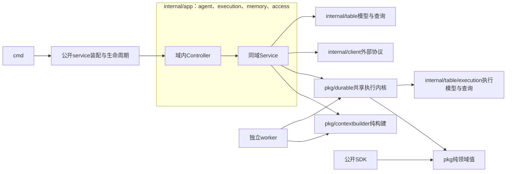

# Agentic Kit API 通用 Agent 框架重构设计

状态：待实施。2026-10-16 的 Memory 版本存储修订为提案，详见 [Memory设计](memory-design.md)与[ADR-0008](adr/0008-memory-artifact-versions.md)，不将此次新增方向标为此前已确认。范围和决策见第14节，第10节为按正文契约校准的目标文件地图；实施前须核对第13节的技术事实和依赖能力。当前行为仍以代码、[HTTP契约](api.md)、[恢复设计](design.md)和[布局约束](layout.md)为准。

设计基线：2026-10-14 的当前工作树，Go 1.27.1、server-go v0.9.0。本文依据当前方法实现、数据库模型、API/SDK 测试及相邻 worker 调用编写。实施时先核对工作树变化，不把本地框架 main 的接口当作发布版能力。

阅读入口：[代码问题](#2-当前代码内容的主要问题)、[功能与类型](#3-功能模型与所有权)、[访问与入口](#4-身份权限与入口统一)、[执行事务](#6-对话提交与持久执行核心)、[文件地图](#10-文件级实施地图)、[方法清单](#11-原方法重写与删除清单)、[实施与验收](#12-实施顺序与验收)。

[核心流程与接口HTML](core-flows.html)按本设计展示创建、对话与恢复；现有通用路径和待定新增HTTP入口分别标注。

## 1. 目标与范围

本次重构只负责通用Agent框架：Agent资产与不可变版本、会话与消息、应用任务跨轮执行、worker领取与恢复、人工介入、事件回放与Trace、Memory基础版、context_builder、通用HTTP/SDK、配置与生命周期。目标是让校验、权限、状态转换、事务和外部协议各有明确归属，目录移动服务于这些职责。

评测由另一任务设计为独立模块，不在本文范围。Writing/Coding和未来Personal属于独立场景应用；本设计只定义通用框架，不设计产品模板、交互、环境工作流、审批或项目启用。

通用服务保持一个Go module、自己的PostgreSQL、一套表结构来源，以及API/worker两个既有部署单元；Memory内容存档复用外部artifact-go，其数据库由该服务拥有。场景应用通过通用API/SDK访问，不共享本项目数据库、不注入私有Store、不在本项目app.Run中装配。框架仅提供授权的资产、执行、上下文、Memory和查询能力，不通过应用名称选择行为。

Memory首版实现人工读写/纠正/停用及恢复、版本、受控召回与Run内冻结；context_builder实现规范材料组合、完整消息组选择与预算。后台提炼、自主学习、自动晋升、LLM摘要调用后置。详细契约见 [Memory设计](memory-design.md)：artifact-go拥有不可变内容历史，Memory拥有生效指针与完整检索投影；远期能力不提前实现。

当前审查只修改设计文档，不改范围外实现、不修改或发布其他仓库。范围外模块的工作由所属任务推进；本轮不承诺交付其功能，也不因从设计排除而删除未移交的代码或数据。

本次采用全新目标结构，不考虑旧版本接口、数据库、请求摘要或checkpoint的兼容与迁移。目标不包含兼容别名、回退、历史回填、旧状态转换、升级或切换文件；数据库按新模型初始化，API、SDK与worker共同使用同一新版契约。本文不安排生产数据删除操作。

## 2. 当前代码内容的主要问题

| 当前实现与证据 | 实际混合的职责 | 重构决策 |
| --- | --- | --- |
| [platform/service.go](../internal/app/platform/service.go)：`environmentAccess`、`CreateAgent`、`UpdateAgent` | 路由识别、身份、模板政策和资产操作 | 通用访问与资产规则进入所属模块；产品模板政策由外部场景拥有 |
| [platform/controller.go](../internal/app/platform/controller.go)：`coding`、`writing`、`agentKind`、`publicAgent` | 配置有效性、产品分类、响应投影 | 通用配置校验归 Agent；Writing/Coding 识别及组合约束归场景；响应投影留 HTTP；不将其他合法配置默认为 Writing |
| [platform/auth.go](../internal/app/platform/auth.go)与 [workspace.go](../internal/app/platform/workspace.go) | 当前权限、owner 派生、路径形态、隐式 Context key | 以经过校验的访问对象传递身份和范围；移除 `pid` 驱动的隐式业务规则 |
| [durable/agent_service.go](../pkg/durable/agent_service.go)：`ValidateAgentConfig`、`runSpec`、编辑与发布事务 | 资产政策、执行快照编译、数据库事务 | 校验和快照构建成为纯函数；资产事务归控制面；执行核心只接受受控解析后的快照 |
| [session_service.go](../pkg/durable/session_service.go)与 [execution_service.go](../pkg/durable/execution_service.go) | 两条提交路径各维护幂等、活动任务、历史冻结、Run/消息/事件写入 | 统一事务内接受执行的算法，保留两种真实的会话寻址方式 |
| [run_service.go](../pkg/durable/run_service.go)：`Save`、`save`、`SupplyResult` | 调用方指定状态与事件组合；存储解析 worker 私有状态中的 `waitingStep` | 采用有类型的执行命令；等待交互成为明确的执行元数据 |
| [trace.go](../pkg/durable/trace.go)、[run/events.go](../internal/app/run/events.go)、[durable/events.go](../pkg/durable/events.go) | 读快照、脱敏投影、SSE 调度、Redis 协议、Outbox 发布 | 读取、投影、订阅和通知分开；状态与事件写入继续由执行事务负责 |
| [SDK 类型](../sdk/go/agenticv1/agentic_api_agent.go)、[durable/types.go](../pkg/durable/types.go)、[表模型](../internal/table/agent.go) | 领域值、HTTP 标签、持久化 JSON、客户端传输在同一 package 依赖链 | 领域值由无传输依赖的公开包拥有；SDK 与数据库分别使用它们 |
| [service/api.go](../service/api.go)与 [config/service.go](../internal/config/service.go) | 公共构造内部创建客户端；配置依赖 HTTP 模块；一个对象协调所有后台算法 | 装配显式注入；配置独立；后台任务分别由实际能力所有者管理 |

这些是规则归属与调用约定的问题。`Store` 方法多或文件长本身不是拆分依据。执行存储隐藏租约、锁、历史及事件的一致提交规则，值得保留为有深度的模块；仅逐方法转发的 Service 不需要新增。

## 3. 功能模型与所有权

| 模块 | 拥有的数据与规则 | 对外完整行为 |
| --- | --- | --- |
| Agent 资产 | 通用 Config、草稿 revision、不可变 Version、可信版本引用 | 保存草稿、发布不可变版本、读取版本；不识别 Writing/Coding 类型 |
| 外部场景应用 | Writing/Coding模板、允许编辑字段、工具组合、交互入口与业务政策 | 通过API/SDK使用通用资产和执行能力；不在本项目装配，Personal后续按同一边界组合 |
| 对话提交 | 用户会话、应用任务会话身份、输入意图、目标版本选择 | 创建会话、提交消息、提交应用轮次、查询历史 |
| 上下文构建（context_builder） | 模型输入组合、相关历史选取、消息配对、预算与渲染政策 | 使用已授权/冻结来源构建本轮模型输入；独立于记忆存储与Eino实现 |
| Memory | 事实、偏好与经验的范围、来源、生效指针和完整检索投影；不可变内容历史委托artifact-go | 首版人工读写/纠正、停用、版本查询与受控召回；跨服务写入按持久回执恢复 |
| 持久执行 | 冻结 Spec、Run、Lease、Step、等待交互、原子消息与事件 | 领取、续期、记录决策、记录工具、暂停、完成、重试、取消、人工恢复 |
| Workspace 访问 | 认证结果、企业范围、owner、actor、项目权限、可信应用能力 | 校验读写范围、校验环境访问、校验管理员及服务身份 |
| 执行查询与通知 | 公开 Run/Trace 投影、游标、订阅循环、Outbox 投递 | 查询、回放、订阅、发布通知；不决定执行状态 |

Agent资产及不可变版本支持Enterprise（企业共享）和Project（项目私有）作用域。AssetScope明确tenant、kind和项目作用域所需projectID；资产归属与执行环境分别表达。术语见 [领域术语](../CONTEXT.md)，取舍见 [ADR-0001](adr/0001-asset-scopes.md)。

一次Run可以组合共享Agent与所属项目私有的上下文/Memory等已授权材料；Agent源引用和Memory/历史来源分别按自身契约保留范围、身份和版本，Run、消息、Trace与事件按结果可见范围保护。项目私有材料不能扩大到企业共享结果，不能跨项目混用。无需复制共享Agent冒充私有候选，源资产归属与Run的ResultScope可以不同。

执行来源Origin使用Chat或Application等通用入口身份，应用调用方身份由服务认证确定，Ref用于关联调用方任务。读取、取消和Trace同时核验来源与结果范围，不能通过taskID前缀取得权限。业务是否为试运行或其他工作流由外部应用表达，核心不增加产品或业务工作流类型或对应状态机。

Application来源保存服务端认证的稳定CallerID，标识调用方应用且不随凭据轮换改变；不能用正文中的应用名代替。CallerID纳入应用会话身份、幂等命名空间和输入意图，同一owner下不同应用的相同taskID/request key分别寻址。查询、取消、人工恢复及外部租约检查同时核验调用方身份和结果授权范围，不能凭共享owner操作另一应用的Run。

Session创建时固定Origin、AgentRef（资产作用域与AgentID，不含版本）和ResultScope；共享Agent可直接在已授权的项目私有Session中使用。后续环境和上下文材料必须适用于这个固定结果范围：企业Session不能引入项目私有材料，项目P的Session不能引入其他项目内容。不自动变更Session归属或旧历史范围；改变结果范围须创建新Session。执行及幂等回放均核验原Session/Run范围与当前权限。

通用PublishVersion将草稿冻结为不可变版本并更新默认发布版本指针，不触发产品启用。候选是场景选择某个不可变版本时的称谓，不是核心的另一种状态或命令。模板目录、受信任来源和允许编辑字段由场景维护；核心只核验实际资产权限、配置与版本。

### 3.1 场景与通用能力的边界

Writing、Coding，以及未来 Claw 类 Personal Agent 都是场景 Agent。场景可以包含模板、工具组合、用户渠道、触发方式、业务状态、验证和启用流程，其复杂度不限制为一份提示词。Personal 仅用于说明边界，本轮不新增该场景实现。术语见 [领域术语](../CONTEXT.md)，取舍见 [ADR-0007](adr/0007-scenario-agents-and-generic-capabilities.md)。

依赖从场景指向通用能力。通用 Agent 资产及校验只理解模型、工具和配置约束；执行只理解授权后的快照、调用、步骤与恢复；Memory 管理内容、范围与版本；context_builder 管理模型输入及预算。它们均不导入场景实现，不维护 Writing/Coding/Personal 枚举，也不按场景名称选择规则。需要项目资源时按实际资源绑定检查，不能以“是 Coding”作为底层授权条件。

通用服务不装配场景实现或专用客户端，不加入Coding分支或插件注册表。worker按HTTP、filesystem等实际工具协议执行，不能把产品场景固化为运行类型。外部模块通过公开通用能力接入，其内部流程不在本文定义。

Agent资产、对话、Memory、context_builder与执行必须能在没有外部场景业务模块的情况下构建、启动和运行。artifact-go是内容版本基础服务：Memory维护和历史查询依赖它，已有完整投影的召回与Run恢复不依赖远端在线。新增场景不要求修改这些模块；通用授权、幂等、事务及恢复规则由框架承担，场景通过公开API使用。

Q13已确认独立场景应用；本项目只承担通用框架。本项目公开service只用于组合通用服务自身，不嵌入产品业务或共享外部模块数据库。本设计的文件地图、API/SDK、后台任务和验收只覆盖通用框架。

### 3.2 server-go布局与类型归属

依据go.mod选定的[server-go v0.9.0发布版《Go服务项目组织约定》](https://github.com/FlyTOmeLight/server-go/blob/v0.9.0/docs/go-project-layout.md)：Controller与业务Service按领域放internal/app，Service定义事务，internal/table拥有模型、查询与更新，internal/client转换外部协议，公开service只装配和管理生命周期。此处不采用本地v0.10.0接口，不因本轮文档修正升级依赖。

本项目私有业务收敛为agent、execution、memory、access四域。Session、聊天/应用提交、Run查询、Trace/SSE和上下文准备同属execution；浏览器与Bearer的Agent操作使用同一agent业务，不另建workspace业务层。一个业务变化在所属域内完成，不拆Controller壳与另一套Service，也不为Table再加仓库转发层。



- pkg/workspace拥有AssetScope、AgentRef、VersionRef和ResultScope。SourceRef是输入来源字段的领域称谓，使用同一VersionRef表示，不再复制一套引用DTO。
- pkg/agent拥有Config、ModelSpec、ToolSpec、ToolReplayPolicy和版本内容值；不放资产业务Service或数据库操作。
- pkg/execution拥有Spec、Run、SessionIdentity、Origin/CallerID、Lease、消息/事件、命令/事实/Prepared及opaque ContextSnapshot信封，不导入HTTP或Memory/builder实现。
- pkg/memory仅承载SDK与业务共用的MemorySelection、MemoryScope、版本及召回纯值，CRUD/授权/召回行为归app/memory。
- pkg/contextbuilder隐藏完整消息组选择、预算、裁剪与冻结payload格式的实际复杂性，无HTTP/数据库/Eino依赖。
- pkg/durable是API与独立worker真实共用的执行存储，隐藏租约、锁、步骤重放、恢复及原子消息/快照/事件提交；不是第二套资产业务层。

公开pkg仅保留已有跨仓库或公开契约的共享需要。执行Table单独成internal/table/execution包，因为durable/worker不应拉入Agent/Memory查询与资产业务；其他通用资产/记忆模型及查询集中在internal/table，不为每个单文件再建目录。跨领域关联只保留ID/引用，约束由schema维护，避免执行模型反向依赖资产业务。SDK复用纯值，HTTP字段与私有模型通过明确映射转换。

## 4. 身份、权限与入口统一

### 4.1 显式访问对象

HTTP Controller与对应业务Service入口遵循server-go使用*core.Context。Service从access取得核验后的Grant，业务默认值、权限与事务范围由该Service决定；数据库/SDK调用取ctx.Request.Context()。同事务prepare、Memory受控召回、纯函数、共享执行及后台任务使用标准context.Context，不持有HTTP Context，不新增一套转发Service。

`Grant` 仅由访问模块根据已认证身份创建，内部字段不可由请求绑定。它包含 principal 类型、actor、可信 owner、tenant、企业编辑权限以及项目读写/Admin 范围。项目范围明确表达为受限项目集合；空集合表示没有项目权限，不能用 nil 隐式表达无限访问。

应用Grant另绑定认证CallerID及被授予的操作能力；正文中的actor/业务Scope不扩大它们。普通聊天不能冒充Application，应用来源和任务关联由内部入口构造。

Grant 包含本次操作明确请求并已核验的 AssetScope。Enterprise 资产按当前企业成员及企业编辑权限授权；Project 资产按所属项目的当前读写能力授权，企业成员身份本身不授予项目私有资产访问。owner 由服务端根据 AssetScope 派生，保留两类隔离命名空间；客户端只请求作用域，不直接指定 owner。执行环境授权另外检查：项目私有资产仅可用于所属项目环境，即使调用者同时拥有其他项目权限也不放宽；企业共享资产可用于调用者有权限的项目环境。该取舍见 [ADR-0002](adr/0002-project-private-execution.md)。

执行提交分别核验Agent SourceRef与Memory/上下文来源的读权限、ResultScope的创建/写权限和环境执行权限；使用共享Agent不要求其草稿编辑权限。ResultScope依据授权材料和环境推导，客户端不能声明更宽范围。查询、取消、SSE和Trace按运行结果范围重新授权，读取共享Agent本身不授予其他调用方运行记录的访问。

Grant 只在当前请求内有效，零值不能授权；不写入数据库、执行快照或调用方文件。人工恢复和重放幂等请求均重新认证并取得当前企业/项目权限，不能从已接受请求恢复一个旧 Grant。同 key 改 actor 或项目是不同意图，返回 Conflict。

```go
// 通用服务的目标接口示意，省略无关字段；场景审批不在此处。
func (s *Access) Workspace(ctx *core.Context, tenant string) (Grant, error)
func (s *Agents) UpdateDraft(ctx *core.Context,
    cmd UpdateDraft) (Agent, error)
func (s *Execution) SubmitMessage(ctx *core.Context,
    cmd SubmitMessage) (Submission, error)
```

当前 read/write/Admin 的等级 20/30/40 集中转为具名能力，只在 Tenant adapter 解码等级，不在各方法里重复写数字。业务模块仍检查资源所属 owner/tenant/project；入口已认证不等于任意 ID 都可操作。

### 4.2 三种入口保留真实差异

| 入口 | 授权来源 | 允许的操作与输入 |
| --- | --- | --- |
| Workspace 浏览器入口 | Forge Session、Origin/CSRF、实时企业与项目权限 | 企业共享或项目私有资产管理；明确区分资产作用域与执行环境 |
| 管理/自动化 Bearer 入口 | 配置中的服务 owner 与写能力 | 受控Agent配置、固定版本及通用执行输入；操作限于自己的owner |
| 内部应用能力入口 | 受信任场景服务身份及受限能力，必要时再次核验当前项目权限 | 执行提交、受控资源绑定及授权的派生资产创建；通用配置创建不代替场景业务授权 |

SDK及外部调用方可以使用Bearer入口，但不能通过正文提供 owner 或项目权限集合。浏览器不能直接提交任意工具 URL、TokenEnv 或 filesystem binding。外部应用的 Scope 是受信任服务断言，须在内部入口授权后才能进入提交模块。

### 4.3 显式资产作用域与统一入口规则

新 Workspace 入口统一实现资产行为和授权规则，操作显式携带 AssetScope。资产集合与创建请求必须选择 Enterprise 或 Project；已有资产操作也指定预期作用域，服务端校验与持久记录一致。作用域缺失或非法返回参数错误，不默认提升为企业共享。

保留项目 owner 的真实隔离职责；撤掉由 `pid` 是否存在隐式决定整组业务政策的分支，以及企业 owner 找不到后尝试项目 owner 的回退。旧重复路由不作兼容入口，新协议将作用域转换为明确业务值后调用同一实现。执行环境字段命名为 `environmentProjectID`，与 AssetScope.ProjectID 分开。

通用服务按实际资源绑定决定是否需要项目环境：无项目资源执行允许不选择项目，需要项目资源时必须选择项目并通过权限检查。Writing/Coding场景再核验自己的工具组合，底层不以场景名称或URL是否带pid决定。

有环境的执行必须满足 `AssetScope=Project(P) → environmentProjectID=P`；Scope 不匹配返回 Forbidden，不进入Run接受事务。无项目资源的执行未选择环境时，仍保留资产的项目私有归属和访问要求，不因环境字段为空成为企业共享内容。跨项目复用采用企业共享资产，不在本次重构增加私有资产跨项目授权机制。

企业共享与项目私有资产从创建起就具有明确AssetScope、owner和可见范围，不在查询时跨作用域搜索。

通用管理 `/v1/agents|sessions|runs` 和内部 `/internal/v1/executions` 提供框架能力，Workspace资产操作携带AssetScope；目标接口只处理授权资产、执行、Memory和查询。Query/正文作用域由HTTP适配核验，不通过路径形态推断授权。

### 4.4 外部错误

Tenant adapter提供AuthenticateSession、WorkspaceAccess、ProjectAccess等有类型的方法，替代Check(path, body, out) int。它返回领域结果与可检查错误，保留context取消/超时身份，区分认证失败、拒绝、资源不存在和依赖不可用；HTTP只映射一次。保留已有连接超时、禁止重定向、响应大小限制和关闭行为。

通用框架不包含Coding adapter、其SDK依赖或专用endpoint/token；这些资源由使用者自己的应用拥有。通用工具协议按授权配置执行，不代理产品服务的业务流程。

## 5. Agent 资产与版本发布

通用ValidateAgentConfig拆为模型连接与预算、工具名称/schema、工具策略与协议种类、toolset、整体一致性等纯规则。所有通过通用校验且被授权的现有配置都可使用；不从工具名猜测Writing/Coding身份。

UpdateDraft在一个资产事务中锁草稿、比较revision并保存明确的新配置。PublishVersion锁Agent、核验revision、校验配置，原子插入不可变版本并更新默认发布指针；相同已发布revision返回原版本，版本号仅在锁内递增，通用发布不触发场景启用。通用接口按实际身份和操作能力控制配置及资源绑定，场景服务身份不获得任意owner或作用域权限。

模板目录、可信模板选择、PrepareTemplateCopy、ApplyEditablePatch以及允许编辑字段由独立场景应用维护。它读取授权的固定版本、构建新值并调用通用资产API，更新时携带读到的revision，底层CAS拒绝过期配置。场景浏览器接口只开放场景允许的输入，工具地址与凭据绑定由可信场景后端构造，不能将这些政策留在本项目的Controller或资产模块。

CompileExecutionSnapshot归通用执行提交，将明确Agent版本与被授权的执行绑定编译为快照。构建过程中复制slice、map和json.RawMessage，不共享可变配置。派生运行资产创建携带真实SourceRef，底层重新核验源读取与目标写能力并保留项目私有来源限制；不能由场景后端声明更宽范围绕过Q2。

CreateDerivedVersion是通用资产的完整创建命令，输入为固定SourceRef、目标AssetScope、规范Config与稳定request key。服务器自行计算包含源、目标和配置的意图摘要，在同一个资产事务中保存新资产、首个不可变版本、来源限制与幂等结果；相同请求回放原引用，改参数返回Conflict。私有来源只能派生到其所属项目，授权的共享来源可在目标项目形成私有运行资产。创建前分别核验源读取、目标写入和资源绑定能力；服务身份不能用任意ActorID补齐权限。场景无需以CreateAgent→Publish两次请求取得运行引用。

该命令由通用Agent Controller和SDK能力组提供，输入为固定SourceRef、目标范围、Config和Idempotency-Key，Created区分新建/重放，不增加场景发布Controller。无权来源、非法目标或资源绑定在接受前拒绝；资产、首版本、来源关系和请求结果同事务回滚，丢响应重试返回同一版本。

外部场景通过通用执行提交获取Run，并使用通用读取、取消与Trace；调用方的任务引用与结果范围必须匹配。场景的试运行政策不进入Agent类型或核心状态机。

## 6. 对话提交与持久执行核心

### 6.1 统一接受执行的算法

保留两种会话定位：用户显式 sessionID；应用按 `(resultOwner, CallerID, tenant, project, taskID)` 稳定复用会话。它们只在会话寻找/首次创建和目标版本选择上不同，共用以下算法：

1. 纯校验原始命令，计算输入意图摘要；当前授权必须先完成。
2. 开启PostgreSQL事务，按结果owner、来源kind、认证调用方命名空间及key取得请求锁，读取已接受请求；不同应用不共用请求键。
3. 同 key/同意图返回原 Run；不同意图返回 Conflict。回放不再次解析当前 Agent、模板或环境配置。
4. 新请求取得会话身份锁和Session行锁，核验固定Origin/CallerID、ResultScope、AgentRef与活动任务限制；材料/环境不兼容时拒绝，不修改旧会话。
5. 在同一个事务中解析目标版本：用户消息选择当前发布版本；应用执行使用明确不可变版本。
6. 编译执行配置，固定本轮允许读取的会话事实及来源版本，校验项目及 filesystem 约束；上下文材料由对应模块准备，具体接入见第 6.6 节。
7. 原子写入 Run、User 消息和 RunQueued 事件；提交后返回 `Submission{Run, Created}`。

首次应用会话只有身份锁、还没有可锁的 Session 行时，先建立待创建的 SessionIdentity；prepare成功后才插入Session，避免未解析目标就触发 Agent 外键错误。Session/User/Run/Event 同一事务回滚，prepare失败不会留下空会话。

意图摘要包含认证确认的来源kind/CallerID，以及调用方明确给出的session、目标、输入、Scope、执行预算、Memory选择/召回政策和上下文政策选项；显式选择变化返回Conflict。 MemorySelection和builder政策在app/execution的提交命令中归一为版本化ContextOptions规范JSON，作为execution.Intent的opaque字段参与摘要；执行核心不导入memory/builder类型，也不解析其选项。默认值保留“未指定”语义，不包含解析后的最新配置、记忆正文、历史、网关地址或当前时间。用户消息仅按session/query比较的旧契约须同步改写，不盲目Marshal HTTP对象的全部标签字段。

提交采用唯一的具名Intent结构和SHA-256/JSON摘要，固定字段名、默认值处理及数组顺序；actor/project、调用方显式预算均进入其语义。只支持本轮定义的请求协议，同一命名空间与key必须保证同意图回放原接受结果、不同意图返回Conflict，不增加旧摘要识别或转换分支。

会话/运行状态和消息是权威事实，不以 Completed/Failed/Canceled 的标签直接决定它们能否进入模型上下文。上下文选择政策归 context_builder，跨任务事实和经验归 Memory；消息配对仍是模型输入约束。应用同一任务不允许同时接受两个活动轮次，也不允许偷偷切换 Agent。

### 6.2 跨包事务的具体实现

`pkg/durable`只拥有执行存储与一致性事务，资产CRUD由自己的业务/持久化实现拥有。它提供普通事务入口及受控的 `BindTransaction`；后者仅供本项目业务Service的同事务协作，绑定调用方的同一个 GORM transaction，不开启、提交或关闭事务。

```go
// 明确的技术 interface：业务Service定义事务，Table和执行存储使用传入GORM句柄。
func New(db *gorm.DB) (*Store, error) // 借用连接；不依赖 server-go/db
func BindTransaction(tx *gorm.DB) *Tx

// Facts为会话锁内的规范执行事实，Prepared为Spec与opaque ContextSnapshot。
type PrepareSubmission func(context.Context, execution.SubmissionFacts) (execution.PreparedSubmission, error)

func (tx *Tx) Submit(ctx context.Context, cmd execution.SubmitCommand,
    prepare PrepareSubmission) (execution.Submission, error)
func (tx *Tx) Cancel(ctx context.Context, owner, runID string) (bool, error)
func (tx *Tx) Read(ctx context.Context, owner, runID string) (execution.Run, error)
```

Tx.Submit完成幂等回放、会话锁、活动任务检查和规范事实读取。新请求在会话锁内一次读取按seq排序的事实，形成SubmissionFacts：SessionIdentity、固定Origin/ResultScope、消息及来源/状态元数据、历史截止seq；再调用一次prepare。回放不读取新历史、不重复准备。

prepare由internal/app/execution/submission.go构造并捕获同一个tx：读取固定Agent/Version，调用该域context.go，将传入事实与app/memory的同事务受控召回结果映射为规范材料，编码并返回PreparedSubmission中的Spec与ContextSnapshot。上下文准备不重新查询Session历史，durable不导入Memory/builder。返回目标、Scope、输入及来源必须与命令匹配，核心通过durable/context.go保存不透明信封，并原子保存Session、Run、消息、快照和事件；准备失败全部回滚。

回调只使用绑定tx的查询及纯构建，不从根db查询、不访问外部网络、不嵌套事务或逃逸。执行事实不能预先按成功/失败删掉消息，材料选择归builder。冻结保留本次读取的明确版本，不承诺与记忆库提交瞬间的最新内容同步；并发纠正影响后续接受的Run。

跨作用域输入的Run/Session owner来自ResultScope，prepare中的Agent版本解析按明确SourceRef的源owner读取版本，二者允许不同。提交命令绑定目标AssetScope/AgentID/版本，prepare必须返回同一目标，不能在不同owner间自动寻找候选。Session只保留目标Agent的AgentRef；Run另保存实际解析的VersionRef，只读运行快照不反写共享资产。

通用Agent和执行由app/execution的提交Service定义一个数据库事务，Table查询与durable执行写入共用该tx；BindTransaction仅用于本项目的事务组合，不向外部应用暴露，不承诺跨模块数据库或多次API请求原子。这里明确把GORM纳入持久化技术接口，普通SDK、领域值与worker命令不暴露GORM。

### 6.3 锁与执行权

| 操作 | 锁规则 |
| --- | --- |
| 用户/应用提交 | 请求 advisory lock → 必要的应用会话身份 lock → Session 行锁；持有 Session 时不锁旧 Run，只读活动状态 |
| worker 状态/工具保存 | Run 行锁与有效 Lease 校验 → 必要的 Step → Session 行锁分配消息 seq → Run 事件 seq |
| Agent 发布 | Agent 行锁；版本插入与发布号更新一起提交 |
| Outbox | 只锁每个 Run 最早未发布 Event；不持有 Event 再去锁 Run 或 Session |

领取继续使用 `FOR UPDATE SKIP LOCKED`、数据库时钟、epoch 递增。续期、决策、工具保存、完成及重试都校验 runID/workerID/epoch、Running 状态和 lease 未过期。取消增加 epoch，旧 worker 不能继续提交。数据库隔离不等同于撤回已到达下游的外部请求。

外部 `CheckExecutionLease` 同样要求 deadline 未过期；当前查询只校验 lease_until，写入校验还检查 deadline，新实现统一为一个执行权谓词。API 对工具网关返回 allowed 的条件必须与 worker 能提交结果的条件一致。

### 6.4 用类型化命令限制状态转换

撤掉 `Save(ctx, lease, state, status, output, detail, kind)` 的任意状态/事件字符串组合。改为 `CommitBoundary(ctx, lease, execution.Boundary)`；Boundary 的 Kind 仅接受 ModelStarted、Complete、Fail、AwaitClarification、AwaitReview，核心根据 Kind 生成合法状态、消息与事件。ModelStarted 生成同名事件并保持 Running；暂停必须含待处理 step 和 detail，Complete 才接受最终 output。字段组合错误返回 Invalid，不写数据库。

保留有明确原子语义的 `RecordDecision`、`BeginStep`、`FinishStep`、`Retry`。`BeginStep` 接收 `StepIntent{ID, Input, Policy}`，返回具名结果 Execute、Replay 或 Uncertain，Replay 携带原结果。输入摘要或策略不一致返回 Conflict；Unsafe 的不确定结果必须进入人工审核，不能被重试自动重新执行。

澄清与人工确认使用明确的 InteractionKind。新模型添加 `waiting_step`、`waiting_kind` 等执行元数据，与暂停状态、checkpoint 和事件同事务保存；人工恢复校验这份元数据、Run deadline 和 Step 状态。worker 的 Eino checkpoint 继续作为私有 opaque JSON/bytes 保存，API 不再为了校验或投影解析其中的 `waitingStep`。

恢复相同已提交结果是幂等行为，不追加第二条消息；不同结果返回 Conflict。恢复后清除等待元数据、重新排队并保存工具结果/对应消息/RunResumed 事件，但不修改 opaque checkpoint。worker 仍按已保存的 Eino checkpoint Resume，并通过 BeginStep 取回人工答案；不能根据等待元数据已清空而从头运行。Eino 状态中的版本与 turn 限制继续由 worker 管理。

### 6.5 worker 调用面

worker 使用执行值与具体 durable 存储。需要测试替换时，在 worker 的消费方定义仅含 Claim、Renew、CommitBoundary、RecordDecision、BeginStep、FinishStep、Retry 的小 interface。worker调用面只包含执行命令、状态和冻结快照读取。

worker 的 checkpoint middleware 负责把 Eino 决策/暂停/结果转换为类型化命令。Eino runner、工具协议、模型构造与 checkpoint 内容继续由 worker 仓库维护。本次 API 设计要求同步修改这些实际调用，不另写平台 ReAct 循环。

### 6.6 上下文管线与 Memory 基础版

上下文选择应具备独立的规则归属，不能用成功/失败二选一替代。推荐以下分工：

- 会话与执行存储保存输入、回复、工具调用/结果、失败原因和状态变化等完整事实，按身份与 ResultScope 提供一致快照；它不决定哪些内容最值得给模型看。
- Memory 负责跨轮、跨任务可复用的事实、偏好和操作经验，包括版本、来源、有效性、权限范围与召回。失败和纠正也可能提供有价值经验，Run.Completed 不等于业务目标成功。
- context_builder 根据当前任务、已授权会话事实、冻结记忆和工具/模型配置，选择相关材料、处理消息配对、安排优先级与长度预算并渲染模型输入。状态可以作为选择依据之一，不作为统一硬过滤。
- worker 的 Eino adapter 将构建结果放入既有 GenModelInput；当前 Run 中的迭代状态和未完成工具调用仍由 Eino checkpoint 恢复，Memory 不替代执行 checkpoint，context_builder 不建立第二套消息循环。

首版采用独立数据契约组合：Memory从本地完整生效投影返回固定版本内容和来源，调用方将其映射为ContextBlock；context_builder只接收规范化材料、策略、预算和本轮消息，不直接调用Memory、数据库、SDK或模型网络接口。app/execution的context.go负责结果可见范围、传入事实映射及调用app/memory的同事务召回；worker的Eino adapter负责格式转换与注入。

```go
// 纯构建器采用自有的规范化输入/输出，不暴露Memory表模型或Eino类型。
func Build(in BuildInput) (BuildResult, error)
// BuildInput: FrozenMaterials、CurrentTurn、Policy、Budget。
// BuildResult: Messages、Usage、OmittedSources；消息含role和tool call关联。
```

执行核心在durable/context.go中保存带格式/策略版本及digest的ContextSnapshot信封，payload由上下文模块编码与解释；durable不导入Memory或builder实现。Run与快照同事务提交，回放读取原记录。Memory、context_builder、execution之间不双向导入；类型转换集中在准备编排和worker adapter，后续更换检索或构建策略不重写租约、步骤和状态协议。

显式开启Memory的Run在接受时召回并固定版本与完整内容，随后模型调用、重试、接管及澄清恢复使用原快照；人工纠正、更新或停用影响后续新Run，不修改已经接受的材料。关闭Memory的Run不查询或注入记忆，仍冻结其会话事实与上下文策略。动态本轮工具结果来自Eino状态，不在Resume时重复追加记忆。确需立即停止旧记忆影响时，明确取消当前Run，再用新请求重新接受任务；首版不提供运行中刷新。

启用Memory但没有匹配项时保存明确的空快照；召回失败使整次接受事务失败，不能静默把失败当空记忆。快照同时保存检索/构建策略版本和预算参数，恢复不套用最新策略；worker不支持所需版本时明确报告无法执行，不重召回或替换材料。首版范围与这条冻结规则见 [ADR-0005](adr/0005-context-and-memory-foundation.md)。

预算由context_builder统筹，token与字节明确区分，不把字节换算当准确token计数。模型窗口、输出预留、工具定义计入每轮计数输入，窗口/输出预留及序列化计数政策进入冻结Budget，计数策略按实际模型/协议核实，不在事务中请求模型元信息。首版不调用LLM摘要；后续提炼也不在提交事务内持锁调用模型。

worker每次请求模型前，将冻结材料与本轮Eino消息映射为规范输入，再使用同一Policy/Budget构建；检查范围包含动态工具输出，不能只在接受Run时检查一次。构建器不修改checkpoint或原消息切片，裁剪不破坏tool call/result配对。缺失结果的历史组不注入，当前工具链不作为已完成历史删除。

Q16确认首版只做材料选择与裁剪，不做摘要式压缩，也不截断当前工具结果正文。必需输入包括实际system instructions、工具定义/协议开销、当前用户输入及本轮完整的assistant/tool调用结果链，输出预留计入Budget。超过输入预算时先移除最低相关/优先级的Memory条目，再按从旧到新的顺序移除完整历史轮次；稳定次序和来源ID用于保证相同材料/Policy/Budget得到相同结果。Memory或历史按整项/完整组移除，不留下孤立tool消息。裁剪仅影响此次模型输入，数据库事实、冻结材料和checkpoint保持完整，BuildResult记录被省略来源。

必需输入仍超限时返回明确的ContextBudgetExceeded，不调用模型，也不以同样输入自动Retry。接受前对可确定材料预检，已确定必需材料超限则提交失败、不创建Run；worker以实际工具定义和当前完整模型输入再检查，执行中因模型输入或新的工具结果超限则保留已存步骤与checkpoint，按Fail边界结束该Run并公开稳定失败原因。调用方可以调整输入或预算后以新请求提交；首版不自动生成摘要、改写工具结果或重新开始执行。

输入材料还须遵守结果可见性：项目私有结果不能借上下文召回读取其他项目内容，私人Memory不能仅因actor有读取权限就注入项目成员共同可见的输出。[Memory设计](memory-design.md)规定版本存储与生效边界；维护、召回和外部协议不进入共享执行核心。

OutputAudience表示本次结果预期可见的人群/范围，由入口授权确定；MemoryVersion的OutputVisibility表示材料允许用于私人或项目结果，默认Private，ProjectShared为Project。两者必须同时满足，不能仅凭读取权限扩大材料的输出可见性。

基础Memory使用artifact-go保存不可变内容历史，本地PostgreSQL保存Entry、生效版本引用、完整内容检索投影及持久操作回执。人工维护先持久化操作意图，在事务外发布受保护的JSON版本，再以本地revision检查原子更新生效引用、投影和回执；未生效的存档版本不进入召回。RecallTx只查询本地投影，不在接受Run事务中调用artifact。停用阻止后续召回，不删除远端版本或旧Run快照；显式restore更新在revision检查后发布新版本并恢复原条目。主题唯一键包括subjectKey，操作回执以规范请求命名空间及requestKey唯一；首次并发输家复用赢家操作。版本历史以Applied内容操作为索引，仅展示生效过的版本。查询先按精确身份范围、有效性及材料OutputVisibility与结果OutputAudience的匹配过滤，再做受限词项/标签匹配与稳定排序，不新增向量库或宣称语义检索。没有Scope的调用采用OwnerPrivate；带已验证身份的调用按Memory设计的actor/project范围核验，服务owner不能代替真实actor。模型没有自动写入、扩域或生效权限。

本轮不实现memory_job、自动轨迹提炼、自动候选晋升、记忆工具或LLM摘要调用；后续单独设计。builder首版实现明确排序、完整消息组选择与预算裁剪，不建立空Provider占位。预算单位与实际token核算按目标模型能力确认，不采用未经验证的字节→token换算。未来提取以这些契约与适配边界为依据，当前不增加新Memory仓库、go.mod或插件注册框架。

Q15确认首版Memory默认关闭，普通聊天与内部应用执行使用相同规则。两类提交请求提供MemorySelection，模式为Off或Recall；缺省与显式Off归一为Off，只有本次请求明确Recall才召回，每个新Run独立选择。Memory CRUD及版本读取与执行是否召回分别授权，写入或纠正记忆本身不启用后续Run。

Recall的受控召回条件和政策选择进入Intent，服务器核验实际范围与可用政策；Off不能同时携带召回参数，避免无效选择被静默忽略。同key从Off改为Recall或更换显式条件返回Conflict，缺省与显式Off可以重放同一请求。解析后的策略版本、材料正文/版本及Budget随Run冻结，解析出的最新记忆正文不进入原请求摘要。同键重放不重解析、不重新召回。

关闭在builder快照payload中保存Off，显式召回但无匹配保存Empty，读取失败则接受事务回滚；三者不可混同。模式由调用方请求，权限与实际政策由服务端约束，模型不自行开启Memory；服务器政策更新影响新接受的Recall请求，已接受Run保持原快照。选择值归pkg/memory/types.go，SDK提交请求复用该纯值；当前状态仍为待实施，首版取舍见 [ADR-0005](adr/0005-context-and-memory-foundation.md)。artifact接入必须补齐tenant_id、project_id、user_id三元数据隔离；Memory核验业务权限并使用固定ArtifactBinding，共享条目不随编辑者切换远端user。账号和凭据治理不属于此次设计；正式SDK的依赖兼容性在实施前验证。完整写入恢复、停用后恢复、历史筛选及约束由[Memory设计](memory-design.md)维护；其中§2.4单列artifact待补的三元数据隔离、集合幂等创建及发布验证，不把这些前提当作已实现能力。

## 7. 查询、Trace、SSE 与 Outbox

执行核心拥有原子事件写入和 EventSeq；通知模块拥有 Redis 投递；查询模块拥有公开投影。

`ReadRun` 与 `ReadTrace` 返回一致数据库快照。Trace 将 SQL 读取与纯投影分开：从已持久消息关联 tool call，补充事件名称/参数；仅公开允许字段，保留 UTF-8 32 KiB 截断与标记，checkpoint、秘密及完整 prompt 不进入公开响应。需要完整执行输出的调用方使用Run输出，不从截断Trace恢复输入或结果。

SSE Controller 负责 binder、Header 来源、游标优先级、开始输出前的错误和 server-go stream 写入。订阅循环进入 `RunSubscription`，只依赖事件读取和通知等待的小 interface，负责翻页、数据库回放、终态确认及取消。每次成功发送后才推进游标，空闲心跳，200 条满页立即继续；Redis 离线用有界轮询继续读数据库。

通知relay定义投递事务；execution Table的outbox_query.go选择每个Run最早未发布事件并锁住它，internal/client/notification.go负责Redis的稳定seq-0 ID、Lua幂等和TTL。持锁投递与标记发布保持当前顺序语义，单次投递沿用 3 秒上限。这是有意保留的短事务外部调用例外，不能改成先解锁、再任意并发投递而破坏每个 Run 的顺序。

Relay 负责取消、重试间隔与日志；它属于 API 后台能力，不在 worker 共享执行包中引入 Redis 客户端。数据库事件始终是权威来源，通知初始化不要求 Redis 在线。

## 8. SDK、装配与配置

### 8.1 HTTP 与 SDK

Controller只负责来源绑定、调用完整业务行为、响应投影和Swagger；access提供认证中间件，各业务Service通过access核验当前Grant。Header 保持独立对象绑定，避免覆盖 JSON/URI。业务参数默认值与 policy 留所属模块；协议范围校验使用 SDK 标签及 server-go binder。

通用SDK按Agent、Session、Run、Execution、Memory与Workspace资产能力提供操作。保留 `ctx, *Request` 与Created的新建/重放表达。workspace 方法不再暗含旧项目路由。客户端错误、连接、超时和普通 JSON 判定复用 server-go SDK；SSE 单独负责流关闭。

场景和独立模块的产品API/SDK不在本项目定义；通用客户端不导入产品协议，不隐式触发业务工作流。

错误契约按可观察原因映射：Invalid及接受前ContextBudgetExceeded→400、未认证→401、当前权限不足→403、owner范围内不存在→404、revision/状态/幂等冲突→409、依赖不可用→503；LeaseLost/Uncertain 供 worker 用 errors.Is 判断，按其执行流程处理。业务和存储保留错误 cause，HTTP 只输出稳定code和允许公开的信息，不在每层重复写日志。

删除不再使用的 `Project*` 请求/响应、旧方法及别名。语义一致的领域类型复用不属于兼容别名；它服务于一份类型所有权。同步真实调用方、Swagger scan 范围与 examples，验证生成后的路径、标签、枚举和引用，不手改生成产物。

### 8.2 发布脚本

现有Agent发布脚本使用通用资产API并同步请求形状，使用明确身份、超时与错误处理，不硬编码企业/项目/actor。目标不保留cmd/cli或command目录；数据库初始化归独立服务装配，不新增迁移命令或产品客户端工作流。

### 8.3 装配和资源生命周期

公开service只保留build.go与service.go两个实现文件。build.go拥有类型化Config入口、app.Run资源初始化与交付：数据库解包、GORM独立Session和UTC/日志策略、Redis及Tenant HTTP连接初始化、schema初始化，都在这个装配文件内完成；不再为这些装配步骤单独建立database.go、notification_cache.go或clients.go。

service.go拥有Dependencies、New及host.Service的RegisterRoutes/Start/Stop。New一次构造access、agent、execution、memory及通知relay，并保存Controller；RegisterRoutes只安装这些已有对象的路由，框架重建handler时不重新构造业务对象或后台任务，不另建routes.go。资产、Memory及执行规则仍属于internal/app，不进入公开service。

service.Dependencies只表达实际借用的资源：logger、GORM数据库句柄、Redis客户端、TenantHTTP（标准*http.Client）及启用Memory维护时的artifact客户端。artifact依赖以Memory消费方定义的小接口注入，第三方SDK类型留在internal/client。Tenant endpoint/token来自Config；internal/client/tenant.go将配置与借用HTTP连接组成协议适配，并负责请求超时、禁止重定向、响应限制及有类型的错误转换。New不创建连接、不修改或关闭调用方传入的连接；移除只为一个Tenant客户端建立的Clients集合与NewClients/Close公开构造。SDK与Table不反向导入service。

Build通过runtime.Initialize初始化数据库、通知缓存及Tenant HTTP资源，并在启用Memory维护时构造artifact客户端，资源包装及关闭函数留在build.go；构造成功后通过runtime.AddService交付API，初始化成功的资源由Runtime在服务停止后关闭。失败时，已交付资源由Runtime清理，尚未交付的部分由构造者清理。组合调用方提供已初始化数据库和自己拥有的其他资源，只调用New，不调用独立Build重复创建连接；New借用资源，Stop只取消并等待后台任务。资源所有者在服务真正停止后关闭连接。

API后台只装配通用OutboxRelay。HTTP排空后取消并等待任务，再释放所属资源；不增加场景协调任务或通用调度框架。通知初始化不要求Redis在线，离线时仍可从数据库回放。durable.New借用传入GORM连接，durable.Open供独立worker拥有连接，Close不关闭借用池；执行存储不导入server-go/db。

配置包保存被动类型与实际校验，不导入internal/app/platform。仅保留通用访问、执行、Memory/context与通知配置；Memory维护增加artifact端点、必要的存储归属映射及超时；Entry/Operation固定tenant/project/user绑定，存储绑定不随HTTP热重载改变；TOML占位符和部署环境变量同步。产品endpoint/token、模板和流程配置不属于通用配置。HTTP配置重载由server-go管理。

## 9. 新结构初始化与旧实现删除

本次从新数据库或独立的空schema初始化目标模型，不迁移旧Agent、Session、Run、请求摘要或Eino checkpoint，也不维护旧表名/JSON形状的兼容约束。API、worker和SDK使用同一套新契约，不支持混用旧程序。

internal/schema/init.go只建立目标Table模型与必要的外键、唯一约束及索引，供Build在接收请求前初始化；可以对同一新版结构重复执行，不提供历史升级、数据回填、状态转换或旧结构探测分支。初始化测试使用空库，验证完整约束及同版重复初始化。worker使用已经初始化的新结构，不自行建表。

Agent派生关系保存SourceRef（源VersionRef）；Session保存AgentRef与ResultScope；Run保存实际VersionRef、ResultScope、Intent、Spec及ContextSnapshot。Memory保存精确范围、固定artifact版本引用、完整生效投影、来源、OutputVisibility和操作回执；不可变历史内容由artifact-go保存。等待交互元数据与执行检查点从新版运行开始显式保存，API不解析worker内部检查点。

实现新链路后删除被替换的重复项目路由、owner fallback、platform大Store、durable资产业务/Redis/全库迁移方法、任意状态事件Save形状、Run.Response的SDK依赖及API对waitingStep的解析。迁移CLI、历史backfill、旧摘要/checkpoint兼容和临时双写/双读路径不进入目标。范围外功能按所属任务处理，本次写设计不执行任何旧库删除操作。

同一新版Run的请求回放、lease/epoch隔离、工具结果重放、checkpoint接管、人工恢复与事务回滚属于正常运行机制，继续实现与验证；它们不承担老版本升级职责。

## 10. 文件级实施地图

这里按第3—9节的契约列目标文件、拥有的符号/事务和验证落点，全部待实施。README的树记录现有工作树，不是本地图。一个文件有完整职责才保留，不按一个方法创建一层转发或空占位；表模型、SDK和业务值分别承接自己的格式/权限边界。

### 10.1 设计契约到文件的对应

| 正文契约 | 业务Service/纯规则 | Table/共享内核及调用方 |
| --- | --- | --- |
| §3/4 范围、CallerID、Grant | app/access与各业务Service | workspace纯引用；Session/Run来源/固定范围；Controller只绑定 |
| §5 草稿revision与发布指针 | app/agent/service.go、pkg/agent/validate.go | table/agent_query.go使用Service传入tx做锁/CAS/版本与指针更新 |
| §5 派生版本原子创建 | app/agent/derived.go定义一次事务 | Agent Table保存资产/首版本/来源/幂等结果；SDK复用同一资产业务 |
| §6.1 Intent与提交 | app/execution/submission.go归一并开事务 | durable/submission锁请求和Session；事实读取一次，回放不prepare |
| §6.2 同事务prepare | app/execution的submission/snapshot/context | Agent Table与Memory RecallTx共用tx；durable保存opaque信封与Run/消息/事件 |
| §6.3—6.5 Lease/Boundary/Step/Interaction | worker执行器 | execution纯值、durable一致性算法及专用执行Table，不进入HTTP业务Service |
| §6.6 Memory维护/Off/Recall/Empty | app/memory定义授权、跨服务维护步骤及受控RecallTx | artifact保存版本；本地指针/完整投影/回执原子应用；RecallTx只读本库，execution/context冻结材料 |
| §6.6 构建/预算/裁剪/快照 | pkg/contextbuilder实际纯算法 | execution/context静态准备；worker context adapter每轮构建及错误Fail不Retry |
| §7 Run/Trace/SSE/Outbox | app/execution查询/订阅，notification/relay实际后台投递 | execution/query和outbox_query；client/notification只负责Redis协议 |
| §8 装配/配置/资源 | 公开service、internal/config | app.Run初始化/交付/清理，New借用资源，Stop等待所属后台任务 |
| §9 新结构初始化 | schema/init.go由Build调用 | 只建立目标Table与跨域ID外键/索引，不做历史转换 |

事务范围归所属业务Service；Table按传入db/tx执行模型操作，不取得Grant或开第二笔业务事务。durable的执行写入是跨API/worker共享的一致性算法，仍按传入tx原子保存，不与另一个persistence层重复。HTTP Service与Controller在同一个业务域；prepare、RecallTx和订阅循环是该域的标准context内部行为，不再拆成平行Service包。

### 10.2 本仓库目标文件

每个Go文件的注释列该文件实际负责的符号或一致性规则；测试集中验证跨操作行为，不为每个转发函数建mock。

```text
agentic-kit-api/
├── go.mod                         # 通用框架与SDK依赖；移交后移除产品客户端依赖
├── go.sum                         # 与最终通用依赖一起tidy，交付不含临时replace
├── .swaggo                        # 通用契约必要的Swagger类型映射，移除旧业务类型替换
├── Makefile                       # 通用构建/格式/Swagger/集成入口
├── Dockerfile                     # 只打包server与默认配置
├── README.md                      # 当前实现树与目标树分别标注；实施后更新通用实际行为
├── AGENTS.md                      # 通用修改场景的文档路由，不复制设计正文
├── CONTEXT.md                     # 通用Agent、CallerID、来源/结果范围、Memory术语
├── cmd/
│   └── server/
│       └── main.go                # 信号、app.Run、service.Build、退出码
├── service/
│   ├── build.go                   # Config入口；DB/GORM、Redis、TenantHTTP、artifact客户端与schema初始化、Runtime交付/清理
│   ├── service.go                 # Dependencies/New；一次构造四域；RegisterRoutes/Start/Stop，借用资源
│   ├── build_test.go              # 新库初始化、资源接管/部分失败清理、Redis离线启动
│   └── service_test.go            # 路由/Swagger对应、重载不重建、停止等待及借用资源不关闭
├── pkg/
│   ├── workspace/
│   │   └── scope.go               # AssetScope、AgentRef、VersionRef/输入SourceRef、ResultScope纯值与合法组合
│   ├── agent/
│   │   ├── types.go               # Config/ModelSpec/ToolSpec/ToolReplayPolicy与版本内容值
│   │   ├── validate.go            # 模型、schema、协议/toolset约束，不分类产品
│   │   └── validate_test.go       # 合法通用组合、非法配置、JSON语义及无可变别名
│   ├── memory/
│   │   └── types.go               # MemorySelection(Off/Recall)、精确MemoryScope、Entry/Version/召回值
│   ├── contextbuilder/
│   │   ├── types.go               # ContextBlock/来源、规范消息、BuildInput/Result、Policy/Budget/计数输入
│   │   ├── build.go               # Build：必需输入、完整消息组、Memory/历史稳定优先级
│   │   ├── budget.go              # 窗口/输出预留/工具开销核算；ContextBudgetExceeded错误
│   │   ├── snapshot.go            # 冻结材料/模式/Policy/Budget的版本化payload与digest
│   │   ├── build_test.go          # 消息配对、低相关Memory/最旧历史裁剪、无输入修改
│   │   ├── budget_test.go         # 必需输入/工具schema/输出预留、动态组超限与确定结果
│   │   └── snapshot_test.go       # payload格式/摘要/策略版本，Off与Empty不同
│   ├── execution/
│   │   ├── types.go               # Spec/Run/SessionIdentity/Origin/CallerID、Lease/消息/事件、opaque ContextSnapshot
│   │   ├── commands.go            # Submit/Intent(opaque ContextOptions)/Facts/Prepared、Boundary/StepIntent/Interaction
│   │   ├── validate.go            # 目标/来源/Scope/预算/Boundary字段组合及信封约束
│   │   └── errors.go              # LeaseLost/Uncertain/Conflict与通用失败记录，不导入builder
│   └── durable/
│       ├── store.go               # New/Open/Close、BindTransaction及PrepareSubmission回调契约
│       ├── submission.go          # 命名空间请求锁/回放、Session锁、一次事实读取、Prepared核验与原子接受
│       ├── lease.go               # Claim/Renew/CheckExecutionLease，统一数据库时间/epoch/deadline
│       ├── boundary.go            # CommitBoundary/RecordDecision，checkpoint/状态/消息/事件同提交
│       ├── step.go                # BeginStep/FinishStep、意图hash、Execute/Replay/Uncertain
│       ├── interaction.go         # 等待step/kind、SupplyResult幂等、清元数据及重新排队
│       ├── cancellation.go        # Cancel、递增epoch、旧提交拒绝和原子事件
│       ├── retry.go               # attempt/deadline/排队预算；不替worker判定模型预算错误
│       ├── messages.go            # 完整执行事实、历史截止seq、有序消息与Session寻址
│       ├── context.go             # 接受事务内opaque信封保存/读取，校验信封字段但不解析payload
│       ├── events.go              # EventSeq分配及事务内事件写入
│       ├── records.go             # 私有执行表/记录错误映射纯执行值，不构造SDK响应
│       ├── submission_test.go     # 两条提交链原子回滚、CallerID、prepare只调用一次、回放不准备
│       ├── context_test.go        # Context与Run同提交/回滚、Off/Empty信封重放、无重复准备
│       ├── run_service_test.go    # 现有lease/步骤/等待/完成/重试/取消行为迁到typed命令
│       └── events_test.go         # 消息/状态/事件同提交与seq顺序
├── internal/
│   ├── app/                      # Controller与Service按业务域同包，只有四个域
│   │   ├── access/
│   │   │   ├── middleware.go     # 认证/Session/CSRF来源；构造稳定CallerID，不从正文授权
│   │   │   ├── grant.go          # 当前身份、操作能力、源/结果范围的已核验值
│   │   │   ├── service.go        # Workspace/项目授权；供各业务Service调用
│   │   │   └── service_test.go   # 认证/授权差异、撤权、空范围和身份伪造拒绝
│   │   ├── agent/
│   │   │   ├── controller.go     # 通用Agent/草稿/发布/派生的HTTP绑定、响应、Swagger
│   │   │   ├── router.go         # Bearer及Session认证入口，共用同一Service
│   │   │   ├── service.go        # *core.Context业务入口；授权、revision、发布指针及事务范围
│   │   │   ├── derived.go        # 派生授权/请求锁/意图/四记录同事务；调用Agent Table
│   │   │   ├── doc.go            # Swagger总说明与认证声明
│   │   │   └── service_test.go   # 草稿/发布/派生并发、回放、来源范围及四记录回滚
│   │   ├── execution/
│   │   │   ├── session_controller.go # 创建/读取固定范围Session、消息提交绑定/响应
│   │   │   ├── run_controller.go # Run/Trace/取消/交互绑定与响应；SSE游标/Header/stream输出及Swagger
│   │   │   ├── application_controller.go # 应用任务提交/CallerID与lease检查绑定
│   │   │   ├── router.go         # Session/Run/内部执行路由及认证差异
│   │   │   ├── service.go        # HTTP业务入口；Session/Run生命周期授权和业务命令
│   │   │   ├── submission.go     # 归一Intent；开一次事务，构造同tx prepare并调用durable.Submit
│   │   │   ├── snapshot.go       # CompileExecutionSnapshot：AgentRef→固定VersionRef+授权资源绑定
│   │   │   ├── context.go        # 只接SubmissionFacts；调用Memory RecallTx，映射/预算预检/编码payload
│   │   │   ├── query.go          # 查询授权与范围过滤，调用执行Table，不创建新查询Service层
│   │   │   ├── trace.go          # 执行事实关联/允许字段/UTF-8截断及标记
│   │   │   ├── subscription.go   # 标准context下的回放/翻页/通知等待/游标/终态
│   │   │   ├── response.go       # 执行值→SDK公开投影，排除checkpoint/租约秘密并保留失败code
│   │   │   ├── service_test.go   # 固定Session范围、CallerID隔离、交互/取消/执行权
│   │   │   ├── submission_test.go # prepare只用同tx、Facts读取一次、Memory Off/Empty、整体回滚
│   │   │   └── subscription_test.go # 游标重连/终态/Redis离线/范围隔离与取消
│   │   └── memory/
│   │       ├── controller.go     # 人工CRUD/版本/停用的绑定、响应、Swagger
│   │       ├── router.go         # Memory认证与操作权限路由
│   │       ├── service.go        # HTTP业务入口；人工维护事务；RecallTx为标准context内部行为
│   │       ├── write.go          # 持久操作准备、事务外artifact发布、本地CAS生效与原键恢复
│   │       ├── access.go         # 精确MemoryScope、材料OutputVisibility与结果OutputAudience授权
│   │       ├── recall.go         # 受控条件/匹配/稳定排序，调用Memory Table，不开嵌套事务
│   │       ├── service_test.go   # 原键恢复/远端已发布但CAS冲突/投影原子生效/停用及恢复/仅生效历史/默认Off
│   │       └── recall_test.go    # 先范围有效性过滤、稳定召回和空匹配
│   ├── table/                    # 模型+查询/更新；接收标准context与db/tx，不处理用户权限
│   │   ├── agent.go              # Agent/AgentVersion/DerivedSource/DerivedRequest模型
│   │   ├── agent_query.go        # 资产/版本/派生请求读取、行锁、CAS、插入和指针更新
│   │   ├── memory.go             # Entry生效引用/revision/范围与完整投影；MemoryOperation持久回执，无全历史正文表
│   │   ├── memory_query.go        # 精确过滤/分页/生效投影、操作回执、CAS和停用更新
│   │   ├── errors.go             # SQL记录/约束错误转换，不决定业务权限或事务
│   │   └── execution/            # 共享执行内核专用Table包，避免导入资产/Memory查询
│   │       ├── run.go            # Run/Step/Event模型、Origin/CallerID/Intent/等待字段
│   │       ├── session.go        # Session/Message模型；固定AgentRef/结果范围/应用寻址
│   │       ├── context.go        # Run的opaque快照模型，格式/版本/digest，不解释payload
│   │       ├── query.go          # Run/消息/事件/快照一致读取、稳定分页与过滤
│   │       └── outbox_query.go   # 按Run事件顺序锁待投递事件，提交已发标记
│   ├── client/
│   │   ├── tenant.go             # 借用TenantHTTP；认证/授权协议、超时/响应限制及错误转换
│   │   ├── artifact.go           # artifactv1协议/身份/错误转换与幂等集合创建，不参与Run事务
│   │   └── notification.go       # Redis stream/seq-0/Lua/TTL/等待协议，不定义投递事务
│   ├── notification/
│   │   └── relay.go              # 实际后台投递；定义短事务，调用执行Table和通知Client，取消/等待
│   ├── schema/
│   │   ├── init.go               # 只初始化目标Table、外键/唯一约束/索引，无历史迁移与回填
│   │   └── init_test.go          # 空库初始化、同版重复初始化及约束有效
│   ├── config/
│   │   ├── service.go            # 复杂配置独立校验：身份映射、Recall默认Off、ContextPolicy/Budget
│   │   └── service_test.go       # 预算/计数版本/非法配置和实例配置隔离
│   └── apperror/
│       └── response.go           # 业务错误到框架HTTP错误；预算超限400稳定code
├── sdk/go/agenticv1/
│   ├── agentic_api_agent.go        # 通用Agent/发布/派生请求、源引用、Created响应
│   ├── agentic_api_session.go      # Session/消息请求、固定结果范围和MemorySelection
│   ├── agentic_api_run.go          # 公开Run/Trace/事件/失败code，不包含私有checkpoint
│   ├── agentic_api_execution.go    # 应用任务提交、来源断言/MemorySelection与lease协议
│   ├── agentic_api_workspace.go    # Workspace认证下的相同AssetScope资产请求
│   ├── agentic_api_memory.go       # 记忆CRUD/版本/停用协议及memory纯值
│   ├── agentic_api_requests.go     # 各操作URI/Query/Header来源对象与标签
│   ├── agentic_api_page.go         # 分页传输值，不含授权项目集合
│   ├── agentic_client.go           # 通用能力组构造/Close和连接所有权
│   ├── agentic_transport.go        # server-go sdk.Complete/错误、SSE响应体关闭
│   ├── agentic_client_agent.go     # Agent/派生版本请求及同键重放
│   ├── agentic_client_session.go   # 会话/消息请求及显式Memory选择
│   ├── agentic_client_run.go       # Run/Trace/SSE/取消/交互HTTP调用
│   ├── agentic_client_execution.go # 内部提交与执行权HTTP调用
│   ├── agentic_client_workspace.go # Session认证的通用资产HTTP调用
│   ├── agentic_client_memory.go    # 记忆CRUD/版本/停用HTTP调用
│   ├── agentic_interface_agent.go  # 实际资产消费行为，包括CreateDerivedVersion
│   ├── agentic_interface_session.go # 会话/消息消费行为
│   ├── agentic_interface_run.go    # Run/Trace/SSE/取消/交互消费行为
│   ├── agentic_interface_execution.go # 受信任提交/lease消费行为
│   ├── agentic_interface_workspace.go # Workspace资产业务消费行为
│   ├── agentic_interface_memory.go # Memory人工维护/读取消费行为
│   ├── agentic_client_test.go      # 来源编码/缺省Off/Created/error code/Body关闭/真实传输
│   ├── doc.go                     # 通用SDK包与资源说明
│   └── README.md                  # 新通用契约、Memory opt-in、错误与所有权示例
├── conf/server/
│   └── config.toml                # app.Run占位符、CallerID映射、Recall默认Off、Policy/Budget
├── deploy/
│   └── compose.yaml               # API/worker/PostgreSQL/Redis，通用配置与生命周期
├── charts/agentic-kit-api/
│   ├── Chart.yaml                 # 应用包及版本元信息
│   ├── values.yaml                # 通用身份/模型预算/Memory配置与secret引用
│   └── templates/
│       ├── application.yaml       # app.Run环境变量/Secret/探针/SSE/退出预算
│       ├── database.yaml          # PostgreSQL资源；空schema由Build初始化目标结构
│       └── redis.yaml             # 通知资源；不把在线Redis作为启动必要条件
├── examples/agents/
│   └── agents.example.json        # 通用Config与固定版本调用样例，无产品分类字段
├── scripts/
│   └── publish-agent.py           # 通用资产发布请求/错误/幂等行为同步
├── docs/
│   ├── refactoring-design.md      # 本设计与逐文件实施目标，交付后链接实际验证
│   ├── layout.md                  # 实施后的依赖/共享执行边界与资源所有权
│   ├── api.md                     # 实际通用HTTP/SDK契约，与Controller生成物同步
│   ├── design.md                  # 实际租约/checkpoint/等待/快照恢复约定
│   ├── verification.md            # 正式依赖、API/worker联合及实际退出码证据
│   └── lessons/
│       └── README.md              # 仅将已验证经验加入索引，不把设计当经验
└── doc/openapi/
    ├── Agentic_docs.go            # 从通用Controller/SDK生成，不手改
    ├── Agentic_swagger.json        # 通用操作、来源、失败code及引用
    └── Agentic_swagger.yaml        # 与JSON同一生成链路
```

当前文件按上述职责重写或合并；现有资产事务归app/agent，查询归Table；现有执行事务保留在durable改写，Service只定义外层提交范围，不复制其锁/状态算法。移除旧设计的平行Service和persistence目录，不把它们原样搬进新的app域。schema只初始化上树列出的通用模型；Session.Agent等跨包GORM指针移为显式ID/源引用，外键在schema/init.go建立。上下文材料格式只由builder编码/解释，table和durable保存opaque信封；Memory事务只使用自己的模型。

测试文件名是实施目标，不声称当前已经存在或通过。现有durable/worker/SDK有效行为测试归入对应目标，不为所有新增文件额外制造测试层。现有产品配置、入口及样例的交接另行协调，不作为本地图的设计对象。

### 10.3 worker仓库的联合修改文件

以下路径属于相邻agentic-kit-worker，当前仅记录联合实施要求，未修改其代码。worker只导入公开agent/execution/durable/contextbuilder包，不直接使用本项目internal；Engine通过注入的函数调用context adapter，避免engine与adapters相互导入。

```text
agentic-kit-worker/
├── go.mod                         # 更新API公开执行/上下文契约的正式依赖
├── go.sum                         # 与正式依赖同步，无本地replace交付
├── internal/
│   ├── adapters/
│   │   ├── eino.go                # 构造实际模型/工具，将最终工具定义和计数所需协议材料交给context adapter
│   │   ├── context.go             # 解码冻结payload、规范/Eino消息转换、计数策略与每轮Build；不写checkpoint
│   │   └── eino_test.go           # 实际工具schema/消息格式计数、adapter不修改原消息
│   ├── engine/
│   │   ├── engine.go              # GenModelInput每轮Build；预算错误转Fail不走底部Retry分支
│   │   ├── boundaries.go          # ModelStarted/Decision/Step/暂停转typed命令
│   │   ├── checkpoint.go          # opaque Eino State版本，Decision/暂停原子存档与恢复
│   │   ├── worker.go              # lease续期/停止领取/取消等待，不重新执行已Fail的Run
│   │   ├── validation.go          # 执行值/快照格式/计数能力和所需Policy版本支持检查
│   │   ├── engine_test.go         # 动态工具组超限不调模型/不Retry，保留工具事实与失败code
│   │   ├── eino_test.go           # Off/Empty/Recall注入、完整消息组、Resume不重复加入材料
│   │   ├── validation_test.go     # 不支持的快照/政策/计数策略明确失败
│   │   ├── finish_test.go         # Complete/Fail边界和工具完成事实一致
│   │   ├── terminal_tool_test.go  # 终止工具的checkpoint/状态边界，不含产品启用政策
│   │   └── process_test.go        # 强杀接管、旧epoch拒绝、冻结材料/政策沿用
│   ├── config/
│   │   ├── config.go              # 通用模型/执行配置解析及计数能力校验，不覆盖Run冻结Budget
│   │   └── config_test.go         # 配置非法/缺计数能力拒绝
│   └── service/
│       └── worker.go              # 装配Store/模型工具/context函数；只管理worker资源生命周期
└── configs/
    └── config.example.toml        # 计数能力配置及正式API依赖对应的运行参数
```

### 10.4 文件地图验收

按10.1逐项检查声明、调用方、存储和行为测试，缺少任一环节不能以目录已移动作为完成。API/worker均验证同一冻结Policy/Budget及实际消息/工具格式；接受前只对可确定的材料预检，worker在构造实际工具定义后检查每次完整模型输入，预检通过不代替每轮检查。Budget错误由builder产生，API映射400稳定code，worker转通用Fail记录且不Retry；execution/durable不因此导入builder。

公开SDK仅导入纯领域值及框架传输能力；纯builder不导入Memory、GORM、SDK或Eino；durable不导入SDK、Redis、server-go、资产业务、builder或Memory。业务Service按传入tx组合Table、Memory行为与durable，外部应用不能接入BindTransaction。配置/部署/Swagger/调用方与最后实际接口一同验证。

## 11. 原方法重写与删除清单

| 当前文件/方法群 | 新实现责任与改写要求 |
| --- | --- |
| durable/agent_service：Validate/runSpec/Create/Update/Publish/Version/List | pkg/agent纯校验；app/execution/snapshot快照编译；app/agent业务事务与table/agent_query操作；不再留durable aliases |
| durable/session_service：Create/Session/Sessions/Messages/SessionRuns | app/execution会话行为与query查询；表仍由执行模型拥有 |
| durable/session_service：Submit/appendMessage/loadConversationHistory | durable负责接受与事实快照；上下文筛选改归context_builder；固定版本与上下文由同事务prepare解析/生成 |
| durable/execution_service：SubmitExecution/CheckExecutionLease | app/execution/submission定义事务并提交；durable租约检查； scoped task身份保留 |
| durable/run_service：Claim/Renew/lockLease | durable/lease；数据库时钟和epoch集中 |
| durable/run_service：Save/SaveDecision/save | typed CommitBoundary/RecordDecision，推导状态、消息、事件 |
| durable/run_service：BeginStep/FinishStep | durable/step；具名重放结果及同事务checkpoint |
| durable/run_service：Retry/Cancel/SupplyResult | retry/cancellation/interaction；等待元数据取代checkpoint解析 |
| durable/run_service：Get/Events + record_conversion | app/execution/query与执行Table读取；durable/records私有映射；SDK投影移到HTTP |
| durable/events：PublishOne/Relay/StreamKey/Lua | execution Table outbox_query + notification/relay + client/notification |
| durable/trace：Trace/traceEvent | execution Table query + app/execution/trace投影 |
| platform/auth/workspace：authorized/owner/allowedProjects/environmentAccess | app/access认证与Grant；删历史路径分支 |
| platform/controller：coding/writing/kind/publicAgent/publicVersion | 场景自己的组合校验与HTTP视图；pkg/agent仅做通用配置校验 |
| platform/service：Create/Update/Templates/StartTrial/ReadTrial | 通用资产及执行保留；模板、有限编辑和产品试运行入口迁至独立场景 |
| platform/controller/workspace/trial/release全部handler | 通用资产授权/查询归app/agent与app/access；产品响应/模板/试运行政策不进入目标框架；删大Store与双注册 |
| app/agent/execution/memory/access 的Service interface | 按完整消费行为命名；移除durable.Store实现断言；同域Service只保留实际规则，Table直接承担无规则查询 |
| command/migration + durable/Migrate + table/migrate | 删除旧迁移命令与实现；internal/schema/init只建立新结构 |
| config/ProjectPlatform + service/New/Start/reconcile | 只装配通用资源，只保留通用配置和客户端；独立场景自管资源 |
| 新增Memory基础能力 | app/memory拥有读写/召回政策及跨服务编排；artifact保存历史；Memory Table保存生效投影/回执；不向durable添加Memory CRUD/job |
| worker GenModelInput与跨轮History组装 | execution域上下文准备规范材料，纯contextbuilder组合，worker adapter转换Eino消息；策略不留在存储查询 |

## 12. 实施顺序与验收

实施按完整链路推进，每阶段替换旧实现后删除它，最终完成全部阶段；阶段划分用于控制事务与调用方变化，不把第一阶段当全量重构完成。

| 阶段 | 实施与交付物 | 必须通过的行为验证 |
| --- | --- | --- |
| 1 领域值及访问 | 移出SDK反向依赖；AssetScope、Grant、Tenant typed adapter；统一入口的显式作用域政策 | 企业/项目资产隔离、权限撤销、空项目集合、CSRF、受信任Scope、类型JSON往返与执行意图摘要 |
| 2 资产及提交 | 通用配置/版本发布规则、资产revision事务、同事务版本解析/上下文prepare、统一接受执行 | 发布与提交并发、重放不受后续发布影响、单活动轮次、消息/Run/事件回滚、源私有范围保留 |
| 3 执行及worker | typed命令、显式等待元数据、新库初始化、worker实际调用同步 | epoch隔离、Unsafe人工恢复、deadline/attempt、工具结果重放、checkpoint与消息同提交、强杀接管 |
| 3a 上下文基础版 | 先完成artifact集合幂等创建、私密服务接入及SDK兼容验证，再实现Memory操作回执/生效投影、contextbuilder、Run快照与worker接入 | 读写/停用、版本与范围隔离、ResultScope不扩权、完整消息组与预算、与Run一起回滚、接管不重复注入 |
| 4 查询与交付 | Trace/SSE/Outbox、通用SDK/Swagger、配置/部署与文档 | Redis离线启动回放、每Run事件有序、SSE重连游标、Trace不泄密、SDK传输及连接所有权、独立通用服务构建/启动 |

### 12.1 复用现有行为测试

- 提交和历史：`TestMessageAndRunRollbackTogether`、`TestConcurrentPublishAndSubmit`、`TestApplicationsReusePublishedAgentsAndTaskConversations`、`TestConcurrentApplicationRoundsShareOneConversation`。
- 执行与恢复：`TestConcurrentClaimAndFence`、`TestUnsafeStepAndHumanResolution`、`TestResultAndEventCommitTogether`、`TestDeadlineAndAttemptLimit`，以及 worker 的 Eino checkpoint/强杀接管测试。
- 通知与公开接口：`TestConcurrentOutboxPublishersPreservePerRunOrder`、`TestOutboxRetryAfterPublishAndRedisLoss`、`TestRunTracePublicReplayAndOwnerIsolation`、SDK/Workspace集成与OpenAPI路由检查。

通用资产、执行、Memory/context、SDK和通知测试随新版实现调整。新增测试集中在真实变化：显式Grant、配置不按产品分类、prepare不在回放调用、typed Boundary非法组合、等待元数据、派生版本创建原子性、应用来源身份与结果范围、装配与新库初始化。无需为每个转发函数新增mock测试；范围外测试由所属任务接管，本设计不安排其重写。

Memory维护先按[设计验收矩阵](memory-design.md#10-实施顺序与验收)覆盖artifact旁路授权、集合原键确认、首次同键并发唯一、主题唯一性、显式停用恢复、仅生效历史、远端成功本地CAS冲突、原键确认、完整投影原子更新与保护保留。Memory冻结测试覆盖接受后纠正/停用不改变当前Run、后续新Run读取新内容、响应丢失重放不再次召回、接管沿用原版本和digest、空快照与召回失败可区分、源码升级不静默替换构建政策。

补审验收覆盖不同CallerID使用相同taskID/key不串历史、不冲突及不越权操作；共享Agent可用于项目私有Session，已有企业Session引入项目私有材料被拒绝且历史不变。派生资产接受故障使资产/版本/请求记录一起回滚，丢响应重放返回原引用，改配置返回Conflict。

上下文验收覆盖核心只读取一次事实、prepare/召回/编码失败不留Session/Run/Context；聊天和应用缺省均为Off且不执行召回，缺省与显式Off重放同一Run；Recall无匹配保存Empty、读取失败回滚，Off→Recall及显式条件变化触发Conflict。

预算验收覆盖system/tool schema及输出预留计入预算，每轮动态工具组都检查，缺少部分结果的历史组不能注入；先移除低相关Memory，再移除最旧完整历史，必需输入和当前工具正文不截断。相同输入/策略/预算产生相同省略集合；裁剪不修改冻结材料、数据库记录或checkpoint。必需输入接受前超限不留下Run，执行中超限不调用模型、不Retry，Run失败但已提交的工具事实仍可查询；恢复不能通过换成新政策跳过原预算。

### 12.2 必要交付检查

以当前 Makefile 为基准执行 `make test`、`make vet`、`make build`、`make doc`。持久化、状态、SSE和并发改动必须在隔离 PostgreSQL/Redis 下执行 `make integration`；API/worker联合验证包括真实服务启动、HTTP/SDK调用、进程强杀恢复、旧epoch拒绝和Redis离线回放。

依赖发布后的独立验证必须 `GOWORK=off`、无本地 replace。本设计需要调整 worker 的共享Go接口，联合工作树验证与正式发布依赖验证分别记录；不把临时组合构建当独立可交付。发布另仓库和版本不包含在本轮写设计文档的执行范围内。

同时检查 `go list -deps`：本项目生产导入链及go.mod不含forge-coding-api或场景SDK，API/worker不读取Coding配置、不连接场景数据库；执行值的导入链不含HTTP SDK/Resty/GORM；durable的导入链不含API SDK、Redis、server-go、外部业务实现、资产业务或全库迁移。若仅移动文件而这些依赖仍在，本次重构未达成目标。

完成后更新 README 的逐文件功能树、layout 的实际依赖、api/SDK 的新协议、design 的恢复状态约定。AGENTS只维护路由，已验证经验再写入docs/lessons；本文标记为已实施并链接实际验证结果。

## 13. 设计完成条件与实施前事实

本轮grill-with-docs评审已确认框架范围、资产隔离、场景独立、Memory使用/冻结及上下文裁剪语义，第14节记录决策。实施前核对空库部署条件、框架调用方、worker正式依赖版本与新版checkpoint格式，并验证目标模型的窗口来源、输出预留及实际消息/工具计数能力；缺少计数支持时明确记录能力缺口，不用未经验证的字节换算代替。

Memory接入另须核对artifact三元查询与唯一约束、固定存储绑定映射和正式SDK的server-go兼容性。本轮交付仅为技术设计，不声称重构已经实施或新验收已经通过。

## 14. 设计评审决策

沿用grill-with-docs评审，确认后更新所属设计和领域术语；本节只维护当前框架决策，不重复规则正文。

| 决策 | 状态 | 当前影响 |
| --- | --- | --- |
| Q1：资产作用域 | 已确认A；见 [ADR-0001](adr/0001-asset-scopes.md) | 通用Agent支持企业共享/项目私有；其他资产归所属模块 |
| Q2：项目私有资产跨项目执行 | 已确认A；见 [ADR-0002](adr/0002-project-private-execution.md) | 私有来源与运行结果限制保留，不被应用Scope覆盖 |
| Q8：context_builder与Memory基础版 | 已确认A；见 [ADR-0005](adr/0005-context-and-memory-foundation.md) | 基础读写、版本、召回、冻结与独立builder；提炼/学习后置 |
| 2026-10-16：Memory复用artifact版本 | 修订提案；见 [ADR-0008](adr/0008-memory-artifact-versions.md) | 远端不可变历史、本地生效投影/回执、Run完整冻结；服务私密接入及SDK兼容为前提 |
| Q9：Run内记忆冻结 | 已确认A；见 [ADR-0005](adr/0005-context-and-memory-foundation.md) | 接受时固定内容/版本，更新影响新Run；恢复不重召回 |
| Q12：场景Agent与核心分类 | 已确认A；见 [ADR-0007](adr/0007-scenario-agents-and-generic-capabilities.md) | Writing/Coding/Personal由场景组合，核心不维护固定产品类型 |
| Q13：场景归属 | 已确认B；见 [ADR-0007](adr/0007-scenario-agents-and-generic-capabilities.md) | 独立场景经通用API/SDK调用，不在本项目装配 |
| Q15：Memory默认使用政策 | 已确认A；已补入 [ADR-0005](adr/0005-context-and-memory-foundation.md) | 聊天/应用均默认Off，仅显式Recall召回；模式进入Intent，内容与政策随Run冻结 |
| Q16：上下文裁剪与超限行为 | 已确认A；已补入 [ADR-0005](adr/0005-context-and-memory-foundation.md) | 先裁低相关Memory和最旧完整历史，保留必需输入/完整工具链；仍超限则失败、不Retry，摘要压缩后置 |

Q12的代码事实：核心AgentConfig可描述HTTP、AppForgeMCP、AppForgeOpenAPI与filesystem等工具组合；Workspace当前却按无工具Writing或特定finish/run_checks工具组合Coding分类。固定产品类型已被否决，通用配置校验与场景组合校验分开。

本轮评审收束，实施以通用Agent框架为范围；摘要压缩、Memory自动提炼/学习和场景产品流程后置。
