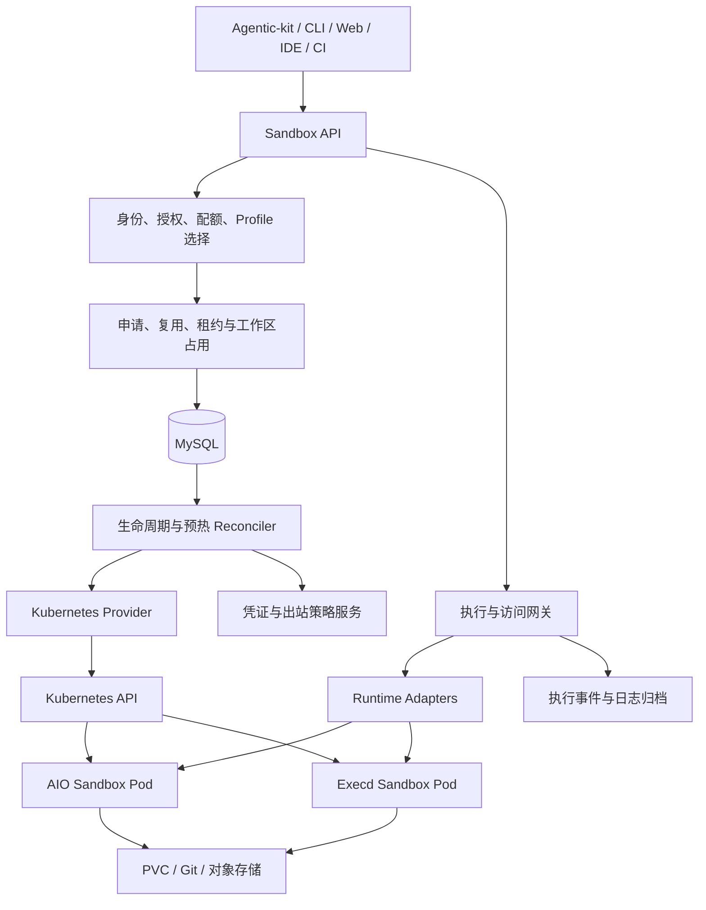
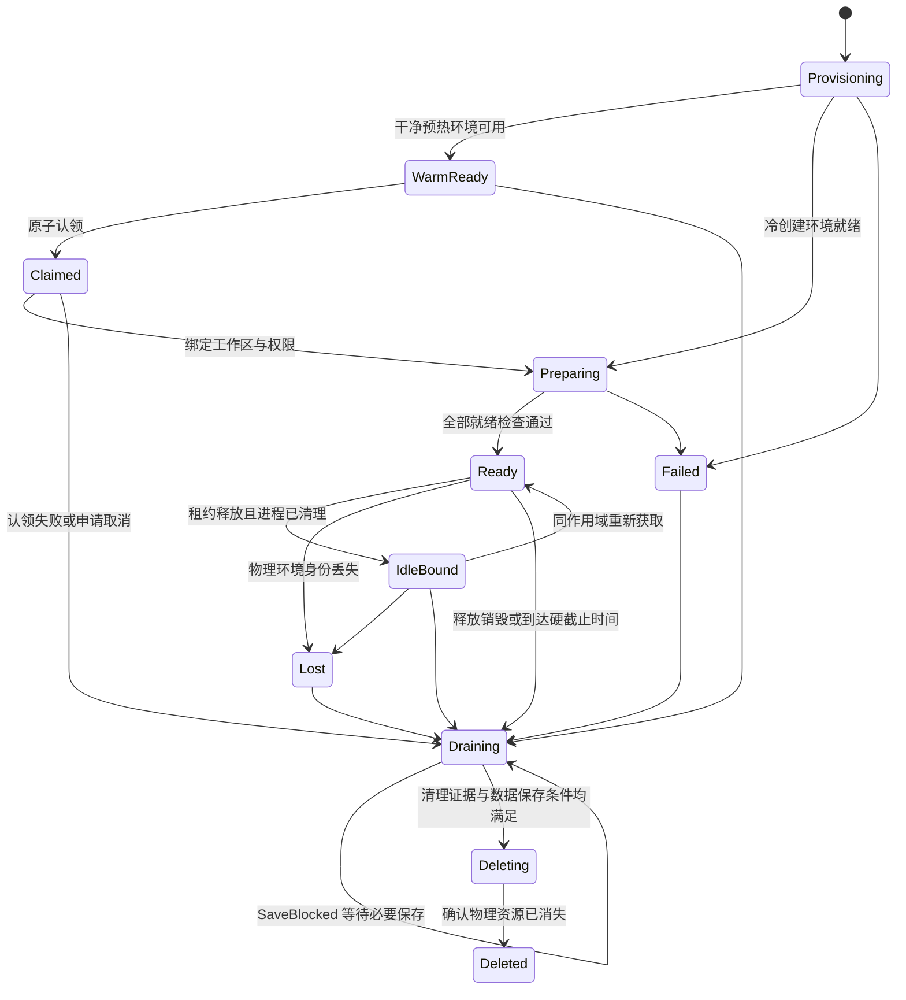

# 企业级 Agent 沙箱管理中心技术方案

版本：1.8  
日期：2026-10-22  
状态：设计稿，供架构评审与研发实施使用  
适用范围：以 Kubernetes 为计算底座，为 agentic-kit、自主 Coding Agent、CLI Agent 和浏览器 Agent 提供统一沙箱服务。

## 1. 目标与范围

沙箱管理中心负责给 Agent 分配可执行任务的隔离环境，并管理环境从申请、准备、执行到回收的完整生命周期。调用方通过统一 API 使用命令、文件、终端和浏览器等能力，无需直接操作 Kubernetes，也无需理解各沙箱产品的协议。

系统支持多种 Sandbox Backend。AIO Sandbox 可提供浏览器与开发工具组合环境，专用执行 Backend 可提供面向命令、文件和 CLI Agent 的环境。具体选择由任务需要、已验证能力、隔离要求和资源配置共同决定。

本方案包含：

- 沙箱申请、幂等、复用、排队、租约、释放与回收。
- Kubernetes 资源编排、预热池、冷创建和多副本恢复。
- 多 Backend 协议适配、能力声明、版本固定和选择规则。
- 工作区、Git worktree、只读 Skill、依赖缓存和产物交付。
- 命令执行、增量输出、可选交互式终端和 CLI 进程运行环境。
- 租户授权、凭证、网络隔离、配额、审计和可观测性。
- 数据模型、外部 API、错误语义、故障处理和验收标准。

Agent 的模型选择、上下文压缩、任务规划、审批决策和业务重试由 Agent 平台负责。代码托管、对象存储、凭证托管和产物版本服务沿用企业已有系统。沙箱管理中心保存执行与资源事实，不再建立一套对话系统、代码托管系统或产物版本库。

CLI Runner、厂商事件解析、Agent 会话及恢复由 agentic-kit 管理。沙箱中心提供通用进程与文件能力，不提供 Agent 会话 API。这个边界已经确认，见[决策记录](sandbox-design-contracts/docs/adr/0001-agent-session-ownership.md)；术语见[领域词汇](sandbox-design-contracts/CONTEXT.md)。其余细化选择仍作为设计提案接受评审。

## 2. 核心设计决策

| 事项 | 设计决定 |
| --- | --- |
| 服务形态 | Headless Server，提供 HTTP API、SSE 事件和可选 WebSocket 通道；CLI、Web、IDE 为客户端 |
| 计算底座 | Kubernetes；一个沙箱对应一个明确身份的 Pod，一次物理重建生成新的实例代次 |
| 隔离等级 | 由 Profile 固定，默认 Hardened；Standard 仅向平台验证过的受控任务开放，不因容量或兼容性问题自动降级 |
| 生命周期事实源 | MySQL 保存申请、分配、租约、实例和执行状态；Kubernetes 保存实际资源状态 |
| Agent 会话归属 | agentic-kit 管理 CLI Runner、厂商事件、逻辑会话和恢复；沙箱中心管理通用执行与访问会话 |
| 控制方式 | Reconciler 持续对齐期望状态和实际状态；内存队列仅作唤醒，不承担可靠存储 |
| Backend 结构 | Provider 管资源，Runtime Adapter 管容器内协议，Profile 固定可用组合 |
| 首组选型 | 原生 Kubernetes Provider + Guard + execd；受保护控制通道为前置条件，AIO 后续用于浏览器 Profile |
| Coding 默认分配 | 按任务独占；同一任务的后续轮次可复用，任务完成后按策略保存必要数据并销毁环境 |
| 场景策略归属 | 平台发布固定版本 Profile，分别确定环境、文件和进程策略；调用方选择 Profile 并在允许范围内调整超时 |
| 预热 | 只认领物理配置兼容的干净实例；静态卷不能在认领时任意替换 |
| 数据寿命 | 工作区寿命独立于 Pod；临时目录不承诺节点故障后的恢复 |
| 默认恢复承诺 | 自动 Coding 使用 Checkpointed，持续开发使用 Persistent；恢复文件后由 Agent 平台决定续跑，不恢复原进程或内存 |
| 检查点触发 | agentic-kit 在业务阶段显式请求；沙箱负责一致性检查、保存与发布，不自行定时创建业务检查点 |
| 分层工作区 | EphemeralCopy 工作区用 layerfs 组装：只读基础层来自仓库基准或已发布检查点，可写层随实例销毁；检查点只固化可写层增量。PersistentVolume 不使用叠加层，直接挂载授权卷 |
| 必要保存失败 | 阻止正常销毁，停止用户执行并保留待保存文件；保存成功或明确授权处置后清理，期间持续计入配额 |
| 放弃未保存结果 | 任务拥有者可在业务界面明确确认，服务端验证归属与本次数据范围；管理员处理跨用户或异常处置，普通执行凭证不包含放弃权限 |
| 资源回收 | 使用过的实例不返回公共预热池；保留给同一工作区复用或销毁 |
| 执行可靠性 | 保存执行 ID 与结果证据；不能确认是否执行的命令标记 Unknown，不盲目重放 |
| 兼容策略 | 缺少能力或隔离等级时明确拒绝；不自动降级到另一个不等价 Backend |

这些是目标系统的设计决定。文中 API、状态机和指标属于拟实现契约，不表示当前 agentic-kit 或第三方产品已经实现。

## 3. 总体架构



API 和 Reconciler 可在同一代码库中按不同进程角色部署。执行网关处理长连接和数据转发，可独立扩容。Provider、Runtime Adapter、工作区逻辑先作为进程内模块，不为每个逻辑模块建立独立微服务。

控制面负责授权和分配。执行面只接受已绑定实例的授权访问。Agent 客户端不持有 Kubernetes 凭证，不直接连接 Pod IP，也不共享一把长期有效的全局沙箱密钥。

## 4. 多 Backend 模型

### 4.1 四个概念

| 概念 | 职责 | 示例 |
| --- | --- | --- |
| Provider | 创建、观察和删除物理沙箱资源，返回资源身份和内部端点 | Kubernetes |
| Runtime Adapter | 将平台执行、文件和会话协议转换成具体 Runtime 协议 | Aio、Execd |
| Profile | 固定镜像、工具链、资源档位、挂载模式、能力和协议版本 | coding-go、coding-web、browser-research |
| Isolation Policy | 规定内核隔离、网络、权限、节点与存储边界 | Standard、Hardened |

gVisor、Kata 通过 Kubernetes RuntimeClass 接入隔离策略，不和 AIO、execd 放在同一个 Backend 枚举中。Profile 也不等同于 Backend：同一个 Runtime 可用于多个工具链镜像，Coding Profile 也可以包含浏览器测试能力。

实际可选组合以平台发布的 Profile 为准，不向业务开放任意 Provider、镜像、权限和 Runtime 的笛卡尔积。普通调用方指定 `profileRef`，有需要时增加 `requiredCapabilities` 和最低隔离要求。

Profile 同时包含环境复用、文件保存和进程保留策略；三者分别表达，由平台组合、验证和发布。调用方只能选择已获授权的版本，并在公开范围内调整超时。场景配置的命名和具体时间值由发布配置确定，不在 SDK 中为每个场景增加接口。见[已确认的策略归属](sandbox-design-contracts/docs/adr/0002-profile-owned-lifecycle-policies.md)。

| 场景 | 环境策略 | 文件策略 | 进程策略 |
| --- | --- | --- | --- |
| 自动 Coding / CI | Task 内复用，任务结束后 Destroy | Checkpointed：恢复到最近成功发布的检查点，其后修改可能丢失 | 可脱离输出连接运行，受执行期限和有效租约约束；释放时停止 |
| 持续开发 | Workspace 内复用，释放后 Retain，空闲回收 | Persistent：恢复范围以底层持久存储保证为准，保存范围和期限由策略规定 | 有效租约内允许断线保留；释放前停止，Retain 不保留开发服务进程 |
| 多轮脚本 / 数据分析 | Session 内复用，空闲回收 | 按 Profile 保存文件及检查点 | 后台计算受执行期限和租约约束 |
| 浏览器任务 | Task 或 Session 分别发布 Profile | 按授权策略保存下载文件和浏览器状态 | 访问会话清理与租约释放一致，不跨授权作用域留存进程 |

这张表定义场景方向；具体保存范围、期限和浏览器状态处理需由平台发布配置明确。长期保留环境属于原授权工作区，不进入公共 WarmPool。

### 4.2 首组 Runtime

**AIO Runtime Adapter**：适用于同时需要 Shell、文件、浏览器、开发工具或人工接管的任务。AIO 上游明确提供文件 API 和 WebSocket 终端，不能因为某个客户端只封装了轮询就认定 AIO 没有交互能力。[来源：AIO 官方仓库](https://github.com/agent-infra/sandbox)

2026-10-22 的固定镜像 [首轮实测](aio-runtime-verification.md) 已确认：脱离进程组的子进程可能在 kill/超时后继续写入，单命令超时不关闭新写入，python-server 重启后原命令查询返回 404。该组合尚不满足本方案的租约与恢复条件，需要受保护执行层补齐，不能直接标记已支持。

**Execd Runtime Adapter**：面向自定义开发镜像中的命令与文件执行，优先复用 OpenSandbox execd 的执行协议。公开协议包含命令、文件和 SSE 输出；PTY、客户端指定执行 ID、重启恢复、输出补读等细节必须按锁定版本验证，不能从“SSE”推导出“双向终端”。[来源：Execd API](https://github.com/opensandbox-group/OpenSandbox/blob/main/specs/execd-api.yaml)

2026-10-22 的固定 `release-1.1.1` 镜像 [Docker backend 实测](opensandbox-runtime-verification.md) 已确认：正常 TTL 能回收整环境并保留独立卷；管理服务退出后，环境超过截止仍可写、可执行。execd 命令终止漏停脱离进程，工作负载重启后原命令状态与日志无法查询，同一调用方幂等键未阻止重复副作用。因此仅换成该组合仍不能满足接管协议；结论不外推到 Kubernetes/FastSandbox。

这里选择的是 execd 数据面组件，物理资源仍由本系统的 Kubernetes Provider 管理。若部署的是完整 OpenSandbox 服务，则应由一个 Provider 适配它的生命周期 API，由该服务独占底层资源管理；同一实例不能同时被两个控制器创建、补池或回收。

进一步的 [backend 选型与实测](backend-selection.md) 推荐首版先实施原生 Kubernetes Provider + execd + 独立 PVC，AIO 留给后续浏览器 Profile。原生 Pod 固定截止和 execd 隔离会话删除已分别实测；前者不能延长期限，后者需要额外 namespace 权限，均不能替代受保护的可续租准入与持久回执。该组合尚未完成生产 Profile 验收。

首版实施顺序、进程拓扑、execd UDS 补丁范围、续租确认和 Unknown 边界以 [Runtime 接入规格](runtime-integration-plan.md) 为准。固定 execd 的内部初始化接口绕过 token 验证，用户进程不得直达其控制端口；普通 HTTP 代理不足以构成该边界。Guard 为独占 PID namespace 的真正 PID 1，execd 仅接受受保护 Unix socket，命令和文件操作强制非 root 身份。上述控制边界已由[固定提交加补丁的容器探针](guard-execd-verification.md)验证；原镜像没有该 UDS 选项，可续租、完整回执与生产隔离仍待实施验收。

不要求每个 Backend 都实现浏览器、PTY、快照和 Git 管理。文件搜索可以在沙箱内调用一次 `rg` 并返回结构化结果；使用 Shell 工具本身不是选型缺陷，应实测往返次数、输出上限和调用语义。

### 4.3 能力声明与协商

Runtime 发布时登记版本化能力，实例就绪时核对能力握手。平台有效能力取以下交集：

```text
EffectiveCapabilities =
  Profile 声明 ∩ Adapter 已实现 ∩ Runtime 版本已验证 ∩ 租户授权
```

能力至少拆分为：

| 能力 | 含义 |
| --- | --- |
| Exec | 启动命令，查询状态，取得退出码 |
| AsyncExec | 请求连接断开后进程仍由 Runtime 持有 |
| IncrementalOutput | 有界补读输出，标明游标、截断与缺口 |
| CancelProcessTree | 取消执行并确认子进程清理结果 |
| FileRead / FileWrite / FileSearch | 文件读取、写入与目录内搜索 |
| Stdin | 向执行输入数据；不等于 PTY |
| Pty | 创建终端、输入、调整窗口和发送终端信号 |
| Browser / Preview | 浏览器会话和应用预览代理 |
| LayeredWorkspace | EphemeralCopy 工作区的只读基础层与实例可写层组装；需核对实际挂载事实 |
| WorkspaceCheckpoint | 工作区数据检查点，需声明覆盖范围 |
| ProcessCheckpoint | 进程内存恢复，仅具体 Provider 明确支持时提供 |

所有可供自主 Agent 使用的 Profile 必须通过 Exec、AsyncExec、IncrementalOutput、CancelProcessTree 和基础文件能力验收。无法确认进程树清理时，平台可在满足必要保存条件或获得对应放弃授权后删除整个独占 Pod，并向调用方披露该终止粒度；仍有受保护数据时先隔离环境。

接入 Agent Run 的首版 Profile 还必须验证 `RuntimeInfo.EnforcesLeaseDeadline`：控制面失联时，Runtime 或用户进程不能控制的 supervisor 仍按本地授权期限拒绝新写入和输入、停止现有用户进程并保留受保护文件；迟到续租不能复活已过期绑定。仅依赖控制面定时回收或删除唯一文件副本的 Pod 不满足条件，具体规则见 [Worker 接管协议](worker-handoff.md)。

额外能力缺失时返回 `CapabilityUnsupported`，不以空成功响应代替。Backend 的名字只决定适配协议，不构成性能或安全保证。

### 4.4 模块契约

以下为职责摘要；完整 Go 接口、参数和返回类型见第 21 节及随附契约文件，不依赖第三方 SDK 类型：

```text
Provider:
  EnsureInstance(instanceID, generation, resolvedSpec)
  ObserveInstance(physicalRef)
  DeleteInstance(physicalRef, expectedUID)

Runtime Adapter:
  Probe(endpoint) -> protocolVersion, capabilities, runtimeBootID
  StartExecution(context, executionSpec) -> backendExecutionRef
  InspectExecution(context, backendExecutionRef)
  ReadOutput(context, backendExecutionRef, cursor, limit)
  CancelExecution(context, backendExecutionRef)
  ReadFile / WriteFile / SearchFiles

Optional Runtime capabilities:
  OpenTerminal / WriteStdin / ResizeTerminal
  OpenBrowser / OpenPreview
```

Git worktree 和工作区检查点归工作区模块，利用已授权执行与存储能力实现，不成为所有 Runtime Adapter 的强制方法。未知 Backend 类型直接拒绝。

## 5. 领域对象与身份

| 对象 | 含义与关键属性 |
| --- | --- |
| ProfileRevision | 不可变模板版本：镜像 digest、Runtime 协议、资源、挂载方式、能力、隔离要求 |
| AcquireRequest | 一次申请事实：requestKey、参数摘要、申请人、状态、截止时间、结果引用 |
| SandboxInstance | 物理环境：实例 ID、代次、Pod UID、内部端点、Runtime boot ID、状态 |
| Lease | 调用方使用实例的资格：holder、有效期、硬截止时间、权限与释放状态 |
| ReuseSlot | 指定作用域当前可复用的实例引用，保护并发申请的一致性 |
| WorkspaceBinding | 工作区来源、数据版本、挂载信息、写入所有者和恢复策略 |
| Execution | 一次命令：平台 ID、后端 ID、实例代次、状态、退出码、日志与幂等键 |
| WarmPool | 某个兼容配置下的干净实例目标数量和资源预算 |

每个业务对象均有 `tenantID`、`projectID`；身份从服务端认证上下文解析。请求里的用户或租户字段不能覆盖认证结果。

`instanceID` 标识逻辑物理环境，`generation` 标识其具体一代执行环境。发生 Pod 替换或 Runtime 重启后，原执行不能继续凭相同地址被当作原进程；实例代次或 Runtime boot ID 必须变化。

`leaseID` 标识持有者，`fencingToken` 是单调递增的写入世代号。网关校验租约和世代号，拒绝旧持有者的新请求。但这不能停止已经运行的进程或直接 PVC 写入，物理隔离与工作区切换另有约束，见第 11 节。

## 6. 分配模式与选择策略

### 6.1 分配模式

申请固定支持两种模式：

- `New`：新的申请生成新的隔离环境；同一 `requestKey` 的重试返回原申请。
- `Reuse`：在授权作用域内寻找可复用实例；没有可用实例时按分配规则创建。

`requestKey` 在两种模式中都必填。幂等作用域是 `(tenantID, callerID, requestKey)`。相同键但请求参数不同，返回 `IdempotencyConflict`；原申请失败或已释放后，重复请求仍返回原结果，新申请使用新键。

复用作用域采用显式对象：

| 作用域 | 使用场景 | 所有权 |
| --- | --- | --- |
| Task | 同一 Coding Task 的多轮执行 | 一个根 Run 持有写租约，SubAgent 从属于该 Run |
| Session | 同一会话的脚本、数据分析或浏览器操作 | 同一时间一个根执行持有者 |
| Workspace | 跨会话继续已有项目环境 | 显式授权，同一时间一个写持有者 |

自动 Coding 任务默认使用 Task，其他场景的作用域由 Profile 固定。仅有相同用户、Agent 和项目，不足以证明两个任务应该共享可写环境。

`scope.id` 由调用方提供，`scope.type` 必须与 Profile 一致；`New/Reuse` 仅表达在该作用域内的分配意图。跨场景切换须重新申请相应 Profile，不能在已分配实例上改策略。Agent 平台在任务完成时调用 Release；沙箱中心不通过进程退出自动推断业务任务已完成。

这里的 Session 只是调用方提供的复用作用域标识。沙箱中心校验其归属与使用权限，不保存其中的对话、CLI 原生会话或恢复状态；它也不等同于终端等 AccessSession。

系统计算：

```text
reuseKey = hash(
  tenantID, projectID, scopeType, scopeID,
  profileOwnerTenantID, profileID, profileRevision, workspaceID, workspaceGeneration,
  isolationPolicyRevision, accessPolicyRevision, readonlyAssetDigest
)
```

作用域 ID 必须经服务端验证归属。请求中的短期凭证值不进入哈希；权限与凭证策略版本进入兼容判断。

Profile 身份由所属租户、ID 和 revision 完整确定。申请、实例及后续续租、执行和释放固定使用该版本；发布新版本不会改变已有实例的策略。其引用的保存策略等配置同样按不可变版本解析。

### 6.2 选择顺序

1. 校验身份、工作区访问权、Profile、所需能力、配额和截止时间。
2. 按 `requestKey` 查申请记录，已存在则返回原申请。
3. 对 Reuse 请求锁定对应复用槽。存在准备中的同一申请则返回其进度；实例由另一个根 Run 占用则返回 `LeaseBusy`。
4. 对空闲且绑定同一作用域的实例检查实际代次、健康、权限版本、工作区和有效期。满足条件才创建租约。
5. 没有可复用实例时，从完全兼容的 WarmPool 中原子认领一个 `WarmReady` 实例。
6. 池为空时按申请的容量策略选择冷创建、等待热池或立即拒绝。
7. 工作区和运行环境准备完成后，申请转为 Ready，调用方才能提交执行。

容量策略为 `AllowCold`、`WaitForWarm`、`FailIfNoCapacity`。默认 `AllowCold`，且必须受租户并发、集群余量和排队截止时间约束。配额不足不能通过切换冷创建绕过。

### 6.3 并发与事务

使用数据库唯一约束和短事务保护幂等键、复用槽、实例认领与配额预留。认领可使用行锁加条件更新，或版本号 CAS；不能依赖单进程互斥锁。

事务内完成：记录申请、预留配额、占用复用槽或工作区准备权、把实例转为 Claimed。准备权属于 acquisitionID，Ready 时在事务中转交给正式 leaseID；准备超时前其他申请不得抢占。事务外执行 Kubernetes 和 Runtime 请求，避免网络操作长期持有行锁。

申请记录在事务提交后即可由 Reconciler 扫描处理。进程在提交后、发送唤醒前退出，不会丢失申请。Kubernetes 创建使用确定性资源名；调用超时后按身份查资源，不能直接生成第二个 Pod。

### 6.4 Ready 的定义

Pod Running 或 TCP 端口打开只证明部分启动完成。申请 Ready 必须同时满足：

- Pod 身份、Runtime boot ID 与数据库记录一致。
- Runtime 认证、协议和所需能力探测通过。
- 工作区已挂载或已恢复到请求指定版本，目录权限正确。
- 只读资源准备完成，受控出站路径可用，必要凭证已按租约生效。
- 基础文件与命令自检通过；Coding 模板可以执行预定义的工具链检查。

Ready 不表示仓库依赖安装和完整构建已完成；需要项目级初始化的 Profile 应把该步骤明确列入 Preparing，并单独记录耗时和失败原因。

## 7. 状态机与租约

### 7.1 实例状态



其他非终态在申请取消、超时或管理停用时也可进入 Draining。所有转换记录原因、时间、旧版本与新版本，并用条件更新避免旧任务覆盖新状态。

`WarmReady` 是无用户数据的公共库存；`IdleBound` 仍带有原作用域数据，只能由同一授权作用域复用。两者不能合并统计或互相替换。

### 7.2 三类时间

- `provisionDeadline`：资源与工作区准备截止时间。
- `leaseExpiresAt`：持有者必须续租的有效期。
- `hardExpiresAt`：策略允许的最长用户执行时间，续租不得突破；不授权删除尚未满足保存条件的数据。

IdleBound 使用独立 `idleExpiresAt`。长命令有独立 `executionDeadline`，提交时不得超过租约硬截止时间。普通日志查询不自动续租，避免观察流量永久保活环境。

可作为部署初始值：租约 120 秒、心跳每 30 秒、IdleBound 保留 30 分钟、交互式任务硬上限 8 小时。具体值属于 Profile/租户策略，不是对所有任务硬编码的限制。

### 7.3 续租与释放

续租必须校验 holder、当前 fencingToken、租约未过期且实例可用。过期租约不能被延迟到达的心跳复活。

Agent worker 的租约还固定绑定 `holderRunEpoch`，普通写入和续租须验证可信当前 Run 领取并匹配该 epoch。上游执行权期限限制沙箱及 Runtime 授权期限。新 worker 不继承旧租约写权限，先查询旧命令，完成旧租约清理和必要保存，再申请新租约；同一 Run 的当前领取只可申请旧租约的清理。跨库检查不承诺瞬时撤销已经在途的请求，新工作区写权必须等待准入屏障、写者隔离及保存检查完成。详细流程与验收见 [Worker 接管协议](worker-handoff.md)。

释放支持 `Retain` 与 `Destroy`：

- Retain：拒绝新执行，清理该租约的进程、终端和凭证，完成必要数据保存后进入 IdleBound。
- Destroy：执行同样的清理，再删除物理实例。

正常释放方式由已绑定 Profile 固定；请求里的 `mode` 仅作期望值校验，不允许调用方把 coding-task 的 Destroy 改成 Retain。因故障需要销毁时也须满足下述保存条件，执行停止与数据删除分别验证。断开输出流或终端连接不等于 Release：普通执行继续受命令截止时间和有效租约约束，终端按 Profile 的断线保留时间处理；租约到期或显式释放都需要清理进程。

释放 API 只表示受理，异步完成后才标为 Released。租约到期也必须确认进程停止；无法证明已停止时保留工作区占用，进入隔离与故障处理，不马上把它分给其他持有者。

必要保存失败后，实例进入 `Draining`，`phase=SaveBlocked`，租约保持 Releasing 或 Expired；进程终止无法确认时使用 Quarantined。关闭用户写入入口、停止进程、关闭访问会话并撤销用户凭证，保留执行保存所需的受限平台通道。实例不能复用或回池，工作区占用和实际配额继续保留。Ready/Released/Deleted 均不能代替保存成功。

释放事务从固定 Profile 和已受理的保存意图冻结必要保存操作 ID，逐项校验发布结果、数据版本、覆盖范围以及保存后没有新的写入。较早的成功检查点不能自动抵消最后一次必要保存失败。必要保存未受理、仍在执行、结果不明或失败时，都阻止正常物理删除；明确放弃只能按第 7.4 节对匹配范围解除该条件。`DrainEvidence.RequiredSaveOperationIDs` 由服务端持久化，空列表不能绕过 Profile 的必要保存要求。

重试只继续已受理的保存意图，不创建新的业务检查点。临时存储故障采用有界单次调用和退避，失败次数与时间触发告警而非自动删除；结果不明先查询。已明确终态失败的操作不原地复活，其替代保存需由 Agent 平台显式提出并记录替代关系，不能套用命令自动重放逻辑。已过期租约不恢复使用权，已受理操作只能在平台的受限保存权限下继续完成。

默认不因空闲超时、租约硬期限或配额不足而删除待保存文件。保存成功后继续原释放流程；任务拥有者也可明确确认放弃本次未保存结果。Release API 不含可绕过保存的 force 参数，放弃操作使用独立授权与审计。保留机制防止平台主动误删，不改变节点或存储故障下的恢复承诺。见[必要保存保护决策](sandbox-design-contracts/docs/adr/0004-block-deletion-on-required-save-failure.md)。

释放与 Start 派发共享一个准入屏障：先在数据库关闭该租约的新执行入口，再处理所有 Pending、Starting 和 Running 记录。不能仅在清理时观察到“没有运行进程”就发放新租约，因为旧 Start 请求可能仍在网络中。支持 Runtime 侧世代校验的组合必须同步撤销旧世代；不支持的组合必须确认全部派发已结束。存在 Unknown 或无法排除迟到启动时，不进入 IdleBound，先隔离并确认旧执行环境停止。删除将同时丢失未保存文件时，不能把删除 Pod 当作唯一常规终止手段；无法分别保证停止执行和保留文件的 Runtime/Profile 组合不能发布为满足该策略。

### 7.4 必要保存的重试与放弃

任务拥有者是业务系统确认有权处置该任务结果的人，不等同于申请沙箱的 Worker 或租约持有者。沙箱中心通过已有授权边界验证当前身份与任务归属；调用方不能靠请求体中的用户 ID、角色或确认布尔值获得权限。业务后端代用户调用时，使用可信授权系统签发、绑定本次处置范围的用户确认委托。管理员仅在已有跨用户授权范围内处理异常，不是普通用户处置自己结果的必经环节。

业务界面先读取保存阻塞快照，展示任务、受影响工作区、未保存版本和放弃后可能丢失的范围。用户确认后提交幂等请求键、原因和该快照的版本。服务端在同一事务内核对实例代次、工作区代次、数据版本及必要保存操作集合；保存重试、成功发布或数据变化使确认过期时，拒绝请求并要求重新读取。一次确认不授权丢弃其他任务、后续版本、已发布检查点或无关产物。

执行 Worker 可以在单独授予的保存权限内重试冻结范围中的失败保存，不需要任务拥有者逐次确认；它不能自行放弃结果。重试创建关联原失败意图的新操作，旧 Failed 记录保留。Unknown 先对账，不能直接换一个请求键再执行。重试和放弃均不依赖已经过期的执行租约，也不会恢复执行权或开放用户写入。

放弃回执表示已记录针对该范围的授权，不表示数据已经删除，也不表示保存成功。释放流程还须停止或隔离在途保存与发布，确认旧执行进程无法继续写入，之后才能清理相应资源；不能用放弃授权把未知的发布结果改写为失败。受影响的原保存记录保留，审计记录实际用户、代理调用方、授权依据、原因与处置范围。数据库复用动作账本和释放证据保存这些事实，不新增独立审批系统。

## 8. WarmPool 设计

### 8.1 预热内容

预热分为三种资源准备：节点镜像缓存、干净运行中 Pod、绑定具体工作区的空闲实例。只有第二种属于公共 WarmPool。镜像缓存减少拉取时间，不消除调度与初始化时间；工作区复用减少数据准备时间，但只服务原授权作用域。

WarmPool 中的 Pod 已完成镜像启动、Runtime 探测和模板自检，不含用户仓库、用户凭证、浏览器登录态或可写租户数据。

池键包含：

```text
poolKey = hash(
  clusterID, namespaceOrTrustDomain, providerType,
  runtimeType, runtimeVersion, imageDigest, profileOwnerTenantID, profileID, profileRevision,
  resourceClass, runtimeClassName, architecture,
  networkPolicyRevision, staticVolumeLayout, readonlyAssetDigest
)
```

只预热高频 Profile；低频或高成本模板按需创建。资源档位不同、卷不同、隔离等级不同，不得通过“差不多可用”共用池。

首版不把基础层 digest 纳入 `poolKey`。WarmPool 只预热空工作区，认领后才物化基础层，因此 `T_ready` 包含基础层就位时间；这是首版接受的成本。只有高频基准被证明值得专属库存时，才为少量 Profile 增加带 digest 的池键和预物化策略。池键格式变化必须版本化，新旧池不得互相认领，避免公共库存默认按仓库版本碎片化。

### 8.2 工作区与预热的组合

运行中 Pod 不能通过普通 API 修改为任意新的 PVC 或 `volumeMount.subPath`。修改工作负载模板会导致替换 Pod。Runtime 的初始化 HTTP 接口也不能绕过这个 Kubernetes 约束。[来源：Pod 更新与替换](https://kubernetes.io/docs/concepts/workloads/pods/#pod-update-and-replacement)

因此支持以下三条明确路径：

| 工作区方式 | 预热策略 | 恢复与限制 |
| --- | --- | --- |
| EphemeralCopy | 只预热空工作区；认领后由节点侧 Workspace Materializer 组装 layerfs：只读基础层（仓库基准或已发布检查点）+ 可写层 | 叠加挂载快于整卷克隆，主要耗时是基础层数据就位；可写层随实例销毁；Pod 丢失后恢复到最近成功归档点 |
| PersistentVolume | 创建时指定授权 PVC 与 subPath；使用冷创建或匹配该卷布局的专属池 | 适合持久开发工作区；挂载、权限和存储性能需验证 |
| IdleBound 复用 | 保留已经绑定工作区的空闲实例 | 最直接保留进程清理后的文件状态；不计入公共库存 |

EphemeralCopy 的只读基础层首版固定为按内容 digest 物化的只读 PVC，由 Layer Materializer 从对象存储或仓库快照生成。基础层内容不属于任何单实例，节点侧以只读方式挂到稳定缓存路径后，同节点同 digest 的实例共享同一 lower；跨节点通过重新挂载同一 PVC 获得一致内容。可写层是绑定实例生命周期的节点本地目录，对用户语义等同 emptyDir，写操作不穿透到基础层。

叠加挂载由节点侧 Workspace Materializer 完成，经 `hostPath` 和 `mountPropagation` 暴露合并视图；Guard 保持 `SETUID/SETGID`，只校验 digest、只读性与挂载事实，不执行需要 `CAP_SYS_ADMIN` 的 mount。用户进程不能请求替换挂载源，也不能在叠加层之下直接写底层目录。目标 RuntimeClass 落地前必须验证 overlay 支持、`mountPropagation` 行为和 hostPath 策略；镜像卷、节点本地缓存和 Pod 内 `fuse-overlayfs` 都是后续可替换实现，必须复用同一 `BaseLayerRef` 契约并单独验收。验收前不得对外宣称 EphemeralCopy 的秒级恢复。

首版实现选择见[layerfs 决策](sandbox-design-contracts/docs/adr/0005-layerfs-implementation-decisions.md)。

默认 Coding Task Profile 使用 EphemeralCopy，任务结果与检查点按约定保存；需要持久工作区的交互开发场景选择配置了 PersistentVolume 的 Profile。一个版本只发布一种经过验证的工作区模式。首次申请临时工作区时必须向调用方返回其恢复级别。

默认 Coding Profile 将 `WorkspaceModes` 固定为 `[EphemeralCopy]`，`WorkspaceDataPolicy.RecoveryLevel` 固定为 `Checkpointed`；持续开发 Profile 分别固定为 `[PersistentVolume]` 和 `Persistent`。这两个默认组合已确认，见[恢复承诺决策](sandbox-design-contracts/docs/adr/0003-scenario-recovery-guarantees.md)。支持空目录热启动不表示修改已经被保存；检查点对象必须存放在独立于该 Pod 的持久存储中。

不得将整租户或全平台存储根目录暴露给公共池，再用 `cwd` 或软链接作为隔离。只读 Skill 可以随固定模板预装；动态 Skill 以版本化文件包准备，或在 Pod 创建时声明所需只读卷。这些只读资产与代码基准层一样可以作为叠加层的只读输入，但写入路径与系统配置路径保持分离，不允许通过叠加让只读资产变得可写。

### 8.3 认领流程

1. 事务中将一个兼容实例从 WarmReady 改为 Claimed，记录申请、占用和配额。
2. 此实例立即从可用库存中移除，补池 Reconciler 创建替代实例。
3. 为已认领实例准备工作区、租约身份和受限凭证，状态变为 Preparing。
4. 检查环境和数据后转为 Ready。
5. 准备失败时进入销毁流程，不放回公共池。

已认领实例发生故障，不能把其执行静默迁移到另一个 Backend。尚未执行任何用户操作、且工作区准备可幂等重做时，可以在同一申请下生成新的物理尝试，记录 attempt 和失败原因。

### 8.4 补池与容量

每个池配置 `minReady`、`maxReady`、`maxProvisioning`、最大空闲时间和资源预算。Reconciler 基于数据库库存与实际 Pod 核对后补足缺口。多个副本竞争同一池时，通过池行版本或短期协调锁限制重复补建。

初始容量使用固定水位。积累流量后可按下式估算，再用真实突发分布校准：

```text
targetReady = clamp(minReady, maxReady,
                    ceil(arrivalRate * replenishTime) + burstReserve)
```

`arrivalRate` 与 `replenishTime` 使用相同时间单位。该公式是容量估算，不是尾延迟保证。集群必须有节点余量；热池本身不能解决节点资源耗尽。

使用过的实例默认销毁或留在 IdleBound。删除 workspace 目录不足以清除后台进程、HOME、凭证、浏览器状态和系统改动，因此不提供跨租户擦洗后回池路径。

## 9. Kubernetes 资源与隔离

### 9.1 资源组织

Kubernetes Provider 使用 client-go 管理确定性命名的 Pod，Pod 采用 `restartPolicy: Never`。Pod 中的 Runtime 必须作为被监控的主进程运行；其异常重启也通过 boot ID 识别。以直接受控 Pod 表达一次执行环境，避免 Deployment 自动补出新进程后误认为旧执行仍然存在。

生产命名空间按租户或明确的信任域配置。单个用户不能在申请中任意指定 namespace、ServiceAccount、hostPath、特权参数和宿主网络。

执行网关通过经过身份验证的内部端点访问 Pod，Provider 用 Pod UID、IP、端口和 generation 维护路由。第一版不要求每个实例创建一个 ClusterIP Service；需要稳定 Service 的 Backend 可以由 Provider 管理，但 Service 存在不代表执行环境未变化。

实例资源统一带上平台标识、实例 ID、代次与模板版本，用于观察、清理和孤儿资源对账。日志与镜像标签不携带凭证明文。

### 9.2 隔离等级

Standard 使用受限容器配置；Hardened 使用集群预装并验证的 gVisor 或 Kata RuntimeClass。RuntimeClass 名称是集群资源名，不假设必然叫 `gvisor` 或 `kata`，也不假设创建该资源就完成底层运行时安装。[来源：RuntimeClass](https://kubernetes.io/docs/concepts/containers/runtime-class/)

平台默认发布和推荐 Hardened Profile，用于 Agent 生成或外部提供代码的执行。Standard 作为独立 Profile，仅向经过平台验证的受控任务开放；不能仅因任务来自内部员工，就认定代码及其依赖可信。Profile 的隔离等级在发布时固定并校验，普通调用方不能覆盖 RuntimeClass 或权限参数。

申请中的 `minimumIsolation` 是额外约束：低于调用方要求的 Profile 直接拒绝；提出更低要求也不会改变已选 Profile 的隔离等级。Hardened 对应运行时不可用、容量不足或工具不兼容时，按失败与容量策略处理，不自动改用 Standard。新 Profile 版本不改变已有实例的隔离配置。

策略至少指定：非 root 执行、禁止提权、能力裁剪、seccomp、ServiceAccount Token 挂载、CPU/内存/临时磁盘限制、可写目录、节点选择和网络路径。浏览器等工作负载需要额外权限时发布独立 Profile，并验证其隔离要求；不能复制示例中的宽松权限作为全平台默认。

### 9.3 网络和凭证

网络从默认拒绝开始，按 Profile 放行 DNS、执行网关、存储和受控出站代理。原生 NetworkPolicy 主要表达地址与端口规则，域名白名单需要出站代理或集群网络插件支持；必须验证所用 CNI 实际执行策略。[来源：NetworkPolicy](https://kubernetes.io/docs/concepts/services-networking/network-policies/)

平台凭证服务为具体租约发放最小权限访问：Git 仓库、模型网关、包仓库和对象存储均使用独立 scope。优先由代理注入外部服务密钥；必须注入容器的短期凭证不得写入镜像、执行参数日志或长期 Profile。

Runtime 认证凭证按实例隔离。控制面到 Runtime 使用受保护通道或实例身份验证。平台管理员密钥不进入用户执行环境。Browser、Preview、PTY 访问也经过网关鉴权，不能仅靠一个不可猜测的 URL 授权。

沙箱限制环境访问；推送分支、创建 MR、部署、发消息等动作是否允许，由上层业务授权决定。工作区内容、网页和工具输出不能改变租约权限。

## 10. 命令、日志与交互协议

### 10.1 命令提交

所有执行请求携带 leaseID、fencingToken、requestKey、cwd、命令模式、超时和输出限制。命令模式分为 `Argv` 与 `Shell`，必须二选一；平台生成的 Git、文件检索操作优先使用 Argv，用户明确需要管道和重定向时使用 Shell。

提交前检查实例 Ready、租约有效、能力与资源配额。数据库先生成平台 executionID，再调用 Runtime。返回 `202 Accepted` 表示执行请求已记录，不表示命令已经成功。

Execution 状态：

```text
Pending -> Starting -> Running -> Succeeded | Failed | TimedOut | Cancelled
                   -> Unknown
Running            -> Unknown
```

只有拿到可信退出结果才能写入终态。非零退出码保留为执行结果，不与网络错误混合。HTTP 200 不等于命令成功，无法找到执行记录也不等于命令从未启动。

### 10.2 启动幂等与不确定结果

`requestKey` 在租约内唯一，同键同参数返回原 executionID，同键不同参数返回冲突。

若 Backend 支持按调用方执行 ID 幂等启动并查询，适配器使用平台 executionID 关联。若 Backend 不支持，平台只做一次启动派发；网络断开、Worker 重启或响应丢失后进入 Unknown，通过后端记录对账。后台 Worker 不能因为任务锁超时自动再次调用 Start。

对于没有后端 ID、无法查询的不确定执行，保持 Unknown 并阻止依赖该结果的自动流程继续。上层可以核对外部结果或显式创建新的执行尝试，但平台不承诺跨 Runtime 与外部系统的 exactly-once。

### 10.3 输出与断线恢复

统一输出事件包含 `executionID`、`sequence`、`stream`、`timestamp`、`data` 和可选终态。网关将后端 SSE、分页或长轮询适配为统一 SSE；平台游标与供应商游标分别保存，禁止把不同单位的 byte、line、event 游标混用。

短期输出写入有界事件缓冲，长日志分片归档到对象存储。客户端用 Last-Event-ID 补读。已归档的数据通过日志 API 获取；发生输出缺口必须返回 `OutputGap`、最早可用位置和归档引用，不能悄悄跳过。

客户端断线不默认取消后台执行。网关重启后只有 Backend 提供补读能力时才能补齐未落库输出；不支持补读的连接丢失需要如实标注日志缺口。进程成功与日志完整性是两个独立字段。

配置单次输出上限、每实例磁盘配额、日志保留期和背压策略。日志截断不得改变退出码；超额导致进程终止时需单独记录原因。

### 10.4 PTY 和 stdin

非交互式 Coding 任务默认使用普通进程与结构化输出。人工终端和确需交互的 CLI 使用 Pty 能力，协议支持 Input、Resize、Signal、Output 和 Exit。

PTY 的 stdout/stderr 通常合流，控制字符需要前端按终端协议解释。终端连接的写权限同时只授予一个操作者，观察者只读。连接断开后的保留时间受租约限制。

stdin 不自动重放。可支持连接内 sequence 去重，但连接丢失后未确认输入是否已被消费，应要求客户端查询或人工确认，不能对按键输入声称 exactly-once。

取消流程为：拒绝新增输入，发送终止信号，等待宽限期，强制结束进程树并检查残留。只杀父进程不足以确认执行终止；需要销毁整个独占实例时，仍须通过必要保存或明确放弃检查，否则保持隔离并保留数据。

## 11. 工作区、Git 与 SubAgent

### 11.1 工作区布局

建议布局如下，实际目录写入 Profile：

```text
/workspace/repo                 主仓库或集成工作树
/workspace/worktrees/<memberID> 同任务子 Agent 的工作树
/workspace/artifacts            待提交产物
/workspace/tmp                  任务临时文件
/opt/skills/<version>           固定版本只读 Skill
/home/agent                     该实例的工具配置与 CLI 会话文件
```

每个 WorkspaceBinding 固定来源、仓库 ID、基准 commit、数据版本和保存策略。仓库地址和凭证引用需要授权检查；不能让请求通过任意 URL 访问集群内部服务。

#### EphemeralCopy 的分层组装

EphemeralCopy 工作区在实例内由 layerfs 叠加组装，而不是整卷克隆：

```text
lower（只读，按内容 digest 标识）
  = 仓库基准物化层，或某个已成功发布的检查点数据层
upper（可写，实例 emptyDir）
  = 本实例的全部文件修改，包括新增、删除标记和权限变化
merged = /workspace/repo 等授权根目录
```

基础层按内容 digest 寻址，首版以只读 PVC 为真源，节点侧共享挂载后同节点实例只读复用同一份内容。基础层就位由 Layer Materializer 在 Pod 外完成，作为 Preparing 的独立耗时阶段记录。叠加挂载、卸载和层替换由节点侧 Workspace Materializer 执行；Guard 不持有 `CAP_SYS_ADMIN`，只校验挂载事实并保护合并视图。execd 和用户进程只看到合并视图，不能访问底层目录或请求重新挂载。

可写层是绑定实例生命周期的节点本地目录，实例销毁即丢弃。EphemeralCopy 实例内的全部工作内容只存在于两处：尚未固化的可写层，以及已发布的检查点。必要保存把可写层增量固化为新的检查点数据对象；它不做全量工作区复制，只处理覆盖范围内的增量文件与删除标记。

Guard 读取并记录节点侧组装的基础层 digest 与挂载事实，回执卷保存当前挂载身份。Guard 或 Pod 重建后不沿用旧的挂载状态：要么由平台按已发布检查点重新组装新实例，要么明确报告原可写层不可恢复。不允许在 boot 变化后把新环境冒充为原工作区。

平台文件 API 将路径限制在授权根目录，并防范路径穿越与符号链接逃逸。允许执行任意 Shell 后，API 路径校验不能限制 Shell 的全部访问；真正边界由该实例能挂载的存储与 OS 权限决定。

文件版本条件写入只有在 Runtime 能可靠执行检查与替换时才作为可选能力公开。远程先读后写不构成原子条件更新；直接 Shell 写入也不会遵守平台锁。需要严格防止并发覆盖时，必须停止该工作树的其他写入者，或使用独立 worktree 后集成。

### 11.2 Git worktree

同一任务内需要多个 SubAgent 并行修改代码时，工作区模块从固定基准 commit 创建独立 worktree 和分支。它们共享 Git 对象数据库，各自有工作目录、HEAD 与 index。[来源：Git worktree](https://git-scm.com/docs/git-worktree)

创建时记录 memberID、baseCommit、分支和目录；同一分支不能被多个写任务同时 checkout。合并由集成步骤按固定顺序执行，记录冲突、diff、测试结果与新的基准版本。

worktree 隔离代码修改状态，不隔离进程、网络、HOME、凭证或整个文件系统。同一 Pod 内的 SubAgent 必须属于同一信任域。需要不同权限或不互信时，分配不同沙箱。端口、临时目录、构建输出与可写依赖缓存也需按成员区分。

Git worktree 不等于进程快照，也不要求 APFS clonefile 或 reflink。只有实际文件系统明确支持并验证后，才使用写时复制加速。

### 11.3 保存与检查点

工作区检查点至少声明：基准 commit、已跟踪文件改动、未跟踪且允许保存的文件、二进制文件、文件权限和实际包含与排除的路径。仅保存 `git diff` 不能保证恢复全部工作内容。Agent 平台负责把需要保留的 CLI 会话文件放入授权保存范围，并验证其语义完整性；沙箱中心不解析这些文件，也不通过检查点承诺 Agent 会话可恢复。

创建一致检查点时暂停新写操作，等待当前写操作结束，再生成 manifest 和数据对象，最后发布检查点引用。无法静止的文件系统快照只能标为 crash-consistent，不能冒充应用一致检查点。

EphemeralCopy 的静止验证直接落在叠加层上。`ApplicationConsistent` 至少要求以下证据同时成立：准入屏障已关闭该租约的新写入与新输入；已受理的文件操作和命令全部排空；沙箱 cgroup 中除 Guard/execd 固定集合外没有用户进程；授权根目录下没有仍可写的文件描述符或在途写入；对合并视图执行 `syncfs` 成功；检查点期间基础层 digest 与挂载事实没有变化。任一项无法确认时检查点明确失败，不降级为“先存了再说”。只有调用方显式声明 `CrashConsistent` 且 Profile 允许时，才走崩溃一致路径，服务端不得静默改级。PersistentVolume 不使用叠加层，静止仍靠准入屏障与进程清理确认，检查点按声明覆盖范围保存数据对象，不存在“读取可写层即一致”的快捷路径。

检查点对象由 manifest 和 upper 增量层组成。manifest 记录基础层 digest、增量层 digest、覆盖范围、一致性级别、生成时间和工具版本；增量层使用 OCI layer 兼容的 tar 结构表达新增、修改、删除和 opaque 目录，不把 overlay 语义压平成普通 tar。恢复时先物化新的只读基础层，再把增量层应用到新的可写层；两份对象都按内容寻址存储并校验 digest。

检查点由 agentic-kit 在完成一轮修改、验证或结束任务前显式触发。沙箱中心不推断业务阶段，也不按周期自行创建检查点；控制循环可以继续处理已受理的保存请求和发布结果对账。保存时机的选择不代表业务测试已通过，检查点只记录文件状态。

agentic-kit 先协调本轮写任务和子 Agent，再携带有效租约、工作区身份和 requestKey 调用 CreateCheckpoint。沙箱中心仍必须验证静止证据，覆盖直接 Shell/CLI 及后台进程的写入；不能只等待文件 API 请求结束。需要 ApplicationConsistent 但无法确认静止时，明确失败，不能静默降级。请求受理不等于保存成功，Agent 平台需等待检查点 Ready，并保存其 ID 与工作区版本。

任务结束时，Agent 平台显式请求最后一次必要检查点并确认保存结果，再发起 Release。Release 清理过程使用已有保存结果和保存意图，不自行选择业务检查点时机。必要保存失败时进入第 7.3 节的 SaveBlocked 处理，阻止正常销毁；Agent 平台可提交 Release 关闭用户执行入口，但不能将失败的保存标为成功。保存响应丢失时按原 requestKey 查询与对账，不直接提交另一次保存。沙箱服务不保证固定时间间隔的数据丢失上限，具体取决于 Agent 平台实际完成的保存阶段。

恢复级别明确区分：

- `Ephemeral`：Pod 存在期间可用，无节点故障恢复承诺。
- `Checkpointed`：恢复到最近已成功发布的数据检查点。
- `Persistent`：文件保存在持久卷，仍受底层存储持久性和一致性约束。

这些级别均不自动恢复运行中的进程。CLI 对话历史、Agent checkpoint、工作区数据和外部副作用分别保存。

自动 Coding 默认承诺恢复到同一授权工作区历史中最近一次成功发布、且数据和 manifest 均可验证的检查点，或调用方显式指定的有效检查点。检查点之后的修改可能丢失；正在保存或发布结果不明的记录必须先对账，不能直接当作成功恢复点。没有成功检查点时明确报告没有可用恢复点；从仓库基准重新开始是 Agent 平台的显式决定，不能冒充已恢复修改。

恢复 EphemeralCopy 工作区就是把恢复点物化为新的只读基础层，再在其上叠加空可写层。检查点数据对象可以在不同节点重建基础层；恢复不依赖原 Pod、原可写层或原节点。基础层就位失败时申请停留在 Preparing 并报告原因，不允许以一个内容不完整的部分基础层开始执行。

持续开发默认依赖 PersistentVolume 的实际持久性与一致性保证，不将进程缓冲区或尚未持久化的写入算作可恢复数据。重挂工作区仍需完成旧写者隔离。任何恢复只重建文件状态，命令结果、Agent 会话和外部副作用分别查询与核验，不能因文件恢复成功就自动重放上次执行。

### 11.4 单写者与故障切换

一个可写 WorkspaceBinding 同时只绑定一个有效根持有者。数据库占用和 fencingToken 可以拒绝旧网关请求，但失联节点上的旧进程可能仍直接写 PVC。

因此，原实例失联时采取以下顺序：先撤销入口与凭证，确认旧 Pod/节点执行已停止或存储写权限已被可靠隔离，再释放同一卷的写入权。仅删除 API 中的 Pod 记录或让租约过期，不足以证明停止。

无法确认旧写者终止时，不把同一可写卷挂到新实例。可以从已确认的检查点复制到新的独立工作区继续，旧工作区隔离保留，合并由显式操作完成。底层支持的独占挂载模式也需要验证其实际故障隔离语义。

对 EphemeralCopy，旧写者的写入范围就是旧实例的可写层。实例失联但节点可能仍运行时，同节点的基础层缓存仍可只读共享，但绝不允许两个实例把各自的合并视图挂到同一个可写目录。故障切换的路径是从最近成功发布的检查点在新实例组装新工作区；旧实例可写层中未固化的修改按检查点之后丢失处理，不进入合并流程。需要抢救未固化修改时，由明确授权的只读路径读取旧可写层并生成新检查点，这不属于自动恢复承诺。

### 11.5 缓存与产物

依赖缓存按工具链版本、架构、依赖锁文件和信任域分组；公共共享缓存以只读形式提供。可写缓存仅在明确的租户边界内共享，避免一个任务污染另一个任务的构建结果。

产物写入既有对象存储与产物服务，以内容清单和引用关联 Execution。发布请求携带幂等键，外部发布结果不明时先查询，不能重复创建版本。Git push、MR 创建等由上层交付步骤执行并记录授权与外部结果。

## 12. Codex、Claude Code、OMP 等 CLI Agent 接入

系统支持两种执行形态：

1. Agent Loop 位于平台 Worker，工具调用通过执行网关进入沙箱。适用于 agentic-kit 自身的 Agent Runtime。
2. Agent Loop 位于沙箱内，以 CLI 进程运行；agentic-kit 组织启动、厂商事件解析和结果收集，沙箱中心执行通用进程启动、输出读取和取消。适用于 Codex、Claude Code、OMP 等。

第二种形态由 agentic-kit 提供 CLI Runner 适配层，固定 CLI 版本、启动参数、事件协议、会话路径和恢复方式。Runner 使用公开沙箱 SDK，不依赖沙箱服务内部接口；沙箱服务不保存 Runner Profile 或逻辑 CLI 会话。自动任务优先使用经过验证的非交互模式与结构化输出，人工接管才使用 PTY。本文不规定未经当前版本验证的 CLI flag。

一次任务的调用链为：agentic-kit 保存 Agent 会话与任务 → 申请沙箱并取得租约 → Runner 生成命令 → StartExecution 返回执行标识 → 读取输出并由 Runner 解析事件 → agentic-kit 保存会话状态与执行关联。沙箱中心只解释通用命令和进程状态，CLI 原生事件作为输出字节传递。

CLI 进程直接访问沙箱内工作区，其子 Agent 的 Git 工作树也可以位于同一 Pod。CLI 进程不能把平台自身的工具再次代理回自己，形成重复调度或循环调用。

CLI 内置 sandbox 和审批机制按具体版本能力保留或配置；外层 Kubernetes 隔离为平台管理边界。嵌套 sandbox 的 namespace、seccomp 或系统调用要求需要在目标 RuntimeClass 下验收，不能通过默认授予 privileged 来解决兼容问题。

CLI 自行发起的文件和工具操作不会自然出现在平台工具事件中。agentic-kit 解析 CLI 结构化事件，沙箱中心提供受控网络与进程日志证据，两者明确各自覆盖范围；只有 stdout 不能声称拥有完整工具审计。

agentic-kit 保存 CLI 原生会话 ID、Task/Run 与每次 executionID 的映射。断开输出连接后先查询原 Execution：仍运行时重新读取输出，不新开进程；状态不明时先对账，不盲目续跑。需要恢复会话时，由 agentic-kit 核验 CLI 版本、会话文件和工作区版本，再通过 StartExecution 建立新的执行尝试。恢复对话不证明上次测试或外部操作成功。

## 13. 数据模型与一致性

以下列出核心生命周期表。完整建表语句、其余工作区/会话/配额/操作记录表和 Go 行结构以第 22 节为准：

| 表 | 主要字段 | 约束与索引 |
| --- | --- | --- |
| sandbox_profile_revision | profileID、revision、resolvedTemplate、imageDigest、capabilities、enabled | profileID + revision 唯一；版本不可变 |
| sandbox_acquire_request | tenantID、callerID、requestKey、specHash、mode、status、deadline、instanceID、leaseID、attempt | tenantID + callerID + requestKey 唯一 |
| sandbox_instance | ID、generation、status、poolKey、physicalRef、podUID、runtimeBootID、resolvedSpec、version、observedAt | 状态与下次对账时间索引 |
| sandbox_lease | ID、instanceID、holderRunID、holderRunEpoch、fencingToken、expiresAt、hardExpiresAt、status | 当前写持有者通过实例或占用槽事务保护 |
| sandbox_reuse_slot | tenantID、reuseKey、instanceID、version | tenantID + reuseKey 唯一 |
| sandbox_workspace_binding | workspaceID、workspaceGeneration、sourceRef、storageRef、preparingAcquisitionID、writerLeaseID、checkpointRef、status | 工作区世代唯一；准备权与写租约互斥 |
| sandbox_execution | ID、leaseID、requestKey、specHash、backendRef、generation、status、exitCode、logRef、completeness | leaseID + requestKey 唯一 |
| sandbox_warm_pool | poolKey、resolvedSpec、minReady、maxReady、maxProvisioning、budget、version | poolKey 唯一 |
| sandbox_event | entityID、sequence、type、payload、createdAt | entityID + sequence 唯一 |

配额使用原子计数或租户配额行加锁预留，和申请提交保持同一事务。业务申请的配额预留从排队持续到释放；公共 WarmPool 的资源计入平台库存预算，认领时转换归属，避免漏计或重复计费。

数据库保存业务期望与已观察事实，不能仅凭数据库 Ready 就忽略实际 Pod 身份变化。Kubernetes Watch 提供快速通知，周期性全量对账补充 Watch 中断和遗漏。

Reconciler 领取记录时带有处理所有权与过期时间，写回使用 version CAS。Kubernetes 操作按实例 ID 和代次幂等执行，删除带 UID 条件，避免迟到的 Worker 删除新的资源。

非幂等命令 Start 不套用通用“任务锁过期后自动重做”规则，遵循第 10.2 节。

## 14. 对外 API

### 14.1 接口清单

| 方法与路径 | 作用 |
| --- | --- |
| GET /v1/sandbox-profiles | 查询当前主体有权使用的模板和能力 |
| POST /v1/sandbox-acquisitions | 创建或幂等获取申请 |
| GET /v1/sandbox-acquisitions/{id} | 查询排队、准备与分配结果 |
| DELETE /v1/sandbox-acquisitions/{id} | 取消尚未完成的申请 |
| GET /v1/sandboxes/{id} | 查询实例、代次与工作区恢复级别 |
| GET /v1/sandboxes/{id}/events | SSE 订阅生命周期事件 |
| POST /v1/sandbox-leases/{id}/renew | 续租 |
| POST /v1/sandbox-leases/{id}/release | 按 Retain 或 Destroy 释放 |
| GET /v1/sandboxes/{id}/blocked-save?generation=... | 查询当前保存阻塞快照和用户确认范围 |
| POST /v1/sandboxes/{id}/blocked-save/retry | 按受限保存权限重试冻结范围中的保存 |
| POST /v1/sandboxes/{id}/blocked-save/discard | 记录拥有者确认的放弃授权，返回处置回执 |
| POST /v1/sandboxes/{id}/executions | 提交命令 |
| GET /v1/executions/{id} | 查询命令状态、退出码和日志完整性 |
| GET /v1/executions/{id}/events | SSE 订阅或补读命令输出 |
| POST /v1/executions/{id}/cancel | 请求取消，查询接口确认是否完成 |
| POST /v1/sandboxes/{id}/files/read | 读取指定路径与范围 |
| POST /v1/sandboxes/{id}/files/write | 写入文件，可携带期望文件版本 |
| POST /v1/sandboxes/{id}/files/search | 有界文件或内容搜索 |
| POST /v1/sandboxes/{id}/terminals | 创建可选终端会话并返回受控连接信息 |
| POST /v1/workspaces/{id}/worktrees | 创建同任务的 Git 工作树 |
| POST /v1/workspaces/{id}/checkpoints | 创建工作区数据检查点 |

普通实例写操作需要有效 leaseID 和 fencingToken。必要保存的受限重试和明确放弃使用独立资源授权，允许在租约过期后处理，但不恢复用户写权限。资源 ID 不是授权凭证。管理接口和普通调用方接口分别配置权限。

### 14.2 申请示例

```json
{
  "requestKey": "task-123-acquire-1",
  "projectId": "project-1",
  "mode": "Reuse",
  "scope": {
    "type": "Task",
    "id": "task-123"
  },
  "holderRunId": "run-001",
  "holderRunEpoch": 1,
  "profileRef": {
    "id": "coding-go",
    "revision": 1
  },
  "requiredCapabilities": [
    "Exec",
    "AsyncExec",
    "FileRead",
    "FileWrite"
  ],
  "minimumIsolation": "Hardened",
  "workspace": {
    "id": "workspace-123",
    "generation": 1,
    "mode": "EphemeralCopy",
    "sourceRef": "git-source-123",
    "baseCommit": "0123456789abcdef0123456789abcdef01234567",
    "dataVersion": null,
    "storageRef": null,
    "checkpointId": null,
    "savePolicyRef": {
      "id": "task-checkpoint",
      "revision": 1
    }
  },
  "capacityPolicy": "AllowCold",
  "waitTimeoutSeconds": 10,
  "provisionTimeoutSeconds": 180,
  "requestedLeaseSeconds": 120
}
```

`sourceRef` 引用服务端已授权的仓库配置，不携带明文密钥。`waitTimeoutSeconds` 只控制当前 HTTP 等待时长，不能替代申请截止时间。等待结束后仍未就绪，返回 202 和进度，申请继续运行。

示例里的 `scope.type`、`workspace.mode`、`savePolicyRef` 必须与 `coding-go@1` 完全一致，它们表达调用方的期望，不覆盖 Profile。只有平台管理员能发布新的组合。准备、执行和租约时长按该版本允许的范围校验，越界或策略不匹配返回 InvalidArgument，不静默截断或切换到其他 Profile。

```json
{
  "scope": {
    "tenantId": "tenant-1",
    "projectId": "project-1"
  },
  "id": "acq-123",
  "requestKey": "task-123-acquire-1",
  "callerId": "agentic-kit-worker",
  "holderRunId": "run-001",
  "holderRunEpoch": 1,
  "mode": "Reuse",
  "reuseScope": {
    "type": "Task",
    "id": "task-123"
  },
  "profileRef": {
    "id": "coding-go",
    "revision": 1
  },
  "status": "Preparing",
  "phase": "RestoringWorkspace",
  "attempt": 1,
  "sandbox": {
    "id": "sandbox-123",
    "generation": 1
  },
  "allocationSource": "WarmPool",
  "readyResult": null,
  "createdAt": "2026-10-22T08:00:00Z",
  "provisionDeadline": "2026-10-22T08:03:00Z",
  "completedAt": null,
  "retryAfterSeconds": 2,
  "eventsUrl": "/v1/sandboxes/sandbox-123/events",
  "failure": null
}
```

准备阶段持有内部认领权；执行租约在 Ready 时生效，避免用户等待初始化时消耗租约有效期。Ready 响应返回 leaseID、fencingToken、有效期、能力和恢复级别。客户端在获得 Ready 后执行工具，不以不断失败的命令探测初始化状态。

### 14.3 执行示例

下例为 SDK 完整请求对象；HTTP 路径已经携带的 `sandboxId` 不重复放入 body，其余字段按原名编码。

```json
{
  "requestKey": "run-001-test-1",
  "sandboxId": "sandbox-123",
  "generation": 1,
  "leaseId": "lease-123",
  "fencingToken": 7,
  "commandMode": "Argv",
  "argv": [
    "go",
    "test",
    "./..."
  ],
  "shell": null,
  "workspace": {
    "id": "workspace-123",
    "generation": 1
  },
  "memberId": null,
  "cwd": "/workspace/repo",
  "environment": [],
  "credentialRefs": [],
  "timeoutSeconds": 600,
  "maxOutputBytes": 10485760,
  "openStdin": false
}
```

提交命令的凭证与结果查询权分别校验。SSE 只读连接不获得文件修改或终端输入权限。续租和释放接口同样采用幂等请求键，避免客户端重连产生语义不同的重复动作。

### 14.4 错误语义

| 错误码 | 调用方处理 |
| --- | --- |
| Unauthorized / Forbidden | 重新认证或修改权限，不自动换主体 |
| ProfileNotFound / CapabilityUnsupported | 修正模板与需求，不自动降级 |
| IdempotencyConflict | 检查重复键是否关联了不同参数 |
| LeaseBusy / WorkspaceBusy | 等待当前所有者释放或显式创建独立工作区 |
| CapacityUnavailable / QuotaExceeded | 依据 Retry-After 或业务策略重试申请 |
| SandboxPreparing | 等待申请事件，不重复发命令 |
| LeaseExpired / StaleFence | 停止使用旧租约，查询当前所有权 |
| ProvisionFailed / WorkspacePrepareFailed | 检查阶段、诊断和可重试性 |
| ExecutionUnknown | 核对执行或外部结果，不自动重放 |
| OutputGap | 使用归档或标记日志不完整 |
| SandboxLost | 停止依赖旧进程，按工作区恢复策略处理 |

错误体包含 traceID、资源 ID、phase、reason、retryable 和必要诊断引用；不包含凭证、完整环境变量或私有仓库敏感内容。

## 15. 故障恢复与回收

| 故障 | 系统行为 | 必须保持的事实 |
| --- | --- | --- |
| API 写库后崩溃 | Reconciler 扫描未完成申请继续处理 | 不能依赖内存队列恢复 |
| 创建 Pod 请求超时 | 按确定性名称与实例标签查询，确认后继续 | 不产生两个可写物理环境 |
| 两个 Controller 同时处理 | CAS 保护结果写回，Provider 幂等对账 | 旧版本不能覆盖新代次 |
| WarmReady 实例已死亡 | 移出库存、补池；尚未派发执行的申请可重新准备 | 不返回已死亡实例的 Ready |
| Preparing 失败 | 保存诊断、撤销凭证、删除实例并释放预留 | 污染实例不回公共池 |
| 网关断开，进程仍在 | 按后端 ID 重连和补读；查不到则 Unknown | 不把网络失败当作进程失败 |
| Start 响应丢失 | 按执行 ID 对账；不支持时 Unknown | 不重复执行有副作用命令 |
| Pod 或 Runtime 身份变化 | 原执行失联，实例 Lost；触发工作区恢复流程 | 原进程不会因地址相同而复活 |
| 基础层物化失败或叠加挂载失败 | 停留在 Preparing 并记录阶段诊断，实例不进入 Ready | Ready 不建立在内容不完整的工作区上 |
| 节点失联但可能仍运行 | 阻止同卷重新分配，完成执行/存储隔离或使用独立副本 | 租约失效不等于物理写者停止 |
| 数据库不可用 | 拒绝新分配、续租与新执行；已授权执行按本地截止时间运行 | 不能无限延长失去记录的租约 |
| 删除 Kubernetes 资源失败 | 保持 Deleting 并退避重试，继续计入实际占用 | 不提前标 Deleted 或释放物理容量 |
| 必要检查点或产物保存失败 | Draining/SaveBlocked，保留必要保存操作引用；退避重试或对账，等待成功或明确处置 | 停止用户执行但保留文件和配额；命令成功与交付成功分别记录 |

控制面和网络失联时，Runtime 必须有本地执行截止时间和租约失效后的停止机制。具体 Backend 不具备此能力时，可由受限 supervisor 补齐，且执行用户不得控制 supervisor；没有可靠本地终止路径的组合不能发布。停止用户进程与删除文件分开控制：不能用会破坏唯一待保存副本的 Pod deadline、TTL 或节点回收策略代替执行截止机制。Profile 验收需要证明这些回收路径遵守保存保护；不能保证保留临时文件时，不得承诺该组合满足保存失败保留策略。

GC 处理到期库存、到期 IdleBound、释放中的实例、创建超时以及孤儿资源。删除工作区数据与删除 Pod 分开授权；销毁沙箱默认不删除需要保留的持久工作区。

每条主动删除路径均需核对必要保存条件，不能仅依赖实例 phase 或时间已到；SaveBlocked 不作为可删除空闲资源。控制面重启后从固定 Profile、保存操作、检查点与保存证据重新构建阻塞原因，不因内存状态丢失解除保护。原环境已因不可控故障丢失时如实记录数据不可恢复，不能生成虚假的保存成功证据。

对账只清理由平台标识确认归属的资源。状态记录保留审计期限；结果明细清理后仍保留最小幂等 tombstone，记录请求键、参数摘要与已结束事实，重复键返回 `RequestExpired`。只有关联调用方或任务生命周期结束、旧请求已不再被接纳后才删除 tombstone，避免旧请求被无声重建。

## 16. agentic-kit 与外部系统的职责

| 系统 | 负责内容 | 与沙箱中心交换的信息 |
| --- | --- | --- |
| agentic-kit Runtime | Agent Loop、工具编排、上下文、Run 状态、用户澄清 | Task/Run 身份、环境需求、租约、执行证据 |
| 沙箱管理中心 | 分配、租约、执行、环境状态、回收 | 申请进度、executionID、输出、退出码、工作区引用 |
| 存储与产物服务 | 文件持久化、对象授权、检查点与产物版本 | 授权存储引用、上传结果、发布幂等键 |
| Git 服务 | 仓库、分支、提交与 MR | 仓库引用、基准 commit、受限访问令牌 |
| 身份与策略服务 | 用户与服务身份、资源权限、审批结果 | 主体、资源 scope、可执行操作 |
| 凭证/模型网关 | 密钥托管、模型访问、受控外部请求 | 租约关联的短期身份与访问策略 |

agentic-kit 在 Run 准备阶段申请沙箱，并把等待状态映射为可见的环境准备事件。获得 Ready 后，工具通过统一 Sandbox Client 调用，不在 Agent 代码里新建 AIO 客户端或获取 Pod 地址绕过租约。

Run 接管采用 [Worker 接管协议](worker-handoff.md)：申请键和 Step 到原 executionID 的关联必须先后持久化，新 epoch 先查原执行。当前实现的 Unsafe 步骤待确认逻辑与 AIO 内存 commandID 尚未具备该对账能力，需要在 API/worker 联合接入时补齐。首版不新增活动租约移交接口。

SubAgent 沿用根 Run 的租约与权限，分配独立 executionID、工作树和成员标识。需要更强隔离时由父任务申请新沙箱，父任务负责其生命周期与预算。

企业外部 MCP/OpenAPI 工具由既有工具接入层负责，不默认全部搬进沙箱。运行在沙箱里的 MCP 进程属于执行环境，受沙箱租约和网络限制；远程业务工具的授权与副作用审计仍由业务接入层持有。

IDE 展示 diff、终端和预览可以使用本平台接口；内联补全有独立的延迟与上下文路径，不要求每次补全都创建沙箱。

## 17. 部署与运维

生产部署包括：多副本 API、多个 Reconciler Worker、可横向扩展的执行网关、MySQL 和既有对象存储。Kubernetes 访问权限仅授予控制进程，按受管命名空间限制。数据库连接、Watch 和事件转发使用有界并发与背压。

已有 Kubernetes agent-sandbox 项目提供 Sandbox 与预热相关资源，可作为 Provider 内部实现候选。[来源：agent-sandbox](https://github.com/kubernetes-sigs/agent-sandbox) 本方案的基线采用直接管理 Pod 的 Provider；若部署该控制器，则由它独占物理 Pod 与库存生命周期，本系统只保留业务申请、权限和租约，不能双重补池。是否采用其 CRD 取决于锁定版本与企业集群兼容验证，不改变外部业务 API。

Profile 用不可变 revision 与镜像 digest 发布。新版本建立新池，旧池停止补充并排空；已有租约继续使用原版本到约定截止时间。紧急停用 Profile 时停止新申请，正在运行的实例按管理策略终止并留存原因。

API/Adapter 升级需要维护活动 execution 的协议版本。执行网关下线先停止新连接并排空，客户端用已保存游标重连；不为了发布而重建所有活跃沙箱。

容量监控区分 WarmReady、Preparing、Ready、IdleBound、Deleting；IdleBound 和删除失败资源都占用真实资源。分别统计租户额度、平台库存预算和节点可调度余量。

## 18. 可观测性与性能验证

全链路携带 tenantID、projectID、taskID、runID、acquisitionID、sandboxID、generation、leaseID、executionID 和 traceID；不把这些高基数字段全部作为时序指标标签。

核心指标包括：

- 申请成功率、幂等命中率、复用率、热池命中率、排队时长和超时原因。
- Pod 调度、镜像拉取、Runtime 就绪、工作区恢复、项目初始化的分阶段耗时。
- 每个 Profile 的 CPU/内存/临时磁盘占用、启动资源峰值与空闲成本。
- 执行首个输出时间、退出结果可确认率、Unknown 比例、取消耗时和日志缺口。
- 租约失效、旧世代请求拒绝、工作区占用冲突、GC 积压与孤儿资源数量。

定义四个不同延迟：

```text
T_claim       = 认领事务完成时间 - 申请进入时间
T_environment = Runtime 可用时间 - 申请进入时间
T_ready       = 工作区和准备步骤完成时间 - 申请进入时间
T_task        = 任务可交付时间 - 任务提交时间
```

热池命中只减少其中部分阶段。仓库 clone、依赖安装、模型生成和测试耗时不包含在 T_claim 中。

可把“控制面同集群、池内有空闲、无排队时 T_claim p95 不超过 1 秒”作为初始工程目标；它不是已测结果，也不代表整个 Coding Task 秒级完成。T_ready 和 T_task 按真实仓库规模、镜像缓存、并发、RuntimeClass 与存储类型分别建立基线，不预先给出统一数值。

Backend 对比使用相同任务与资源约束，至少覆盖：小文件批读、全仓搜索、Git checkout/worktree、依赖安装、编译测试、长日志、取消进程树和断线恢复。没有测量结果前，不根据镜像名称推断大小、常驻内存或并发倍数。

## 19. 验收标准

| 主题 | 必须通过的行为验收 |
| --- | --- |
| 申请幂等 | 并发提交同一 requestKey，只产生一个申请结果和一份有效占用；参数不同返回冲突 |
| 复用隔离 | 同一 Task 可续用；不同租户、任务和权限版本不会误复用；忙实例不发第二份写租约 |
| 场景策略 | 与 Profile 不同的 scope、工作区模式、保存策略或释放方式在分配/变更前拒绝；超时越界拒绝；发布新版本不改变已有实例策略 |
| 热池认领 | 多副本并发认领不会重复分配；池为空遵循容量策略；准备失败实例不回池 |
| 卷兼容性 | 不匹配 PVC/subPath 的实例不能被认领；临时数据恢复与持久卷路径分别测试 |
| Ready 语义 | 端口已开但工作区未准备好时不返回 Ready；客户端可以查询准备阶段 |
| 多 Backend | 同一组基础执行、文件和取消用例在两个锁定版本 Runtime 上通过；可选能力准确声明 |
| 执行恢复 | Start 响应丢失不重复执行；无法对账时 Unknown；网关重启可补读或明确返回日志缺口 |
| 取消 | 子进程和后台进程清理可验证；不能确认时销毁实例或保持不可复用 |
| 租约 | 过期心跳不复活租约；旧 fencingToken 被拒绝；正在执行的旧进程得到实际终止处理 |
| 节点故障 | 节点失联不立即重挂同一可写卷；只能在完成隔离或独立副本后继续 |
| 工作区恢复 | 检查点覆盖声明中的 tracked、untracked、binary 与权限；恢复结果可比对 |
| 分层工作区 | 用户进程和 execd 只能看到合并视图，不能读写底层目录、替换挂载源或越过叠加层；基础层 digest 与实际内容一致；两实例不共享同一可写目录；boot 变化后按检查点重新组装或明确不可恢复 |
| 检查点固化 | EphemeralCopy 的必要保存只固化可写层增量并记录基础层 digest；静止确认前不读取可写层，排空失败时保存明确失败；恢复结果与基础层+增量重放一致 |
| 恢复承诺 | Coding 故障恢复只使用确认发布的检查点；无检查点时明确报告；持续开发在旧写者隔离后按存储保证恢复；两者不宣称原进程继续运行 |
| 保存触发 | 未收到显式请求时不自行创建检查点；重复 requestKey 不重复创建；检查所有写入者；无法静止时不冒充一致快照；发布确认前不返回 Ready |
| SubAgent | 独立工作树和输出目录，集成冲突可见；不得把 worktree 当跨租户隔离 |
| 访问边界 | 用户不能直连 Runtime 绕过网关；无法取得其他租户卷、日志或平台密钥 |
| 隔离策略 | 默认场景使用 Hardened；未经授权的任务不能选择 Standard；较低 minimumIsolation 不改变已选 Profile；运行时故障、容量不足与工具不兼容不触发降级 |
| CLI Agent 集成 | agentic-kit 的固定版本 Runner 通过通用 SDK 完成启动、事件解析、取消、会话恢复和工作区结果校验；沙箱 API 无厂商会话依赖 |
| GC 与重启 | 控制进程重启后恢复未完成申请；删除失败可重试且不提前释放物理容量 |
| 保存失败保护 | 存储不可用时停止用户执行并保留文件；硬期限、空闲回收、配额压力及控制面重启不绕过保护；恢复存储后对账并继续释放 |
| 明确放弃 | 任务拥有者可确认本任务的当前未保存范围；其他用户和普通 Worker 被拒绝；陈旧确认、重复请求、并发保存及在途发布不造成越界丢弃，回执与实际删除分别验证 |
| 保存重试 | 租约过期后仍可按受限权限保存；终态失败由关联的新操作替代；Unknown 先对账；重试不恢复执行权限，也不改变原数据范围 |
| 交付证据 | 命令退出、日志完整性、检查点保存和产物发布分别报告，不相互代替 |

故障注入至少覆盖：API 提交后退出、Kubernetes 创建响应丢失、Runtime 启动响应丢失、网关连接中断、Pod OOM、节点失联、存储短时不可用和数据库不可用。每项验收都检查数据库、实际进程、实际存储与用户可见结果，不能仅检查 HTTP 状态码。

## 20. 研发交付单元

以下按完整系统的职责组织研发，不包含旧系统迁移或兼容分支：

1. **契约与控制面**：领域模型、Profile、授权、配额、Acquire/Lease API、状态机和数据库约束。
2. **Kubernetes 与库存**：Provider、Reconciler、资源对账、WarmPool、网络策略与物理资源回收。
3. **Runtime 接入**：AIO/Execd 适配器、能力测试、命令与文件接口、输出归档和可选终端。
4. **工作区与交付**：Git/存储准备、单写者、worktree、检查点和产物服务接入。
5. **Agent 接入与验证**：在 agentic-kit 侧实现 Sandbox Client 和 CLI Runner，开展真实仓库任务、故障注入与容量测试；Runner 和会话持久化由 Agent 平台交付。

发布前必须固定各依赖版本、镜像 digest、集群 RuntimeClass/CNI/CSI 组合和 Profile 能力报告。当前文档给出系统契约与选型方向；尚未在目标集群运行的兼容性和性能数据应由验收产物填写，不能用供应商宣传值替代。

## 21. Go 契约与模块边界

本方案附带独立的 Go 契约目录 [sandbox-design-contracts](sandbox-design-contracts/README.md)。接口、请求、响应、枚举、持久化结构和 SQL 都在其中给出完整定义。它是研发输入，不包含 HTTP 客户端、数据库访问或沙箱控制器的运行实现；Go 编译检查用于确认这些声明可以组成一个完整模块。

### 21.1 三类模型

| 模型 | 文件位置 | 使用规则 |
| --- | --- | --- |
| 对外 DTO 与 SDK | `sdk/go/sandboxv1` | 业务系统与 HTTP Handler 共用；不依赖服务端 internal、数据库、Kubernetes 或 Runtime SDK |
| 内部执行与事务契约 | `internal/contract` | 服务内部使用；保留 Pod UID、Runtime boot ID、准入世代和对账证据；不直接序列化给调用方 |
| 表结构 | `internal/table/rows.go` | 一张表对应一个 Row，字段带 db tag；NULL 用 sql.Null 类型或可空 JSON 表示；不作为 API 响应 |

转换由对应应用服务负责。SDK 的 `SandboxRef` 映射到内部 `InstanceKey`；SDK 的 `LeaseProof` 经身份和当前租约校验后，生成内部 `AdmissionProof`，补上服务端持有的 admission epoch 和到期时间。请求不得自行指定内部端点、Pod UID、内部凭证 Grant/Secret 引用或工作区写入所有者。公开 `CredentialRefs` 只选择调用方已获授权的企业凭证配置，由凭证服务核验并换取内部短期 Grant，不接受任意密钥路径或明文密钥。

需要持久化的内部类型带有明确的 JSON tag，但不构成公开协议。SQL JSON 列写入前使用第 22 节约定的版本化存储封装，不依赖 Go 字段名的默认编码；纯调用参数不要求持久化。完整存储载荷目录见 [storage_json.go](sandbox-design-contracts/internal/contract/storage_json.go)。

### 21.2 资源和 Runtime 接口

完整声明见 [provider.go](sandbox-design-contracts/internal/contract/provider.go) 和 [runtime.go](sandbox-design-contracts/internal/contract/runtime.go)。

| 接口 | 方法 | 必须保证的行为 |
| --- | --- | --- |
| Provider | Ensure、Observe、Delete | 确定性资源名；已存在时校验归属和 spec hash；删除绑定 UID；观察失败不能当作资源不存在 |
| Inventory | ListOwned | 分页扫描本平台拥有的资源，用于孤儿检查；不扫描和删除其他系统的 Pod |
| PhysicalFencer | Fence | 返回旧进程不能继续写存储的证据；不支持时保持旧工作区不可分配 |
| Runtime | Probe、Start、Inspect、Output、Cancel、ReadFile、WriteFile、SearchFiles | 所有调用固定物理代次与 boot ID；输出有界；取消区分受理与实际停止 |
| StartLookup | LookupStart | 按平台 executionID 对账；Found=false 只有在 Authoritative=true 时才证明未启动 |
| RuntimeAdmission | BindLease、CloseAdmission | 绑定租约，并拒绝全部旧准入世代的迟到 Start |
| StdinRuntime | WriteStdin | 显式传入操作 ID；输入响应丢失不能自动补发 |
| PTYRuntime | OpenTerminal、ConnectTerminal、CloseTerminal | 建立进程和建立连接分离；断线不等于终止会话 |
| BrowserRuntime / PreviewRuntime | OpenBrowser/CloseBrowser、OpenPreview/ClosePreview | 返回内部端点，由访问网关代理；不能把内部 URL 直接交给客户端 |

Runtime 可选接口与 capability 必须同时成立。仅实现 Go 方法但未通过锁定版本验收，不能对外声明能力。`ProcessCheckpoint` 是保留能力标识，首组 Provider 不声明它，也不提供进程快照 API；工作区检查点只保存数据。

`StartResult` 用 `Accepted`、`NotAccepted`、`Unknown` 表达派发结果，`Ref` 允许为空。返回 error 且没有明确 NotAccepted 时，一律按 Unknown 对账；`context.Canceled` 也不能证明命令没有启动。`PortError` 保留原始 Cause，应用服务使用 `errors.Is/As` 分类，不能通过字符串匹配决定重试。详见 [errors.go](sandbox-design-contracts/internal/contract/errors.go)。

`Resources` 统一采用 CPU millicores、内存/磁盘 bytes、进程数；HTTP 时长字段统一秒，内部换成 `time.Duration`。转换前检查范围，不能直接把任意 int64 秒乘上 `time.Second` 造成溢出。Pod spec 中的卷、RuntimeClass、节点选择、镜像 digest 和权限来自已发布 Profile，不接收调用方任意 Pod 配置。

### 21.3 工作区与凭证

场景生命周期使用公开的 `EnvironmentPolicy`、`WorkspaceDataPolicy`、`ExecutionPolicy` 分别定义环境、文件和进程约束；`TimeoutPolicy` 定义准备和执行超时的 min/default/max，`LeasePolicy` 定义租约范围及终端断线保留时间。发布时要求 `0 < min <= default <= max`，固定时长使用相等边界；租约最大时长不超过硬期限，Destroy 的空闲保留时间必须为 0。请求必须提交范围内的值，不做隐式截断。

`ResolvedProfile.Policy` 返回固定版本完整策略，申请与后续操作据此校验。字段存入既有 `sandbox_profile_revision.resolved_template` 的 `ProfileSpec` JSON，保存策略范围、期限与恢复等级必须相容；不为这些策略新增独立表或策略服务。发布验证还需确认工作区模式、恢复等级和 Runtime 能力实际能够兑现承诺。

完整声明见 [workspace.go](sandbox-design-contracts/internal/contract/workspace.go) 和 [security.go](sandbox-design-contracts/internal/contract/security.go)。

| 接口 | 输入与返回 | 所有权 |
| --- | --- | --- |
| WorkspaceDriver | PrepareWorkspace → WorkspaceReady；WorktreeSpec → WorktreeResult；CheckpointSpec → CheckpointManifest；RestoreSpec → WorkspaceReady | 必须先有申请或操作记录的准备权；不能在无占用记录时直接改工作区 |
| ArtifactPublisher | ArtifactSpec + io.Reader → PublishResult；按 requestKey 查询 | 复用既有产物服务；不创建另一套版本库；结果不明先查询 |
| Authorizer | AuthInput → Principal；主体/动作/资源 → PolicyDecision | 入口认证后解析租户与项目；对象 ID 和租约号本身不授予访问权 |
| ProfileResolver | ProfileSelection → ResolvedProfile | 固定版本、权限和能力交集，生成不可被调用方覆写的物理配置 |
| CredentialBroker | CredentialRequest → CredentialGrant；Revoke | 保存短期授权引用；密钥值不写 SQL、事件或普通日志 |
| NetworkEnforcer | NetworkBinding → Bind/Revoke | 控制出站身份与策略；撤销授权与销毁实例是不同动作 |
| AccessTickets | AccessTicketRequest → Issue/Consume | 网关可选的一次性短期票据；限定会话、受众和到期时间；不放在 URL 查询参数中 |

正常 SDK 连接使用当前调用方身份。确实需要浏览器跳转时，由受控网关把单次票据兑换为受限会话，票据不写入公开 AccessSession、审计 payload 或日志。票据消费必须原子；撤销、过期和并发连接检查不能只依赖无状态签名。

路径类操作必须限制在授权工作区，拒绝越界路径、symlink 逃逸和服务私有目录。条件写能力要由 Runtime 原子比较并替换，先读再写不构成 CAS；直接执行的 Shell 仍可能绕过文件 API，因此不能承诺与任意进程写入全局串行。

CLI Runner 属于 agentic-kit 的调用方适配层，不引用沙箱服务的 internal 类型。它通过公开 ExecutionClient、FileClient 和按需使用的 AccessClient 完成运行；Agent 会话映射及厂商事件保存在 Agent 平台。沙箱契约只描述执行输出、退出结果和文件事实。

### 21.4 事务端口与控制循环

完整声明见 [persistence.go](sandbox-design-contracts/internal/contract/persistence.go)。端口按需要原子完成的业务动作划分，不给每张表创建一套独立 CRUD 服务。

| 接口 | 原子动作或用途 |
| --- | --- |
| AllocationStore | Reserve、Activate、CancelAcquisition、Renew、BeginRelease、FinishRelease；同时更新申请、占用、租约、配额与事件 |
| ExecutionStore | Admit、BeginDispatch、RecordDispatch、RecordObservation、BeginCancel；Start 前持久化 Starting，结果不明保留派发事实 |
| OperationStore | Begin/Get/Complete；文件写、worktree、checkpoint、会话等动作的幂等记录与对应资源行一起提交 |
| BlockedSaveStore | GetBlockedSave、BeginSaveRetry、CompleteRequiredSave、ConfirmDiscard；共享保存保护版本，原子校验重试、发布与放弃，并写入现有动作账本 |
| ReconcileStore | ClaimDue、ExtendClaim、Schedule；多副本认领、续期与下次扫描时间 |
| Reconciler | Step；执行一个有时间上限的对账步骤，不长期持有数据库事务 |
| PoolStore | Plan；原子预留平台库存预算、记录补池实例和待淘汰实例，防止多副本各自补齐全部缺口 |
| InstanceStore | GetSpec、Record、ConfirmDeleted；代次/版本/处理权校验，确认删除后才归还物理容量 |
| EventReader | 按资源和 sequence 读取已提交事件；状态变更时由对应事务端口同时追加事件 |
| OutputArchive | 按源游标幂等归档并返回平台游标；字节持久化完成后才能推进读取位置 |

每个写端口实现都必须在数据库事务里重新校验授权作用域、状态、版本和占用。事务之间不能靠“上一次查询已经检查过”维持互斥。后台处理用 ClaimToken 防止旧 Worker 覆盖新 Worker；涉及实例或执行时额外校验 generation、UID 和 boot ID。

`Authorizer.AuthorizeSaveRecovery` 验证任务归属、用户确认或受限保存权限，返回服务端授权证据。`SaveProtectionState` 保存在既有 `DrainEvidence` 中，包含完整保存要求、原始输入、当前尝试与确认版本。释放检查以要求是否由对应成功尝试满足为准，保留原失败操作历史；尚未纳入释放保护的正常业务检查点仍走原完成流程。

进程启动不能复用普通队列的超时重做逻辑。Starting 的 Worker 失联后，继任者只做后端查询或标记 Unknown，不再次执行 Start。其他操作也必须按 action 区分可安全重试、可查询恢复和结果不明三种情况。

## 22. 表结构、索引与存储契约

完整 SQL：[schema/mysql.sql](sandbox-design-contracts/schema/mysql.sql)。逐列对应的 Go 定义：[internal/table/rows.go](sandbox-design-contracts/internal/table/rows.go)。另附[数据字典与 JSON 类型映射](sandbox-design-contracts/schema-reference.md)，逐表列出字段、类型、NULL 和索引。这些文件一起构成持久化契约，Row 的 db tag 与列名一一对应。

完整模型包含 18 张表、517 个字段：

| 表 | Go Row | 保存的事实 |
| --- | --- | --- |
| sandbox_profile_revision | ProfileRevisionRow | 固定模板版本、digest、能力和行政停用状态 |
| sandbox_acquire_request | AcquireRequestRow | 幂等申请、准备进度、冻结的分配结果 |
| sandbox_instance | InstanceRow | 实例代次、Pod/Runtime 身份、物理配置、生命周期 |
| sandbox_lease | LeaseRow | 当前持有者、有效期、准入屏障与释放证据 |
| sandbox_reuse_slot | ReuseSlotRow | 复用作用域当前对应的实例和占用 |
| sandbox_workspace_binding | WorkspaceBindingRow | 数据世代、准备权、单写所有者、存储身份与恢复屏障 |
| sandbox_execution | ExecutionRow | 命令参数、派发尝试、后端引用、输出与终态 |
| sandbox_warm_pool | WarmPoolRow | 池配置、库存、预算和对账处理权 |
| sandbox_quota_account | QuotaAccountRow | 各租户/库存/集群的资源上限、预留和实际占用 |
| sandbox_quota_reservation | QuotaReservationRow | 一次资源预留、归属转换和确认释放 |
| sandbox_action | ActionRow | 普通变更与内部副作用的幂等账本，映射公开 Operation |
| sandbox_worktree | WorktreeRow | 成员分支、目录、基准版本和活动占用 |
| sandbox_checkpoint | CheckpointRow | 覆盖范围、manifest、静止证据、数据发布状态 |
| sandbox_access_session | AccessSessionRow | 终端/浏览器/预览会话与单写连接 |
| sandbox_access_ticket | AccessTicketRow | 访问票据摘要、受众、过期、消费和撤销 |
| sandbox_event_stream | EventStreamRow | 每个资源的序列分配、保留范围和关闭状态 |
| sandbox_event | EventRow | 状态/输出事件、来源幂等键和审计证据 |
| sandbox_output_segment | OutputSegmentRow | 已持久化日志片段、公开序列范围和厂商游标映射 |

### 22.1 通用规则

数据库采用 MySQL 8.0.16+、InnoDB。标识、幂等键和哈希按大小写敏感的 ASCII binary collation 比较；自然语言字段使用 utf8mb4。时间为 UTC `DATETIME(6)`，驱动启用时间解析；数据库到期判断统一用数据库时间，避免多个 Worker 的本地时钟差异。[CHECK 从 MySQL 8.0.16 起实际执行](https://dev.mysql.com/doc/refman/8.0/en/create-table-check-constraints.html)。

SQL 不配置外键与级联删除；工作区和实例当前世代会变化，旧执行与审计仍保留旧身份。跨表引用、租户、代次和清理顺序必须由所属事务端口校验，不能因此允许任意模块直接写表。唯一索引、CHECK 与应用事务各自负责能够实际保证的不变量。

代次、版本、fencing token、sequence 使用有符号 BIGINT 和 Go int64。公开 JSON 的计数器上限为 `2^53-1`，避免 JavaScript 精度损失；到达上限返回 CounterExhausted，不回绕。Nullable 字段在 Row 中用 `sql.NullString`、`sql.NullInt64`、`sql.NullTime` 或可空 JSON 字节表示，转换为公开 DTO 时用指针输出 null。

表中的 JSON 不是无约束扩展袋。存储对象使用 `JSONValue[T]` 的 `{"schemaVersion":1,"data":...}` 封装，按列限定类型：Profile 模板对应 ProfileSpec；实例配置对应有固定 tag 的内部 InstanceSpec；申请参数对应 StoredAcquireRequest；命令请求对应 StoredExecutionRequest，只保留授权配置引用与普通参数；capabilities/conditions、错误、终止证据、检查点 coverage 和异步结果分别对应同名 SDK 或内部证据类型。访问令牌、Runtime 密钥和 Git 凭据不进入 JSON。内部存储的 duration 使用带 Nanos 后缀的字段保存纳秒，公开 SDK 仍使用秒。

OperationStore 的 Input/Result 使用 json.RawMessage 是因为不同 action 的持久化载荷不同；应用服务必须按 action 解码到具体类型并校验，不向公共 SDK 暴露任意 JSON 执行入口。存储封装、参数哈希和公开响应分别生成，避免内部版本字段改变调用幂等性。

### 22.2 必须成组提交的写入

| 事务 | 同时完成的写入 | 事务外动作 |
| --- | --- | --- |
| Reserve | 幂等申请、配额预留、复用槽/工作区准备权、实例认领或创建意图、事件 | Kubernetes Ensure、工作区恢复、凭证申请 |
| Activate | 校验 Ready 证据、实例 Ready、准备权转写租约、提升 fence、申请结果、事件 | 网关开放使用；失败时仍禁止派发 |
| Admit/BeginDispatch | 校验租约准入、执行幂等记录；派发前记录 Starting/attempt | Runtime Start |
| RecordDispatch | 后端引用或 Unknown、执行事件 | 继续查询后端、补读输出 |
| BeginRelease | 租约进入释放、关闭新派发、操作记录、事件 | 关闭 Runtime 准入、取消进程、关闭会话、撤销凭证、保存数据 |
| FinishRelease | 校验终止证据、释放写所有权、更新空闲或删除状态、操作结果、事件 | 需要销毁时继续 Provider Delete；物理容量不能在删除受理时提前归还 |
| 必要保存重试 | 校验当前阻塞快照和保存授权，创建关联原意图的新操作，更新保存尝试与快照版本、事件 | 在受限保存权限下重试；结果不明先对账 |
| 明确放弃 | 校验当前阻塞快照和拥有者确认，记录范围受限的处置回执、审计与关闭保存准入的状态 | 停止或隔离在途保存与发布，满足释放条件后清理资源 |
| Pool Plan | 平台库存预算预留、创建/删除意图 | 实际 Pod 创建与销毁 |
| Operation Begin/Complete | 幂等操作记录和 worktree/checkpoint/会话资源记录、结果及事件 | 文件、Git、Runtime、对象存储调用 |

事务统一按配额账户/预留、工作区、复用槽、热池、实例/申请、租约、执行/操作及关联资源、事件的顺序锁定涉及的共享行；同类对象按主键排序。幂等键可以先无锁查找，唯一插入与重复校验在它所属的锁序位置执行；首次并发冲突使用相同规范化摘要核对，不把唯一冲突统一映射为内部错误。锁顺序与锁集合由具体动作确定，不要求每次锁全部表；精确顺序见 SQL 文件开头的事务约定。

热池认领和后台任务选择可以使用 `FOR UPDATE SKIP LOCKED` 跳过已经被其他 Worker 处理的候选；同一个工作区的独占写校验不能跳过锁后另建第二个占用。`SKIP LOCKED` 返回的不是一致业务快照，只用于候选队列。[MySQL 锁定读说明](https://dev.mysql.com/doc/refman/8.0/en/innodb-locking-reads.html)。

数据库 Commit 超时也可能是结果不明。以原 requestKey 查询结果，再决定是否提交同一事务；不得立即换键重试。死锁只重试尚未执行外部副作用的完整短事务，并设置重试次数与总截止时间。

### 22.3 配额、清理和事件

租户逻辑占用和物理库存分别记账。Queued 请求也预留申请额度，实例认领时转换物理预算归属；释放请求被受理不等于资源已经释放。Lost/Deleting 实例仍占物理预算，直到确认实际执行环境和写权限已停止。IdleBound 按空闲预算计费，不能算作 WarmReady。

工作区占用行长期保留以保存单调递增的 fence。工作树的分支/路径占用只约束未删除资源，历史行不应永久阻止未来重建同名 worktree。访问会话的单写连接同样需要数据库占用或网关原子状态，断线重连不能同时出现两个写者。

幂等记录保留时间至少覆盖资源生命周期与约定重试窗口；清理后不能让迟到请求悄悄变成一次新副作用。过期键先保留拒绝重放所需的摘要/墓碑，直到调用协议规定的最长重试窗口结束。日志数据在既有对象存储，数据库保存摘要、范围、游标和引用；不把大段 stdout 写进申请或实例 JSON。

事件顺序按资源分配，状态事件与输出事件共享该资源的序列空间。更新状态与追加生命周期事件在同一事务完成；大块输出先幂等归档，再在事务中登记已提交字节范围和事件。两步之间崩溃时重用源游标对账，不能丢日志后还推进公开游标。保留期之外的补读显式返回 OutputGap。

## 23. Go SDK 与 API 实施契约

SDK 完整定义分为 [types.go](sandbox-design-contracts/sdk/go/sandboxv1/types.go)、[requests.go](sandbox-design-contracts/sdk/go/sandboxv1/requests.go)、[client.go](sandbox-design-contracts/sdk/go/sandboxv1/client.go)。`client.go` 在每个方法旁给出 HTTP method/path，作为第 14 节的完整接口补充。所有方法的请求、返回值、错误和流类型均有 Go 定义。

### 23.1 公开边界

SDK 使用 context.Context 传播取消和截止时间，公开类型只依赖标准库。请求身份来自调用方 TokenSource；普通方法没有可覆盖认证结果的 tenantID。管理方法显式标识目标租户，并由服务端检查管理权限。

公开 JSON 使用 lowerCamelCase，包括 `sandboxId`、`leaseId`、`eventsUrl`、`holderRunId`。Go 字段保留 ID、URL、CLI 初始词规范。所有时间为 RFC3339，时长字段为秒，二进制数据用 []byte/base64。可空事实用指针表示 null，不把未观察到的退出码编码为 0；空列表返回 []。

写入调用使用 requestKey，普通绑定资源写入还需要 LeaseProof；必要保存重试和明确放弃按第 7.4 节使用独立资源授权。requestKey 在其定义的动作作用域内幂等；请求哈希包含规范化后的有效业务参数，排除当前 HTTP 等待时长、鉴权 token、trace ID 和其他不影响动作结果的传输字段。重复调用返回原资源/操作结果，不顺带续租，也不复活旧会话。

申请键为 tenant/caller/requestKey，执行启动键为 leaseID/requestKey。Agent 平台为每次 CLI 执行尝试保存对应的 leaseID、requestKey 和 executionID，同次请求重试沿用原键，会话恢复的新尝试使用新键。普通 action 的键为 tenant/caller/action/target kind/id/revision/requestKey，ProfileRevision 目标带正 revision，非版本目标为 0。SDK GetOperation 的查询字段由服务端映射到同一目标身份，不能漏掉 Profile revision。

### 23.2 能力覆盖

| SDK 业务组 | 必须覆盖的操作 |
| --- | --- |
| Profiles | 列出与获取可用 Profile，精确版本和能力 |
| Acquisitions | Acquire、Get、Cancel、Wait；Wait 超时只结束本地等待 |
| Sandboxes / Leases | 获取实例、生命周期事件/分页补读、租约查询、Renew、Release |
| Executions | Start/Get、事件流和分页、输出范围、stdin、Cancel |
| Files | Read、Write、Search；长度限制、条件写能力和结果不明语义 |
| Access Sessions | Terminal/Browser/Preview 创建、查询、连接、关闭；终端输入、resize、signal |
| Worktrees | Create、Get、List、Remove；分支与目录占用 |
| Checkpoints | Create、Get、List、Restore；覆盖范围和恢复结果 |
| Blocked Saves | GetBlockedSave、RetryRequiredSave、DiscardBlockedSave；阻塞快照、受限重试与拥有者确认处置 |
| Operations | 查询异步动作及按幂等身份定位结果 |
| Administration | Profile Publish/Disable、WarmPool 查询/设置/停用、租户 Quota 查询/设置 |

Client 通过嵌入职责接口组合这些能力，业务调用方可以只依赖需要的小接口。实际 HTTP 实现后续提供具体客户端构造函数；本方案不放一个返回 nil 或 panic 的 New 函数来冒充可运行 SDK。

### 23.3 同步、异步和流

创建申请返回 Acquisition；异步准备未结束时为 202。异步变更返回 Operation；Succeeded 后的 Result 必须是与 Kind 对应的类型，失败返回结构化 Failure。执行创建成功只证明命令已登记，最终结果通过 Get 或事件读取。命令非零退出码属于 Execution 结果，不是 HTTP 传输失败。

同步变更也保存动作记录。WriteFile、WriteStdin、RenewLease、创建会话、设置配额等响应丢失时，可用原 kind/target/requestKey 查询 GetOperation；Result 中有相应的 FileWrite、Input、Lease、AccessSession、Quota 等具体结果。查询不会再次发送输入或执行文件写入。凭证与产物服务的内部 action 不开放给公共 SDK。

EventStream/TerminalConnection 由调用方 Close。Recv 接受 context，正常结束为 io.EOF；网络断开返回可识别的传输错误，不能合成成功终态。SSE 用平台资源 sequence 作为 id/Last-Event-ID，重连从已消费位置继续；厂商游标不暴露给业务。

SDK 不自动重放写请求、stdin、PTY 输入或产生副作用的会话操作。只读分页可以按有界退避重试；事件流是否重连由显式选项或上层控制，不能在 SDK 内悄悄丢弃 OutputGap。取消 HTTP context 只取消当前请求/等待，需要停止命令时显式调用 Cancel。

浏览器和预览的连接地址始终指向平台网关。建立连接和关闭会话分开：断开终端连接遵循 Profile 的保留时间，显式 CloseAccessSession 才发起会话终止。连接、输入、关闭也受租约失效、释放屏障和单写连接约束。

### 23.4 错误处理

公开 Error 包含稳定 Code、Message、TraceID、可选资源/操作引用、RetryAfterSeconds 和可解释的细节；客户端用 errors.As 判断，调用 context 与底层网络错误保留 errors.Is 可识别性。服务端不能回传内部地址、SQL、凭据或完整第三方原始错误。

| 类别 | 处理方式 |
| --- | --- |
| InvalidArgument / Unauthorized / Forbidden | 修正参数或权限；不能靠重试解决 |
| IdempotencyConflict / LeaseBusy / WorkspaceBusy | 查询原操作或等待当前持有者；不能用新键绕过独占 |
| LeaseExpired / StaleFence / GenerationMismatch | 停止旧写入，重新获取当前状态和合法租约 |
| CapabilityUnsupported | 重新选择满足要求的 Profile，服务端不静默降级 |
| QuotaExceeded / CapacityUnavailable | 按容量策略与 RetryAfter 等待，仍受申请截止时间约束 |
| ExecutionUnknown / OutcomeUnknown | 查询和对账，禁止盲目重复外部副作用 |
| OutputGap / ProtocolError | 显式向上层报告缺口或协议不兼容，不能输出完整成功 |

上表说明处理策略，精确错误标识与可空字段以 types.go 的定义为准。Retryable 只表示可以按相同身份重新查询/提交已保证幂等的请求，不授权创建新的执行 ID。

## 附录 A：参考依据

1. [AIO Sandbox 官方仓库](https://github.com/agent-infra/sandbox)：组合环境、文件 API 与 WebSocket 终端能力。
2. [OpenSandbox 官方仓库](https://github.com/opensandbox-group/OpenSandbox)：生命周期与执行组件的项目入口。
3. [Execd 执行 API](https://github.com/opensandbox-group/OpenSandbox/blob/main/specs/execd-api.yaml)：命令、文件、输出与状态协议；实现时按固定版本检查。
4. [Kubernetes Pod 更新与替换](https://kubernetes.io/docs/concepts/workloads/pods/#pod-update-and-replacement)：Pod 字段修改边界。
5. [Kubernetes RuntimeClass](https://kubernetes.io/docs/concepts/containers/runtime-class/)：运行时配置与调度选择。
6. [Kubernetes NetworkPolicy](https://kubernetes.io/docs/concepts/services-networking/network-policies/)：网络策略的作用范围与实现条件。
7. [Git worktree](https://git-scm.com/docs/git-worktree)：多工作树的共享与独立状态。
8. [Kubernetes agent-sandbox](https://github.com/kubernetes-sigs/agent-sandbox)：可选物理资源控制器与预热能力参考。

设计上下文参考本地 agentic-kit 的 Agent Runtime、沙箱管理、工作区存储和 Skill 挂载职责。以上完整契约为本方案定义，不将源码已有部分与拟建设部分混写为已上线事实。

## 附录 B：本次契约检查

2026-10-22 保存处置版历史记录（早于 Worker 接管补充）：公开 SDK 包含 12 个职责接口、50 个方法；内部接口覆盖资源、Runtime、工作区、凭证与事务；SQL 包含 18 张表、515 个字段。CLI Runner、逻辑会话及其执行映射归 agentic-kit；沙箱提供独立的保存阻塞查询、重试与明确放弃契约。

上一版已通过 Go 1.27.3 下的全包编译和 go vet、SQL/Row 逐列映射检查，以及 3 个文档 JSON 示例的 SDK 严格解码与往返校验；并在临时 MySQL 8.4.11 空库执行建表和核对列定义。本次删减后的检查记录见[契约验证范围](sandbox-design-contracts/README.md#验证范围)。上一版 MySQL 建表结果不代表本次 DDL 已重新执行，最低声明版本 MySQL 8.0.16 仍未实测。

这些产物是设计契约，没有实现 HTTP 客户端、数据库事务、控制器和 Runtime Adapter。必要保存重试与任务拥有者明确放弃的权限边界见第 7.4 节，接口以契约包为准。当前检查不证明并发分配、节点故障隔离或目标集群性能已经通过验收；这些由第 19 节的行为与故障注入用例验证。

Worker 接管补充：当前申请与租约各增加 `holder_run_epoch`，共 18 表、517 列；公开 SDK 方法数不变。新增可信 Run 领取授权、派发前复核和本地期限能力要求，见 [接管协议](worker-handoff.md)。本补充仍是声明契约，不代表已完成 worker 接管或 Runtime 故障验收。
