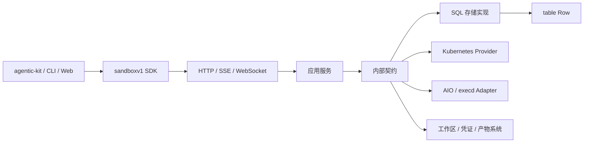

# 沙箱管理中心 Go 契约

本目录是[全量技术方案](../sandbox-control-plane-technical-design.md)的配套研发契约，包含公开 Go SDK、内部接口、完整建表 SQL 和表对应结构体。所有 Go 引用类型均有定义，可以独立编译检查。

这里没有 HTTP 客户端、数据库查询、Kubernetes Controller 或 Runtime Adapter 的运行实现。接口方法表达目标行为，编译通过不等于服务已经可用。`example.com/sandbox-design-contracts` 是设计模块名，正式仓库确定后再替换。

首版范围与实施次序见 [Runtime 接入规格](../runtime-integration-plan.md)。其中 RuntimeAdmission 的 revision/期限确认与读回、Agent 环境/操作关联仍是待实现差异；本轮没有修改 Go/SQL 声明。现有 `BindLease(...) error` 不能独立证明续租响应丢失后实际接受的期限。

Worker 接管规则见 [接管协议](../worker-handoff.md)。申请和租约冻结 `holderRunEpoch`；可信身份及 `AuthorizeRun` 验证当前 Run 领取。新 epoch 只能对账和按权限清理旧租约，待停止及必要保存确认后才申请新租约，不能移交旧写权限。公开 Client 仍为 50 个方法；申请与租约各增加一列，当前为 18 表、517 列。Agent 侧环境/执行关联和授权适配尚未实现。

沙箱中心提供通用环境、进程、文件和终端服务。agentic-kit 负责 CLI Runner、厂商版本参数与事件、逻辑 CLI 会话、resume 和会话到 execution 的映射。沙箱中心保留通用 execution、PTY、工作区与凭据能力；Session 复用范围只使用调用方提供的不透明标识。检查点继续通过现有路径覆盖字段保存文件，不判断 CLI 会话是否可恢复。

公开 `Client` 组合 12 个职责接口，共 50 个方法。SDK 共 16 个接口（另含 Client、TokenSource、EventStream、TerminalConnection），内部契约共 28 个接口。数据库契约为 18 张表、517 列及 18 个对应 Row；动作载荷映射共 28 项，其中公开 OperationKind 为 25 项。

## 文件导航

必要保存失败按[保存保护决策](docs/adr/0004-block-deletion-on-required-save-failure.md)阻止正常销毁。实例进入 Draining/SaveBlocked，停止用户执行但保留文件及配额；释放事务逐项校验冻结的保存要求，包括尚未受理的缺口，不能由 TTL、GC、空操作列表或旧检查点解除保护。任务拥有者可在业务界面明确确认放弃自己的未保存结果，无需管理员代办；普通 worker 只有保存重试权，没有默认放弃权。

默认恢复组合已确认：自动 Coding 为 `EphemeralCopy + Checkpointed`，持续开发为 `PersistentVolume + Persistent`，见[恢复承诺](docs/adr/0003-scenario-recovery-guarantees.md)。沿用现有 `WorkspaceDataPolicy.RecoveryLevel`，不增加接口、表或字段；检查点之后的改动可能丢失，文件恢复不表示进程恢复。

检查点由 agentic-kit 按业务阶段显式调用 `CreateCheckpoint`；沙箱验证写入静止并完成保存发布，不自行定时创建检查点。调用方等待 Ready 后才可使用该恢复点，控制循环仅继续执行和对账已受理的保存请求。

场景策略由平台发布的 Profile 固定，见[决策记录](docs/adr/0002-profile-owned-lifecycle-policies.md)。`ProfileSpec` 分别描述环境、文件和进程策略；调用方仅选择 Profile、业务资源及允许范围内的超时。申请和释放中的策略字段必须与绑定版本一致。新增类型保存在既有 Profile JSON 中，不新增数据库表或列。

隔离等级按 Profile 固定，默认 `Hardened`；只有平台验证的受控任务可使用 `Standard`，发布与选择时均须校验，调用方不能通过 `MinimumIsolation` 或失败回退降低隔离等级。

EphemeralCopy 工作区的分层组装方式由 `ProfileSpec.LayeredWorkspace` 固定：声明经过验证的叠加引擎与允许的基础层来源。实例内以只读基础层（仓库基准或已发布检查点，按内容 digest 寻址）叠加实例级可写层；检查点只固化可写层增量并记录基础层 digest。PersistentVolume Profile 不声明叠加引擎，直接挂载授权卷。该字段保存在既有 Profile JSON 中，不新增数据库表或列。

首版落地方式见[layerfs 决策](docs/adr/0005-layerfs-implementation-decisions.md)：叠加挂载在节点侧完成，Guard 不新增 `CAP_SYS_ADMIN`；基础层以只读 PVC 为真源；检查点使用 OCI layer 风格的 upper 增量；`ApplicationConsistent` 采用固定静止证据集合，服务端不静默降级；WarmPool 首版不按基础层 digest 分池。Profile 声明非空 `LayeredWorkspace.Engine` 时必须同时声明 `LayeredWorkspace` capability，实例就绪时还要核对实际挂载事实。

| 文件 | 内容 |
| --- | --- |
| [sdk/go/sandboxv1/types.go](sdk/go/sandboxv1/types.go) | 公开对象、状态、能力、错误、事件、会话、配额和池配置 |
| [sdk/go/sandboxv1/requests.go](sdk/go/sandboxv1/requests.go) | 每个操作的完整请求、分页、幂等键与租约凭据 |
| [sdk/go/sandboxv1/client.go](sdk/go/sandboxv1/client.go) | Client、小职责接口、HTTP 路由、TokenSource、事件流与双向终端 |
| [internal/contract/provider.go](internal/contract/provider.go) | 物理实例规格、资源、挂载、安全配置、Provider 与物理隔离证据 |
| [internal/contract/runtime.go](internal/contract/runtime.go) | 执行、文件、输出、取消、可选 stdin/PTY/Browser/Preview 接口 |
| [internal/contract/workspace.go](internal/contract/workspace.go) | 工作区准备、worktree、检查点与产物服务 |
| [internal/contract/security.go](internal/contract/security.go) | 身份、授权、Profile 解析、凭证、网络、访问票据和运行策略配置 |
| [internal/contract/persistence.go](internal/contract/persistence.go) | 申请、租约、执行、操作、补池、对账、日志与事件的事务端口 |
| [internal/contract/errors.go](internal/contract/errors.go) | 内部错误分类、重试边界和原始错误包装 |
| [internal/contract/storage_json.go](internal/contract/storage_json.go) | JSONValue 存储封装、规范化请求和逐列载荷类型 |
| [internal/table/rows.go](internal/table/rows.go) | 与 SQL 列一一对应的 Go 行结构，db tag 固定列名 |
| [schema/postgres.sql](schema/postgres.sql) | PostgreSQL 完整 DDL、索引和数据库约束（生产首选，与 agentic-kit-api 统一） |
| [schema/mysql.sql](schema/mysql.sql) | MySQL 完整 DDL、索引和数据库约束 |
| [schema-reference.md](schema-reference.md) | 数据字典、字段与 Go 类型映射、各 action 的载荷类型 |

## 实现时的依赖方向



公开 SDK 不引用 internal，也不包含 SQL、Gin、GORM、Kubernetes 或厂商 SDK 类型。实际 Provider 和 Runtime 实现在内部转换第三方类型；HTTP Handler 在认证后调用应用服务，把领域事实转成公开 DTO。

服务代码按项目既有 server-go 装配约定实现。一个进程可运行 API 与控制循环，长连接网关可以独立部署。这里不引入框架依赖，因为框架不参与协议声明。

## 标识和一致性

| 标识 | 作用 |
| --- | --- |
| requestKey | 识别一次业务请求；相同键、不同参数返回冲突 |
| acquisitionID | 跟踪申请与准备权，在 Ready 时才交给正式租约 |
| instanceID + generation | 唯一确定一代逻辑物理环境 |
| Pod UID + runtimeBootID | 确认实际资源和进程环境，避免连接到同名替身 |
| leaseID + fencingToken | 确认当前写持有者；不能证明旧进程已经停止 |
| holderRunId + holderRunEpoch | 冻结上游 Run 的领取代次；必须验证可信当前领取，不等于沙箱 fencingToken |
| admissionEpoch | Runtime 侧拒绝迟到的旧 Start；不支持时按销毁规则释放 |
| operationID / executionID | 分别记录异步动作与命令事实，Unknown 不自动重放 |
| entityID + sequence | 公开事件顺序，不是厂商游标或日志字节偏移 |

持久化写端口必须原子更新关联事实与事件。Provider、Runtime、存储和凭证网络调用在事务外执行。SQL 事务只保存意图和已经核实的结果。

Start 返回值为零值且伴随 error 时，按 Unknown 处理；只有明确 NotAccepted 才可以确认未启动。Kubernetes API 对象消失也不等于失联节点上的旧进程停止。Retain 必须证明全部派发和进程已清理，否则隔离旧环境；销毁还必须通过必要保存检查。

## SDK 使用方式

业务代码依赖所需的小接口，例如工具执行只依赖 `ExecutionClient`、文件工具只依赖 `FileClient`。Client 由真正的 HTTP 实现注入；本目录没有可调用的 New 构造函数。

完整调用链为：

1. `Acquire` 提交固定 Profile 和工作区要求，保存 requestKey 和返回 ID。
2. `WaitAcquisition` 等待 Ready；超时仅停止等待，需要取消时调用 `CancelAcquisition`。
3. 从 ReadyResult 取得当前 Sandbox 和 Lease，构造 `LeaseProof`。
4. `StartExecution` 使用独立 requestKey，保存 Execution ID；读取事件或有界输出。
5. 执行期间按租约策略 `RenewLease`，续租键每次新建，同一次请求重试沿用原键。
6. 等待命令终态，检查退出码、输出完整性和产物保存结果。
7. `ReleaseLease` 受理后继续查询 Operation，直到终止与释放得到确认。

SDK 不自动重放写请求。响应丢失时按原 requestKey 查询，不能换键重试可能已经发生的外部副作用。事件流与终端连接由调用方 Close；Close 本地流不等于 Cancel 命令或 Release 租约。

## 必要保存阻塞的处置

`BlockedSaveClient` 提供以下三个入口，均独立于过期的 `LeaseProof`，不续租、不恢复执行。

| SDK 方法 | HTTP 路由 | 结果 |
| --- | --- | --- |
| `GetBlockedSave` | `GET /v1/sandboxes/{sandbox.id}/blocked-save?generation=...` | `BlockedSave`，当前一致性快照 |
| `RetryRequiredSave` | `POST /v1/sandboxes/{target.sandbox.id}/blocked-save/retry` | `202 Operation`，完成后 `Result.SaveRetry` |
| `DiscardBlockedSave` | `POST /v1/sandboxes/{target.sandbox.id}/blocked-save/discard` | `200 DiscardReceipt`，也可查询 `Result.Discard` |

业务界面先查询并展示 `BlockedSave.Target`：租户/项目、实例与工作区代次、数据版本、释放操作、确认快照修订和完整 required-save 集合。每个 requirement 有稳定 ID、原意图摘要与文件范围；进度中 operation/status 同为 null 表示尚未受理，不能据此省略该要求。提交时回传整个目标；服务端校验完整集合与当前快照，代次不符返回 `GenerationMismatch`，其他陈旧目标返回 `RevisionConflict`，需重新展示并确认。

`Authorizer.AuthorizeSaveRecovery` 验证可信业务系统中的归属和明确确认委托，生成绑定主体、owner、操作、精确目标和有效期的 `SaveRecoveryAuthorization`。其中 `EvidenceRef` 指向可追踪的服务端授权记录；`ConfirmationRef` 只是现有业务确认的定位引用，不能作为持有即授权的凭证。请求中的 userID/isConfirmed 或普通 worker token 都不能替代证明。管理员跨用户也校验同一 scope 与确认目标，不设 force 接口，不新增审批系统。

授权 worker 可以对一个未受理或终态 Failed 的 requirement 调用 `RetryRequiredSave`。新操作通过释放操作和 requirement ID 关联原冻结意图，保存前一次失败操作 ID；原 Failed 记录不复活。Pending/Running 不重复受理，Unknown 先按原键对账。`SaveRecoveryPermit` 只授权保存该版本和范围，不允许 exec、普通文件写入或续租。释放检查按 requirement 找到最新受理且发布成功的 attempt；成功替代重试能满足该要求，原失败历史不会继续阻塞它。

`BlockedSaveStore.BeginSaveRetry`、`CompleteRequiredSave` 和 `ConfirmDiscard` 共享保护状态锁及修订 CAS。普通业务阶段的检查点仍用 `OperationStore.Complete`；只有 `BeginRelease` 已将它纳入 `SaveProtectionState` 后才走受保护完成入口。释放与原保存完成在同一锁顺序下决定是否已纳入保护，冲突只触发重新读取和结果对账，不能重发发布。新动作的幂等账本、查询和普通动作完成继续复用 `OperationStore`。

放弃事务原子保存授权记录、精确确认目标、`DiscardReceipt` 和审计事件，关闭该范围的新保存受理及发布提交。回执仅解除尚未满足要求的保存阻塞，不表示保存成功或资源删除成功，不删除已发布 checkpoint 和无关产物。真正删除前仍须完成进程隔离，并对所有原保存与重试取得在途发布对账/隔离证据；只增加数据库 epoch 不构成外部隔离。资源实际清理前继续保留占用和配额。

上述目标、冻结意图和进度保存在既有 `sandbox_lease.drain_evidence`；重试输入、授权证明和放弃回执保存在既有 `sandbox_action.input/result/evidence_ref`，使用 `JSONValue[T]` 封装。动作种类新增 `RetryRequiredSave`、`DiscardBlockedSave`，不新增表列，保留全部 `profile_tenant_id`。

## 类型和单位

- JSON 使用 `sandboxId`、`leaseId`、`eventsUrl` 等 lowerCamelCase；Go 使用 `SandboxID`、`LeaseID`、`EventsURL`。
- 时间使用 `time.Time` / RFC3339，内部时间统一 UTC，数据库为 `DATETIME(6)`。
- SDK 时长字段为秒，内部为 `time.Duration`；转换前检查范围。
- CPU 为 millicores，内存/磁盘/日志为 bytes；不在公开 SDK 使用 Kubernetes Quantity。
- 二进制内容为 `[]byte`，JSON 编码为 base64。路径与文件权限由工作区规则校验。
- revision/generation/fence/sequence 为正 int64；对外计数上限 `2^53-1`，NULL 不用 0 代替。
- SQL 可空值使用 `sql.Null*`；SDK 可空事实使用指针；两者不能直接互作返回值。
- SQL JSON 使用版本化封装和固定载荷类型，不能把明文凭证写入 JSON。

## 验证范围

模块声明 Go 1.24，只依赖标准库。可从本目录执行：

```sh
GOWORK=off GOPROXY=off GOSUMDB=off GOTOOLCHAIN=local go test ./...
GOWORK=off GOPROXY=off GOSUMDB=off GOTOOLCHAIN=local go vet ./...
```

2026-10-22 Worker 接管协议的本轮验证：

- 已执行 gofmt，使用 Go 1.27.3 和临时 GOCACHE 离线执行 go test ./...、go vet ./...，退出码均为 0；go test 仅验证声明包可编译，没有行为测试。
- SQL、Row db tag 与数据字典的列名和顺序静态核对通过，共 18 表、517 列；两处 holder_run_epoch 的正整数及安全整数上界约束已检查。
- 主方案 JSON 示例语法、申请示例 epoch 字段及相关文档本地链接检查通过。受理主体快照使用既有 JSON 列，不新增 SQL 列，也不进入公开请求语义哈希。
- 本轮未执行 MySQL DDL、AIO/Kubernetes 运行或接管故障测试。控制器重启后的身份重验、本地到期停止及文件保留仍是后续必须验证的行为。

2026-10-22 保存处置版的历史验证（以下 515 列记录早于本次接管协议）：

- 已运行 gofmt；Go 1.27.3 工具链按上述离线设置执行 go test 和 go vet，全部通过。模块语言声明为 Go 1.24，未单独使用 Go 1.24 工具链运行。
- 18 张表、515 列与 Row 的 db tag、顺序和可空类型，以及数据字典的字段与索引映射，静态逐项核对通过；CHECK 引用列和动作载荷类型引用核对通过。
- 已检查移除的 CLI 类型、路由、字段和映射，无残留引用。
- 场景 Profile 契约补充后，重新通过离线 go test/go vet、18 表/515 列的 Row 名称与顺序检查；文档本地链接、代码块和 JSON 语法检查通过。策略拒绝、边界值和版本固定仍需后续实现行为测试。
- 必要保存保护补充后，离线 go test/go vet 再次通过；只读核对当前 SQL 与 Row 仍为 18 表/515 列，包含已有的 profile_tenant_id 字段。文档链接与代码块检查通过，保存阻塞和 GC 行为尚未实现或实测。
- owner 放弃确认契约补充后，已执行 gofmt 和离线 go test/go vet，并静态核对接口、方法、操作种类及 JSON 映射统计；SQL 仅修改注释，18 表/515 列与全部 profile_tenant_id 保持不变。本次没有新增行为实现或行为测试，授权、并发 CAS 和发布隔离仍待正式实现验证。

历史验证（本版未重跑）：删除 CLI 专属契约前，19 张表、548 列的旧版 DDL 曾在临时 MySQL 8.4.11 空库执行成功，并核对实际列类型与 NULL 属性；旧版主方案的 3 个 JSON 示例曾通过 SDK 严格解码和完整 JSON 往返校验。这些记录不代表本版已完成 MySQL 执行或主方案 JSON 校验；最低声明版本 MySQL 8.0.16 也未实测。

`go test` 在这里完成包编译，当前没有行为实现或行为测试。事务并发、故障恢复、两个 Runtime 的协议和 Kubernetes 隔离仍按主方案验收，建表成功不代替这些验证。
